# 통합 클래스 다이어그램

> 이 파일은 스크립트로 만든다. 직접 고치지 말고 `classes/`를 고친 뒤 다시 생성한다. 실행: `python class-diagram/generate.py` (macOS는 `python3`)

`classes/`의 클래스 파일을 모은 그림이다 (CONVENTIONS 6.5). **원본은 `classes/` 파일이다.** 제출할 때는 CONVENTIONS 8.2에 따라 StarUML 한 장으로 옮긴다.

## 1. 클래스 개수 대조

| 종류 | 개수 |
|---|---|
| 담당 객체 | 21 |
| 공통 객체 | 2 |
| DB | 18 |
| UI | 2 |
| 외부 | 1 |
| 엔티티 | 9 |
| **합계** | **53** |

`classes/` 파일 53개와 1:1로 대응한다. 관계선은 두 클래스 사이에 하나씩, 모두 130개다.

| 번호 | 클래스 | 종류 | 파일 |
|---|---|---|---|
| 1 | 모임공지등록 | 담당 객체 (기능 1) | [MeetingNoticeRegistration.md](../classes/MeetingNoticeRegistration.md) |
| 2 | 신청확인및참가비계산 | 담당 객체 (기능 2-1) | [ApplicationCheckAndFeeCalc.md](../classes/ApplicationCheckAndFeeCalc.md) |
| 3 | 결제및신청확정 | 담당 객체 (기능 2-2) | [PaymentAndApplicationConfirm.md](../classes/PaymentAndApplicationConfirm.md) |
| 4 | 친해지고싶은학생알림 | 담당 객체 (기능 3) | [CloseStudentNotification.md](../classes/CloseStudentNotification.md) |
| 5 | 자리배치생성 | 담당 객체 (기능 4-2) | [SeatArrangementGeneration.md](../classes/SeatArrangementGeneration.md) |
| 6 | QR출석 | 담당 객체 (기능 5) | [QRAttendance.md](../classes/QRAttendance.md) |
| 7 | 1인잔류테이블합석 | 담당 객체 (기능 6) | [SinglePersonTableMerge.md](../classes/SinglePersonTableMerge.md) |
| 8 | 프로필기반대화주제카드 | 담당 객체 (기능 7) | [ProfileTopicCard.md](../classes/ProfileTopicCard.md) |
| 9 | 블라인드프로필공개 | 담당 객체 (기능 8) | [BlindProfileDisclosure.md](../classes/BlindProfileDisclosure.md) |
| 10 | 자동정산 | 담당 객체 (기능 9) | [AutoSettlement.md](../classes/AutoSettlement.md) |
| 11 | 만난사람평가 | 담당 객체 (기능 10) | [MeetingEvaluation.md](../classes/MeetingEvaluation.md) |
| 12 | 친해지고싶은학생등록 | 담당 객체 (기능 11) | [CloseStudentRegistration.md](../classes/CloseStudentRegistration.md) |
| 13 | 비매너학생신고 | 담당 객체 (기능 12) | [MannerReport.md](../classes/MannerReport.md) |
| 14 | 비매너학생이용정지 | 담당 객체 (기능 13) | [MannerSuspension.md](../classes/MannerSuspension.md) |
| 15 | 당일안심귀가 | 담당 객체 (기능 15) | [SafeReturnHome.md](../classes/SafeReturnHome.md) |
| 16 | 기부릴레이잇기 | 담당 객체 (기능 16) | [DonationRelay.md](../classes/DonationRelay.md) |
| 17 | 가게연합음식품앗이 | 담당 객체 (기능 17) | [StoreFoodExchange.md](../classes/StoreFoodExchange.md) |
| 18 | 화장실대기및조편성 | 담당 객체 (기능 18-1) | [ToiletWaitAndGroup.md](../classes/ToiletWaitAndGroup.md) |
| 19 | 화장실입장및퇴실관리 | 담당 객체 (기능 18-2) | [ToiletEntryExitManagement.md](../classes/ToiletEntryExitManagement.md) |
| 20 | 숙취예보 | 담당 객체 (기능 19) | [HangoverForecast.md](../classes/HangoverForecast.md) |
| 21 | 2차참가자동결정 | 담당 객체 (기능 20) | [SecondRoundAutoDecision.md](../classes/SecondRoundAutoDecision.md) |
| 22 | 귀가시간계산 | 공통 객체 | [ReturnHomeTimeCalc.md](../classes/ReturnHomeTimeCalc.md) |
| 23 | 테이블출석현황 | 공통 객체 | [TableAttendanceStatus.md](../classes/TableAttendanceStatus.md) |
| 24 | 신청DB | DB | [ApplicationDB.md](../classes/ApplicationDB.md) |
| 25 | 배치DB | DB | [ArrangementDB.md](../classes/ArrangementDB.md) |
| 26 | 출석DB | DB | [AttendanceDB.md](../classes/AttendanceDB.md) |
| 27 | 기부DB | DB | [DonationDB.md](../classes/DonationDB.md) |
| 28 | 평가DB | DB | [EvaluationDB.md](../classes/EvaluationDB.md) |
| 29 | 품앗이DB | DB | [FoodExchangeDB.md](../classes/FoodExchangeDB.md) |
| 30 | 관심등록DB | DB | [InterestRegistrationDB.md](../classes/InterestRegistrationDB.md) |
| 31 | 모임DB | DB | [MeetingDB.md](../classes/MeetingDB.md) |
| 32 | 주문DB | DB | [OrderDB.md](../classes/OrderDB.md) |
| 33 | 결제DB | DB | [PaymentDB.md](../classes/PaymentDB.md) |
| 34 | 프로필DB | DB | [ProfileDB.md](../classes/ProfileDB.md) |
| 35 | 질문카드DB | DB | [QuestionCardDB.md](../classes/QuestionCardDB.md) |
| 36 | 신고DB | DB | [ReportDB.md](../classes/ReportDB.md) |
| 37 | 2차공지DB | DB | [SecondNoticeDB.md](../classes/SecondNoticeDB.md) |
| 38 | 2차기록DB | DB | [SecondRecordDB.md](../classes/SecondRecordDB.md) |
| 39 | 가게DB | DB | [StoreDB.md](../classes/StoreDB.md) |
| 40 | 정지DB | DB | [SuspensionDB.md](../classes/SuspensionDB.md) |
| 41 | 화장실대기열DB | DB | [ToiletQueueDB.md](../classes/ToiletQueueDB.md) |
| 42 | 사장님UI | UI | [OwnerUI.md](../classes/OwnerUI.md) |
| 43 | 학생UI | UI | [StudentUI.md](../classes/StudentUI.md) |
| 44 | 단말기위치정보 | 외부 | [DeviceLocation.md](../classes/DeviceLocation.md) |
| 45 | 참가기록 | 엔티티 | [ParticipationRecord.md](../classes/ParticipationRecord.md) |
| 46 | 참가응답 | 엔티티 | [ParticipationResponse.md](../classes/ParticipationResponse.md) |
| 47 | 참가결과 | 엔티티 | [ParticipationResult.md](../classes/ParticipationResult.md) |
| 48 | Point | 엔티티 | [Point.md](../classes/Point.md) |
| 49 | 2차공지 | 엔티티 | [SecondNotice.md](../classes/SecondNotice.md) |
| 50 | 학생비상연락정보 | 엔티티 | [StudentEmergencyContact.md](../classes/StudentEmergencyContact.md) |
| 51 | 화장실구성 | 엔티티 | [ToiletConfig.md](../classes/ToiletConfig.md) |
| 52 | 화장실대기열현황 | 엔티티 | [ToiletQueueStatus.md](../classes/ToiletQueueStatus.md) |
| 53 | 화장실대기학생 | 엔티티 | [ToiletWaitStudent.md](../classes/ToiletWaitStudent.md) |

## 2. 전체 그림

53개 클래스의 이름만 종류별로 묶었다. 관계선은 3장에서 본다.

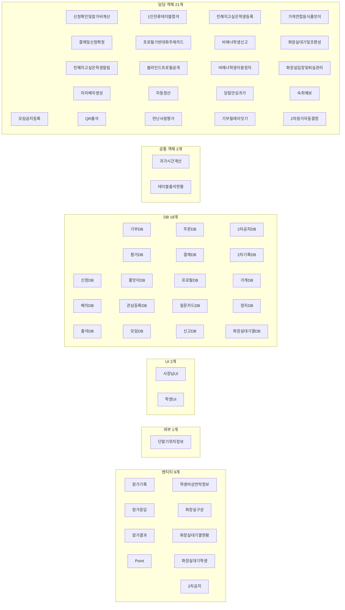

## 3. 영역별 그림

PPT 2장부터 쓰는 그림이다. StarUML에서는 영역마다 다이어그램을 따로 만들고, Model Explorer의 기존 클래스를 끌어다 놓는다. 표기는 Mermaid 규칙에 따라 `List<int>`를 `List~int~`로 적지만 그림에는 `List<int>`로 나온다.

| PPT | 절 | 내용 |
|---|---|---|
| 1장 | 2장 전체 그림, 통합 다이어그램 | 53개, 이름만, 관계선 포함 |
| 2장 | 3.1 | 모임 전 ① |
| 3장 | 3.2 | 모임 전 ② |
| 4장 | 3.3 | 모임 중: 출석·교류 |
| 5장 | 3.4 | 모임 중: 기부·품앗이·화장실 |
| 6장 | 3.5 | 모임 후: 정산·평가·신고 |
| 7장 | 3.6 | 모임 후: 귀가·예보·2차 |
| 8장 | 3.7, 3.8 | 공통 객체·외부, DB 회원·모임 |
| 9장 | 3.9 | DB 모임 진행 |
| 10장 | 3.10 | DB 평가·교류 |
| 11장 | 3.11 | 사장님UI·엔티티 |
| 12장 | 3.12 | 학생UI |
| 슬라이드 아님 | 3.13 | 참고용: 공통 객체·DB·엔티티 사이의 관계선 |

### 3.1 모임 전 ① (기능 1, 2-1, 2-2)

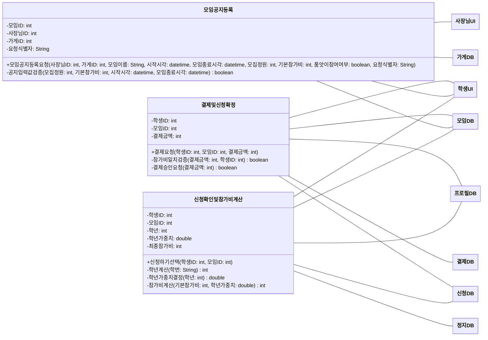

### 3.2 모임 전 ② (기능 3, 4-2)

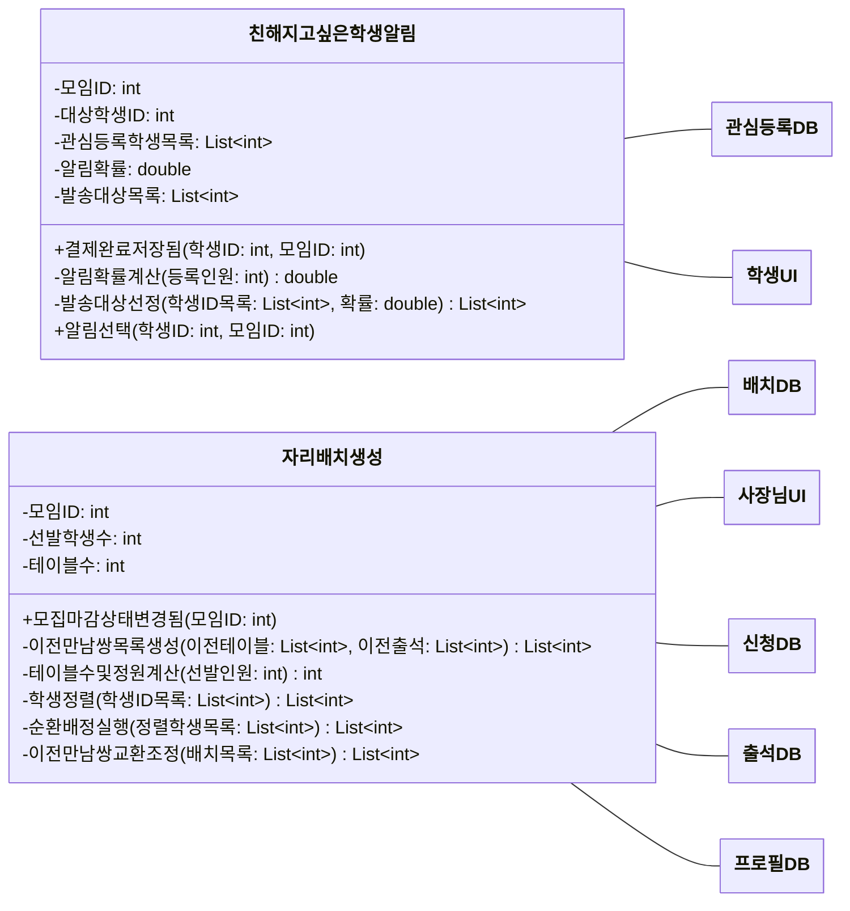

### 3.3 모임 중: 출석·교류 (기능 5, 6, 7, 8)

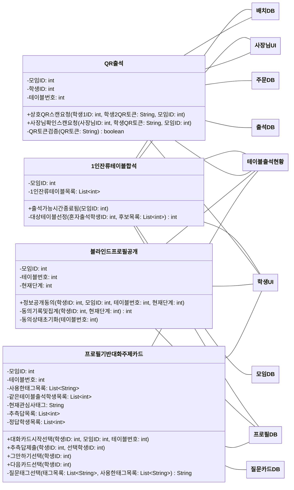

### 3.4 모임 중: 기부·품앗이·화장실 (기능 16, 17, 18-1, 18-2)

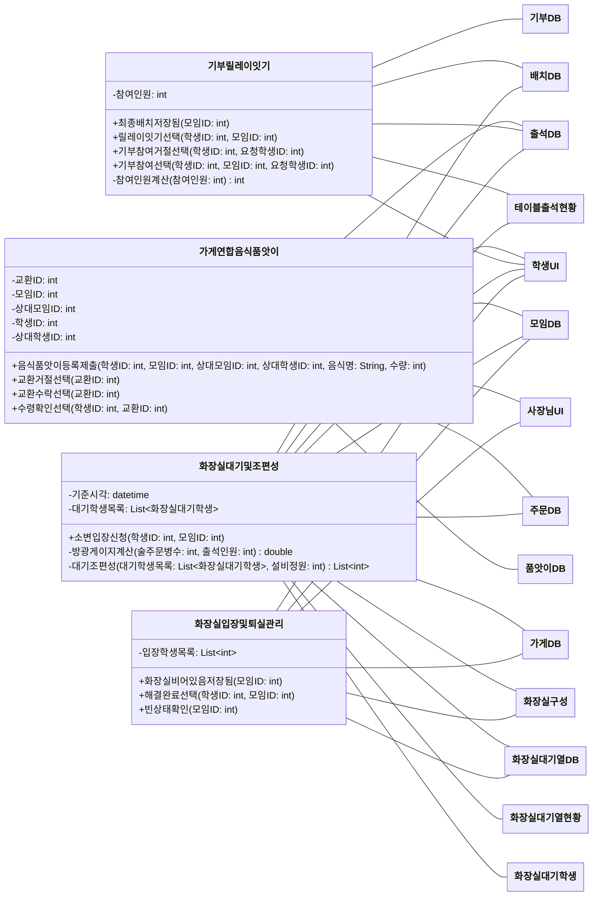

### 3.5 모임 후: 정산·평가·신고 (기능 9, 10, 11, 12, 13)

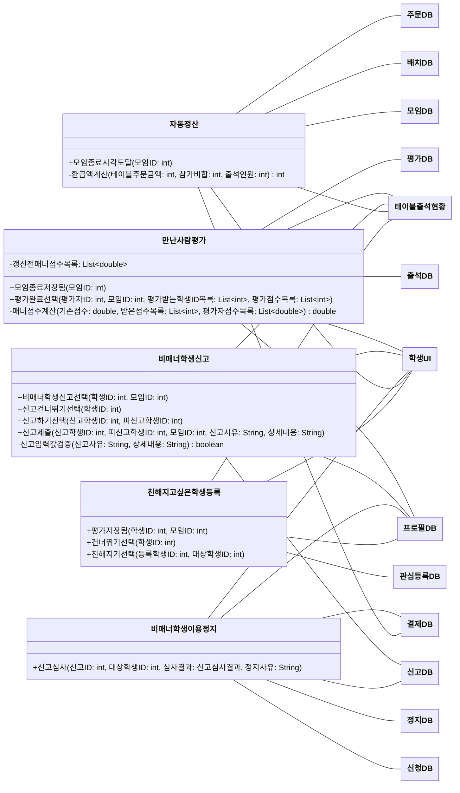

### 3.6 모임 후: 귀가·예보·2차 (기능 15, 19, 20)

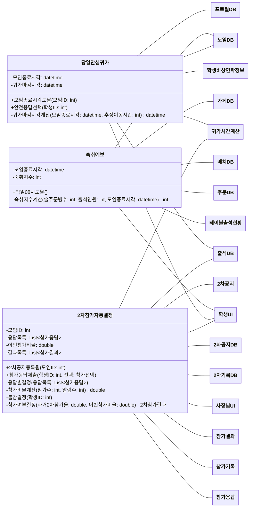

### 3.7 공통 객체·외부

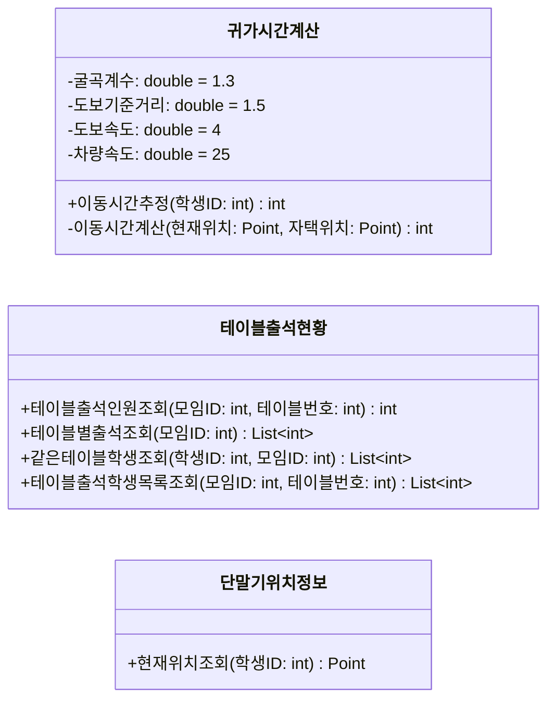

### 3.8 DB: 회원·모임

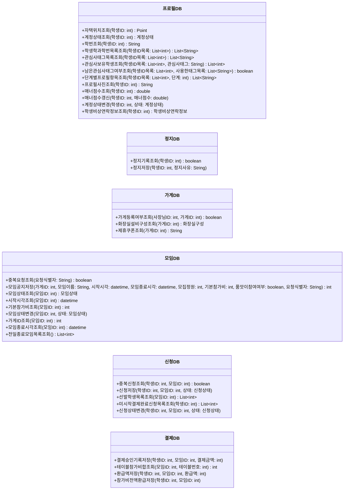

### 3.9 DB: 모임 진행

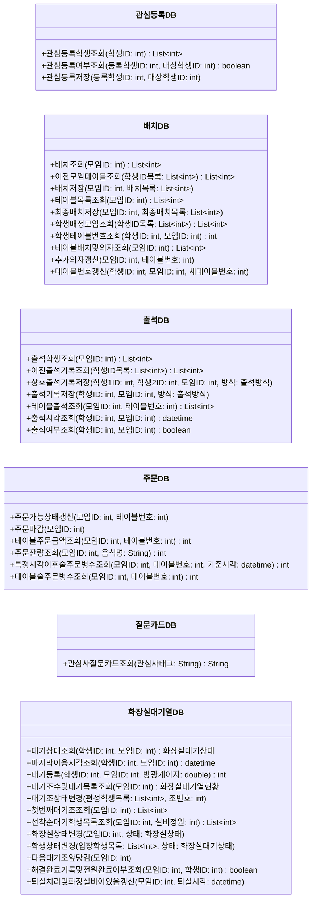

### 3.10 DB: 평가·교류

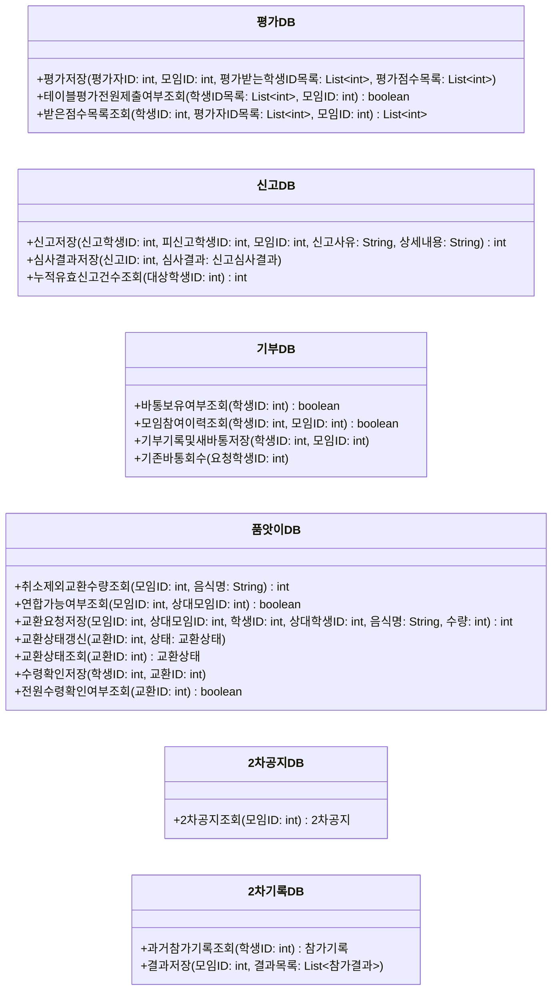

### 3.11 사장님UI·엔티티

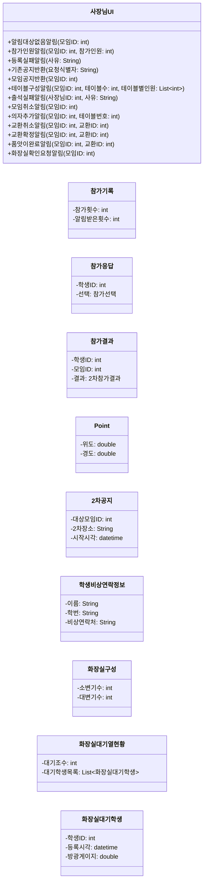

### 3.12 학생UI

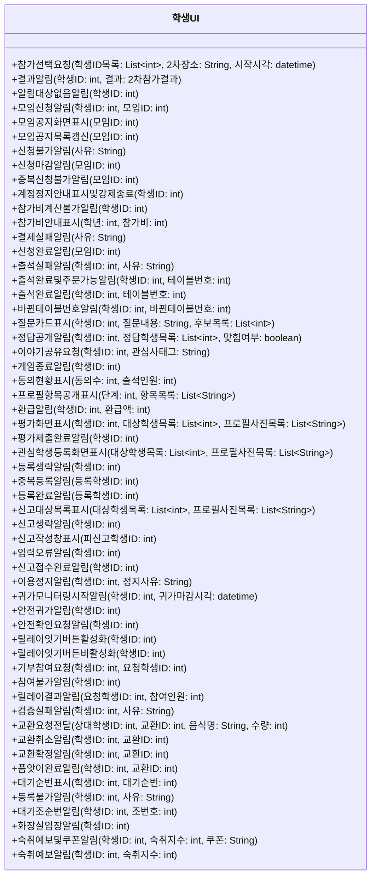

### 3.13 공통 객체·DB·엔티티 사이의 관계선 (참고용)

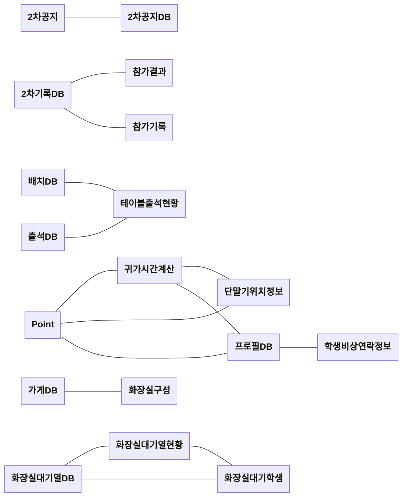
