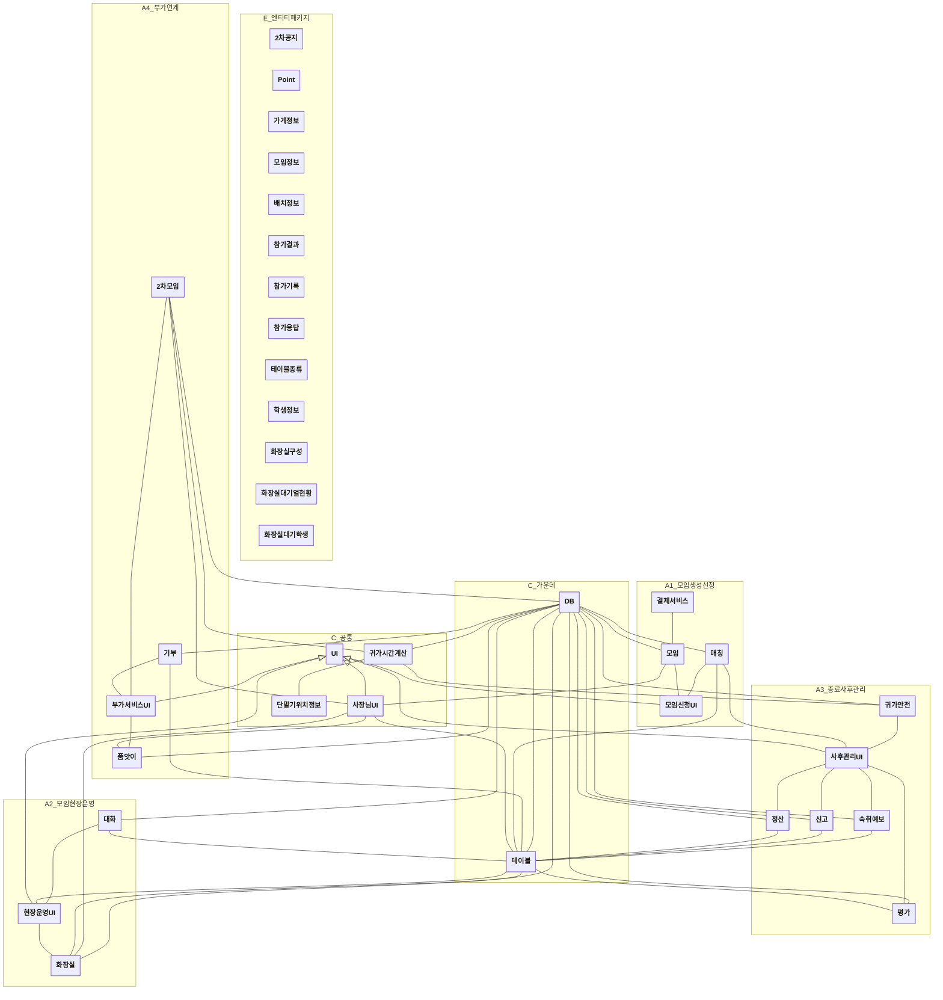
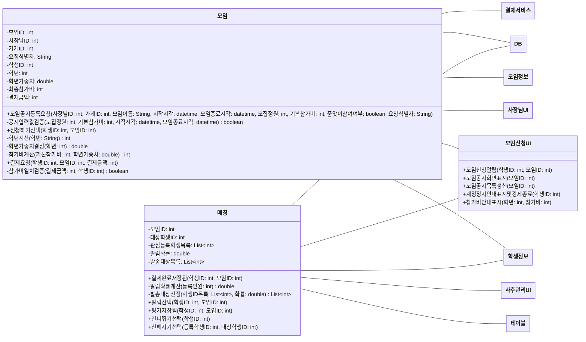
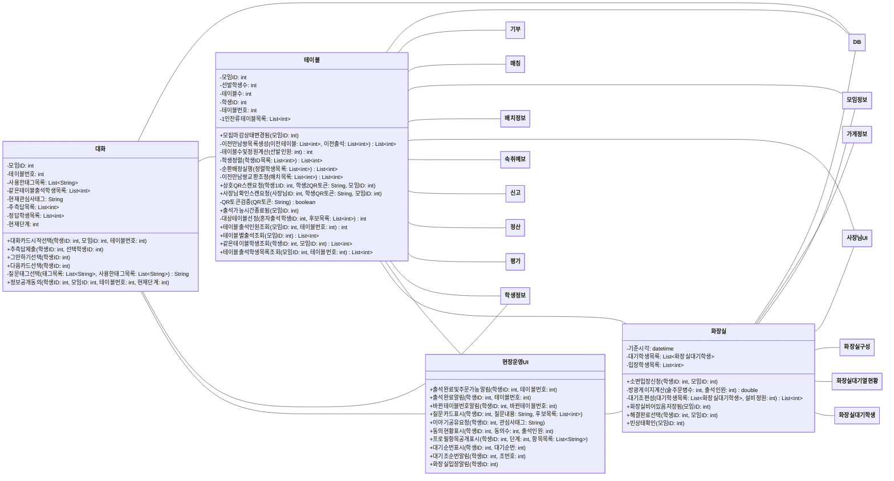
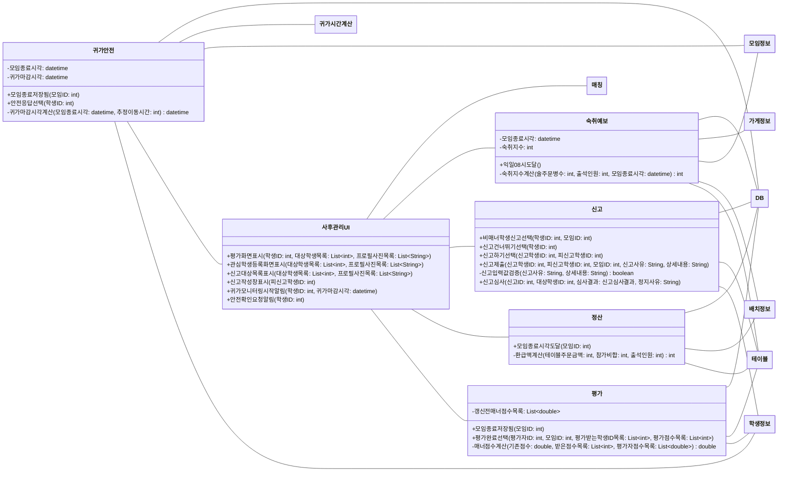
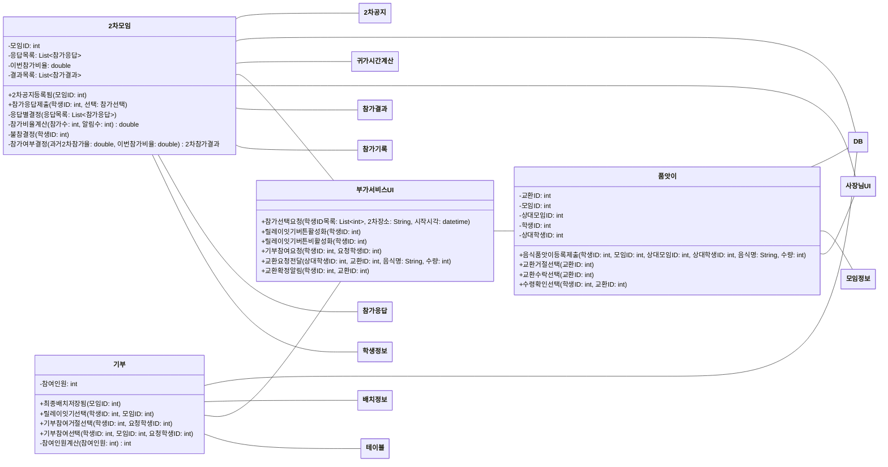
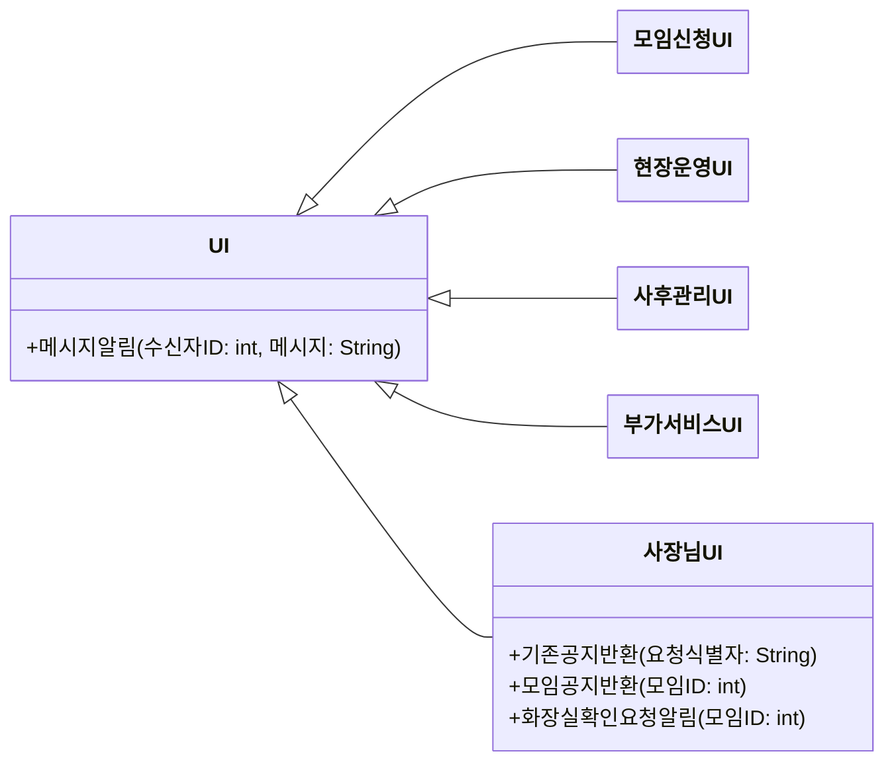
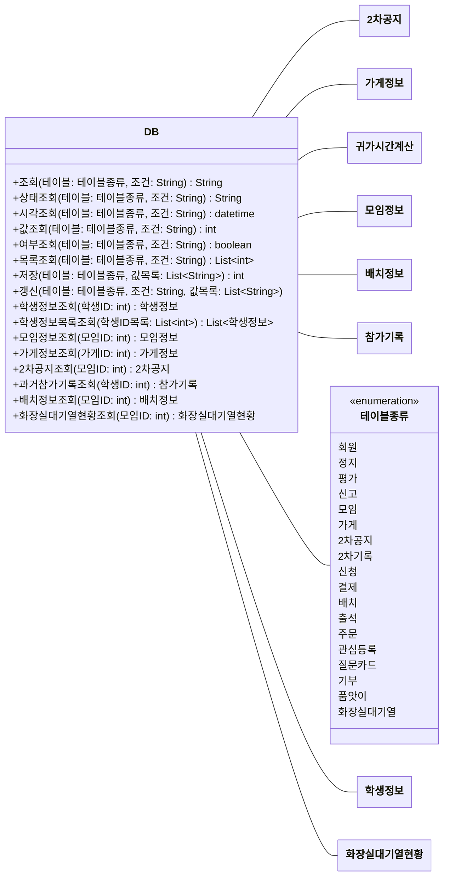
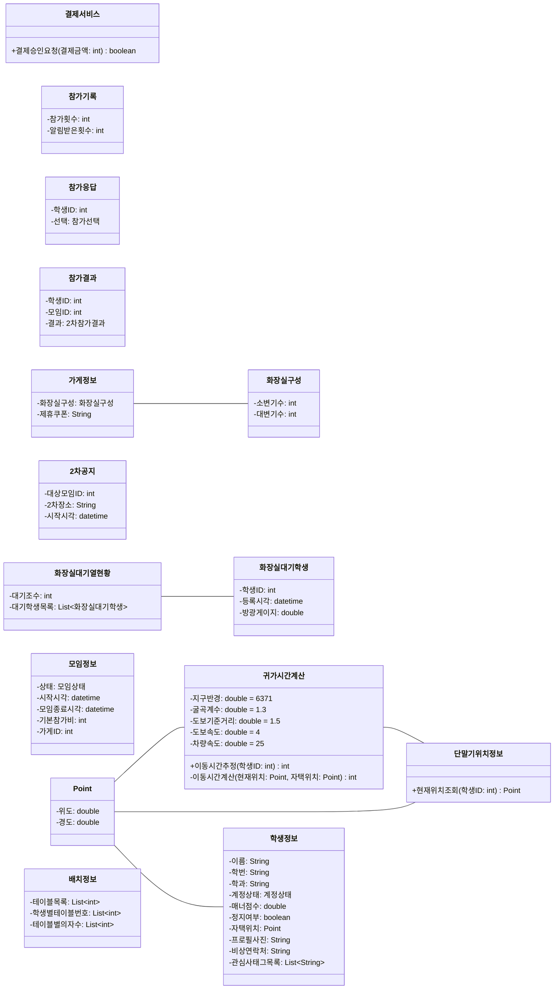

# 클래스 다이어그램 개편 초안 (미리보기용)

> **팀 결정 전 초안이다.** 원본은 `classes/`와 `class-diagram/class-diagram.md`이고, 이 파일은 2026-11-10 면담 피드백(#24~#27)을 반영하면 어떻게 보이는지 미리 보려고 만든 것이다. 클래스 이름은 GLOSSARY에 아직 등록하지 않았다. 함수와 시그니처는 지금 클래스 파일에서 그대로 옮겼다.

## 1. 바뀌는 점

| 피드백 | 지금 | 초안 |
|---|---|---|
| #27 기능 이름 라이프라인 금지 | 담당 객체 21개 + 테이블출석현황 | 주체 클래스 13개 (모임, 테이블, 매칭, 대화, 평가, 신고, 정산, 기부, 품앗이, 화장실, 귀가안전, 숙취예보, 2차모임). 기능 이름은 함수 이름으로 남는다 |
| #26 DB 남발 금지 (교수님 원문: "DB는 통 하나", 상속 없음) | DB 18개 | DB 1개 (DB) |
| #24·#25 학생UI 비대 | 학생UI 1개 (알림 정리 후 28개) | 부모 UI(메시지알림) + 학생 화면 4개(유스케이스와 같은 4단계) + 사장님UI |
| 상속 | 없음 | UI에만 (화면 4개·사장님UI) |
| DB 안이 너무 많음 (교수님 enum 예시) | DB 함수 100개 | DB 함수 16개 = 공통 함수 8개(첫 매개변수 «enumeration» 테이블종류, 값 18개) + 묶음 조회 8개. 묶음 엔티티 학생정보·모임정보·가게정보·배치정보, 학생비상연락정보는 학생정보에 합침 (4.2 대응표) |
| 합계 | 클래스 54개 | 클래스 36개 |

| 종류 | 개수 |
|---|---|
| 주체 | 13 |
| 공통 객체 | 1 |
| DB | 1 |
| UI (부모) | 1 |
| UI (학생 화면) | 4 |
| UI | 1 |
| 외부 | 2 |
| 엔티티 | 12 |
| enum | 1 |
| **합계** | **36** |

### 주체 클래스 ← 지금 클래스

| 주체 | 기능 | 합쳐지는 지금 클래스 | 함수 수 |
|---|---|---|---|
| 모임 | 1, 2-1, 2-2 | 모임공지등록, 신청확인및참가비계산, 결제및신청확정 | 8 |
| 테이블 | 4-2, 5, 6 | 자리배치생성, QR출석, 1인잔류테이블합석, 테이블출석현황 | 15 |
| 매칭 | 3, 11 | 친해지고싶은학생알림, 친해지고싶은학생등록 | 7 |
| 대화 | 7, 8 | 프로필기반대화주제카드, 블라인드프로필공개 | 6 |
| 평가 | 10 | 만난사람평가 | 3 |
| 신고 | 12, 13 | 비매너학생신고, 비매너학생이용정지 | 6 |
| 정산 | 9 | 자동정산 | 2 |
| 기부 | 16 | 기부릴레이잇기 | 5 |
| 품앗이 | 17 | 가게연합음식품앗이 | 4 |
| 화장실 | 18-1, 18-2 | 화장실대기등록및조편성, 화장실입장및퇴실관리 | 6 |
| 귀가안전 | 15 | 당일안심귀가 | 3 |
| 숙취예보 | 19 | 모임다음날숙취예보 | 2 |
| 2차모임 | 20 | 2차참가자동결정 | 6 |

### DB ← 지금 DB

| DB | 합쳐지는 지금 DB | 함수 수 |
|---|---|---|
| DB | 프로필DB, 정지DB, 평가DB, 신고DB, 모임DB, 가게DB, 2차공지DB, 2차기록DB, 신청DB, 결제DB, 배치DB, 출석DB, 주문DB, 관심등록DB, 질문카드DB, 기부DB, 품앗이DB, 화장실대기열DB | 16 |

### UI

| 클래스 | 단계 | 함수 수 |
|---|---|---|
| UI (부모) | 모든 UI가 물려받음 | 1 (메시지알림) |
| 모임신청UI | ① 모임 생성·신청 (기능 1, 2-1, 2-2, 3, 4-2) | 5 |
| 현장운영UI | ② 모임 현장 운영 (기능 5, 6, 7, 8, 18-1, 18-2) | 10 |
| 사후관리UI | ③ 모임 종료·사후 관리 (기능 9, 10, 11, 12, 13, 15, 19) | 6 |
| 부가서비스UI | ④ 부가·연계 서비스 (기능 16, 17, 20) | 6 |
| 사장님UI | | 3 |

## 2. 전체 그림 (PPT 1장)

클래스 36개, 상속 5개. 엔티티 12개와 enum 테이블종류는 "엔티티" 패키지 틀 안에 **펼친 채** 이름만 있는 상자로 모두 둔다. 패키지를 접으면 1장의 상자 수가 클래스 수보다 13개 모자라 감점이다 (교수님: 클래스 개수와 상자 개수를 맞춰 본다). 그래서 1장 상자는 클래스 36개와 같은 36개다. 엔티티 속성과 엔티티끼리의 선은 상세 그림 4.2, 4.3에 있다. DB와 테이블은 가운데에 두고, 주체와 화면은 4단계 영역별로 모은다 (StarUML에서 직접 배치할 때의 자리. Mermaid는 자리를 정확히 지키지 못하고, 틀(namespace)에 선을 붙이지 못해 이 미리보기는 선 없는 모습이다).

| 엔티티 처리 | 클래스 사이 선 | 패키지 선 | 합계 |
|---|---|---|---|
| 엔티티 선을 모두 그림 | 45 | 엔티티 선 40 | 85 |
| 엔티티 선을 뺌 | 45 | 0 | 45 |
| 패키지 1개 (엔티티), 틀에 실선 — 검토했으나 복잡해서 제외 | 45 | 16 | 61 |
| 패키지 3개 (기본정보 / 화장실정보 / 2차모임정보) — 제외 | 45 | 20 | 65 |
| **패키지 1개, 선 없음 — 확정** | 45 | 0 | **45** |
| 상자와 상속만, 관계선 0개 — 팀 판단으로 제외 (상자만 있으면 다이어그램답지 않음. 강의 p.79는 "관계 필요 없다"이지 "그리면 안 된다"가 아니고, chap5 23쪽 예시에도 선이 있음. FEEDBACK #30) | 0 | 0 | 0 |

패키지 3개일 때 묶음: 기본정보(학생정보, 모임정보, 가게정보, 배치정보, Point, 화장실구성, 테이블종류), 화장실정보(화장실대기열현황, 화장실대기학생), 2차모임정보(2차공지, 참가기록, 참가응답, 참가결과). 기본정보에는 주체 대부분이 이어지고, 화장실정보는 화장실·DB, 2차모임정보는 2차모임·DB만 이어진다.

**확정 (2026-11-11): 패키지에는 선을 긋지 않는다.** 패키지 틀(안에 상자 13개) 아래에 "엔티티는 매개변수·반환 타입으로 쓰이며, 관계는 상세 그림(4.2, 4.3)에 있음"을 적는다 (교수님 enum 예시의 "선 없이 타입으로만" 논리). 틀에 실선을 긋는 안은 그려 보니 선이 한 통로로 몰려 더 복잡해서 뺐다. Dependency(점선 화살표)는 교수님 "상속 말고 방향 넣지 말라"(11/10)와 CONVENTIONS 6.3에 걸려 쓰지 않는다. 엔티티 선은 1장에서만 빠지고 2~5장과 4.2·4.3에는 모두 있다.

아래 표는 패키지 선을 뺀 클래스 사이 선의 자리다.

| 선 | 개수 |
|---|---|
| 영역 안 | 15 |
| 영역 ↔ 가운데(DB·테이블) | 23 |
| 영역 ↔ 공통(사장님UI·공통 객체·외부) | 6 |
| **영역 ↔ 다른 영역** | **1** |
| 합계 | 45 |

영역 ↔ 다른 영역 선: 매칭–사후관리UI

영역 ↔ 공통 선: 2차모임–귀가시간계산, 2차모임–사장님UI, 귀가시간계산–귀가안전, 모임–사장님UI, 사장님UI–품앗이, 사장님UI–화장실

## 3. 영역별 그림 (PPT 2~5장)

주체 클래스는 기능이 가장 많이 속한 단계에 둔다 (매칭은 ①·③에 걸치지만 ①, 테이블은 ①·②에 걸치지만 ②). 그 단계의 학생 화면도 같이 그린다.

### 3.1 ① 모임 생성·신청

### 3.2 ② 모임 현장 운영

### 3.3 ③ 모임 종료·사후 관리

### 3.4 ④ 부가·연계 서비스

## 4. 상세 그림 (PPT 6~9장)

### 4.1 UI 상속 (부모 UI와 화면들)

### 4.2 DB와 테이블종류 (교수님 enum 예시 방식)

DB는 하나다 (교수님 "DB는 통 하나"). DB 안의 테이블 18개를 «enumeration» 테이블종류로 빼고, 공통 함수 8개는 첫 매개변수로 어느 테이블인지 받는다. 돌려주는 데이터 묶음이 정해진 조회 8개는 그대로 둔다. 관계선은 DB가 주고받는 엔티티와 테이블종류만 긋는다. 지금 DB 함수 100개가 어디로 가는지는 아래 대응표에 있다.

#### DB 함수 대응표

| 지금 함수 | 테이블종류 값 | 바뀌는 함수 | 비고 |
|---|---|---|---|
| 자택위치조회 | 회원 | 학생정보조회 |  |
| 계정상태조회 | 회원 | 학생정보조회 |  |
| 학번조회 | 회원 | 학생정보조회 |  |
| 프로필사진조회 | 회원 | 학생정보조회 |  |
| 매너점수조회 | 회원 | 학생정보조회 |  |
| 학생비상연락정보조회 | 회원 | 학생정보조회 |  |
| 정지기록조회 | 정지 | 학생정보조회 |  |
| 학생학과학번목록조회 | 회원 | 학생정보목록조회 |  |
| 관심사태그목록조회 | 회원 | 학생정보목록조회 |  |
| 모임상태조회 | 모임 | 모임정보조회 |  |
| 시작시각조회 | 모임 | 모임정보조회 |  |
| 기본참가비조회 | 모임 | 모임정보조회 |  |
| 가게ID조회 | 모임 | 모임정보조회 |  |
| 모임종료시각조회 | 모임 | 모임정보조회 |  |
| 화장실설비구성조회 | 가게 | 가게정보조회 |  |
| 제휴쿠폰조회 | 가게 | 가게정보조회 |  |
| 배치조회 | 배치 | 배치정보조회 |  |
| 테이블목록조회 | 배치 | 배치정보조회 |  |
| 테이블배치및의자조회 | 배치 | 배치정보조회 |  |
| 상호출석기록저장 | 출석 | 저장 |  |
| 출석기록저장 | 출석 | 저장 |  |
| 환급액저장 | 결제 | 저장 |  |
| 참가비전액환급저장 | 결제 | 저장 |  |
| 관심사보유학생조회 | 회원 | 목록조회 |  |
| 남은관심사태그여부조회 | 회원 | 여부조회 |  |
| 단계별프로필항목조회 | 회원 | 학생정보목록조회 | List~String~를 돌려줘서 학생정보목록조회로 받음 |
| 매너점수갱신 | 회원 | 갱신 |  |
| 계정상태변경 | 회원 | 갱신 |  |
| 정지저장 | 정지 | 저장 |  |
| 평가저장 | 평가 | 저장 |  |
| 테이블평가전원제출여부조회 | 평가 | 여부조회 |  |
| 받은점수목록조회 | 평가 | 목록조회 |  |
| 신고저장 | 신고 | 저장 |  |
| 심사결과저장 | 신고 | 저장 |  |
| 누적유효신고건수조회 | 신고 | 값조회 |  |
| 중복요청조회 | 모임 | 여부조회 |  |
| 모임공지저장 | 모임 | 저장 |  |
| 모임상태변경 | 모임 | 갱신 |  |
| 시작전모임목록조회 | 모임 | 목록조회 |  |
| 전일종료모임목록조회 | 모임 | 목록조회 |  |
| 가게등록여부조회 | 가게 | 여부조회 |  |
| 2차공지조회 | 2차공지 | 2차공지조회 |  |
| 과거참가기록조회 | 2차기록 | 과거참가기록조회 |  |
| 결과저장 | 2차기록 | 저장 |  |
| 중복신청조회 | 신청 | 여부조회 |  |
| 신청저장 | 신청 | 저장 |  |
| 선발학생목록조회 | 신청 | 목록조회 |  |
| 미시작신청목록조회 | 신청 | 목록조회 |  |
| 신청상태변경 | 신청 | 갱신 |  |
| 결제승인기록저장 | 결제 | 저장 |  |
| 테이블참가비합조회 | 결제 | 값조회 |  |
| 이전모임테이블조회 | 배치 | 목록조회 |  |
| 배치저장 | 배치 | 저장 |  |
| 최종배치저장 | 배치 | 저장 |  |
| 학생배정모임조회 | 배치 | 목록조회 |  |
| 학생테이블번호조회 | 배치 | 값조회 |  |
| 추가의자갱신 | 배치 | 갱신 |  |
| 동의학생저장 | 배치 | 저장 |  |
| 동의학생수조회 | 배치 | 값조회 |  |
| 동의상태변경 | 배치 | 갱신 |  |
| 공개단계갱신 | 배치 | 갱신 |  |
| 테이블번호갱신 | 배치 | 갱신 |  |
| 출석학생조회 | 출석 | 목록조회 |  |
| 이전출석기록조회 | 출석 | 목록조회 |  |
| 테이블출석조회 | 출석 | 목록조회 |  |
| 출석시각조회 | 출석 | 시각조회 |  |
| 출석여부조회 | 출석 | 여부조회 |  |
| 주문가능상태갱신 | 주문 | 갱신 |  |
| 주문마감 | 주문 | 갱신 |  |
| 테이블주문금액조회 | 주문 | 값조회 |  |
| 주문잔량조회 | 주문 | 값조회 |  |
| 특정시각이후술주문병수조회 | 주문 | 값조회 |  |
| 테이블술주문병수조회 | 주문 | 값조회 |  |
| 관심등록학생조회 | 관심등록 | 목록조회 |  |
| 관심등록여부조회 | 관심등록 | 여부조회 |  |
| 관심등록저장 | 관심등록 | 저장 |  |
| 관심사질문카드조회 | 질문카드 | 조회 |  |
| 바통보유여부조회 | 기부 | 여부조회 |  |
| 모임참여이력조회 | 기부 | 여부조회 |  |
| 기부기록및새바통저장 | 기부 | 저장 | 두 가지 일을 함: 두 번으로 나눠야 함 |
| 기존바통회수 | 기부 | 갱신 |  |
| 취소제외교환수량조회 | 품앗이 | 값조회 |  |
| 연합가능여부조회 | 품앗이 | 여부조회 |  |
| 교환요청저장 | 품앗이 | 저장 |  |
| 교환상태갱신 | 품앗이 | 갱신 |  |
| 교환상태조회 | 품앗이 | 상태조회 |  |
| 수령확인저장 | 품앗이 | 저장 |  |
| 전원수령확인여부조회 | 품앗이 | 여부조회 |  |
| 대기상태조회 | 화장실대기열 | 상태조회 |  |
| 마지막이용시각조회 | 화장실대기열 | 시각조회 |  |
| 대기등록 | 화장실대기열 | 저장 |  |
| 대기조수및대기목록조회 | 화장실대기열 | 화장실대기열현황조회 |  |
| 대기조상태변경 | 화장실대기열 | 갱신 |  |
| 첫번째대기조조회 | 화장실대기열 | 목록조회 |  |
| 선착순대기학생목록조회 | 화장실대기열 | 목록조회 |  |
| 화장실상태변경 | 화장실대기열 | 갱신 |  |
| 학생상태변경 | 화장실대기열 | 갱신 |  |
| 다음대기조앞당김 | 화장실대기열 | 갱신 |  |
| 해결완료기록및전원완료여부조회 | 화장실대기열 | 여부조회 | 두 가지 일을 함: 두 번으로 나눠야 함 |
| 퇴실처리및화장실비어있음갱신 | 화장실대기열 | 갱신 | 두 가지 일을 함: 두 번으로 나눠야 함 |

### 4.3 공통 객체·외부·엔티티

엔티티끼리, 공통 객체·외부끼리의 관계선 6개를 여기서 그린다.

## 5. 아직 넣지 않은 것

- 스케줄러 클래스 (PLAN-scheduler.md, 팀 결정 전)
- 원본 생성기 정리 (개편 반영 때 한꺼번에): generate.py, class-diagram.md, staruml-script.js에 push 안 한 수정이 있다. 그중 A안 "1장은 관계선 없음"과 StarUML 스크립트가 1번 그림의 선을 지우는 부분은 FEEDBACK #30 결정과 반대라 되돌리고, 2~10번 그림에 빠진 선을 채운 수정은 남긴다. 그 전까지 이 3개 파일은 push하지 않는다.
- 시퀀스는 바꾸지 않았다. 반영할 때는 시퀀스의 라이프라인 이름을 주체·DB·화면 이름으로 바꾼다.
- 15번 귀가모니터링시작알림은 확인 전이라 사후관리UI에 남겨 두었다.
- DB 함수는 공통 함수(첫 매개변수 테이블종류)와 묶음 조회로 바꿨다. 저장·갱신도 공통 함수(저장, 갱신)로 합쳤다. 상태조회는 enum 값을 돌려주며 StarUML 규칙(CONVENTIONS 8.1)대로 String으로 적는다. 묶음 엔티티를 부르는 주체는 사용처의 기능으로 정했다. 반영하면 시퀀스의 DB 메시지를 모두 이 함수로 바꿔야 한다.
