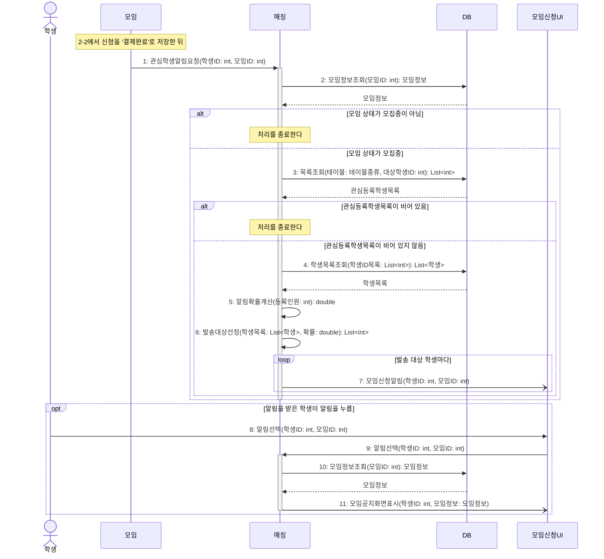
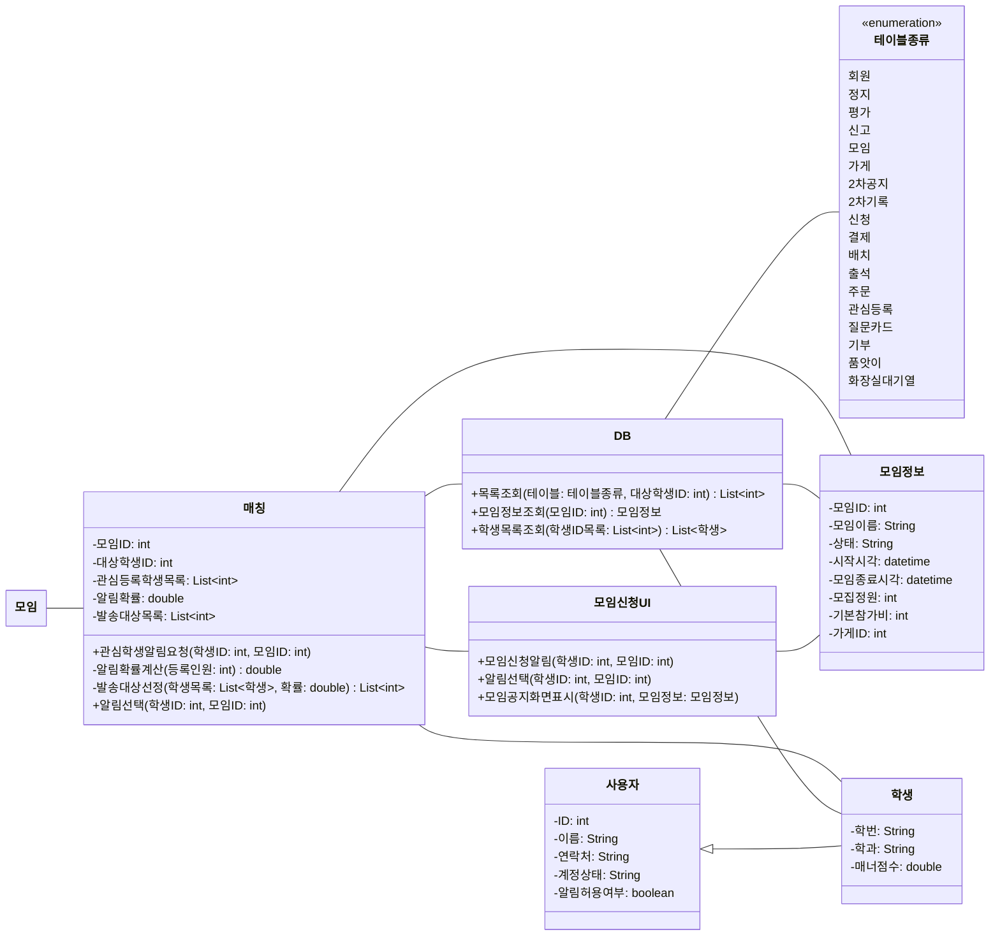

# 3번 발표용 클래스 다이어그램 초안 (친해지고 싶은 학생 알림)

> **팀 결정 전 초안이다.** 11/11 수업 공통 피드백(DB 하나 + 테이블 enum, 사용자 상속, 기능 하나에 클래스 7개 안팎, 홀 없음)을 3번 기능에만 적용했다. 시퀀스 3번은 아직 옛 구조다(담당 최성민). 아래 시퀀스는 클래스를 맞추려고 고친 안이고, 성민님이 시퀀스를 확정하면 다시 맞춘다. 사용자, 학생(엔티티), 사장님(엔티티), 알림허용여부, 학생목록조회, 관심학생알림요청은 GLOSSARY에 아직 없다.

## 1. 고친 시퀀스 (새 구조)

- 1번은 결제를 처리한 모임이 매칭에게 "이 학생을 관심 등록한 학생들에게 알림을 보내 달라"고 요청한다. Found Message로 두면 "매칭이 결제완료를 어떻게 알아?"를 말로 설명해야 해서 메시지로 보였다. 보내는 쪽이 있는 호출이라 사건 이름(~됨) 대신 받는 쪽이 할 일로 이름을 지었다. 2-2 시퀀스 끝에 이 메시지가 같이 들어가야 한다 (담당 양수현, 최종 제출 전).
- 3번 메시지는 테이블종류 값 관심등록, 대상학생ID는 1번에서 받은 신청한 학생 ID다. 이 학생을 관심 대상으로 등록한 학생들을 찾는다.
- 5번 등록인원은 3번에서 받은 목록의 학생 수다. 알림 확률 = 1 ÷ 등록인원.
- 6번은 확률 판정에 뽑히고 알림허용여부가 참인 학생만 남긴다. 알림허용여부는 4번에서 받은 학생에 있다.
- 같은 신청 건으로 여러 번 보내지 않는 것: 1번은 신청 건이 '결제완료'로 저장될 때 한 번만 보낸다.
- 지금 시퀀스의 3번(대상 없음 메시지알림)은 뺐다. 신청한 학생에게 "아무도 등록하지 않았다"는 정보가 새기 때문이다.
- 8~11번은 알림을 받은 학생이 나중에 따로 누를 때 일어나므로, 매칭의 활성 막대를 7번 뒤에 끊고 9번에서 새로 시작한다. 그사이 매칭이 모임정보를 들고 있지 않으므로 10번에서 다시 조회한다 (공지 내용의 출처).
- 8번은 누가 눌렀는지 보이려고 학생 액터를 그렸다 (강의 5장 시퀀스 예시처럼). 다른 시퀀스와의 규칙(CONVENTIONS 5.2)은 최종 제출 전에 같이 정리한다.
- 11번은 학생ID로 누구 화면에 띄울지 정한다.

## 2. 클래스 다이어그램 (PPT용, 클래스 8개)

라이프라인 4개(모임, 매칭, DB, 모임신청UI) + 매개변수·반환 타입으로 쓰이는 4개(테이블종류, 모임정보, 학생, 학생의 부모 사용자). 학생 액터는 클래스가 아니다. 함수는 3번에서 쓰는 것만, 속성은 3번 흐름에 필요한 것만 적었다.

- 모임은 3번에서 메시지를 보내기만 하고 받지 않으므로 함수 없이 이름만 둔다. 모임의 함수(결제요청 등)는 2-2 그림과 전체 그림에서 보인다.
- 상태와 계정상태는 enum(모임상태, 계정상태)이지만 StarUML 규칙(CONVENTIONS 8.1)대로 String으로 적는다. 그래서 enum 상자가 더 늘지 않는다.
- 사용자에는 학생과 사장님이 같이 갖는 속성(ID, 이름, 연락처, 계정상태, 알림허용여부)을 올렸다. 사장님은 3번에서 쓰지 않아 이 그림에는 없다. 전체 그림에서는 `사용자 <|-- 사장님`(가게ID)을 같이 그린다.
- 부모 UI는 3번에서 메시지알림을 쓰지 않게 되어 이 그림에서 뺐다.
- DB와 테이블종류 사이의 선은 생략해도 된다 (교수님 enum 예시). 지금은 남겨 두었다.
- 발표 슬라이드에 적을 문장: "학생(액터) = 화면을 누르는 사람, 학생(클래스) = DB에서 받아 오는 학생 데이터(사용자 상속)"

## 3. 메시지 ↔ 함수 대조표

| 메시지 | 보내는 쪽 → 받는 쪽 | 받는 쪽 함수 | 매개변수 개수·타입 | 반환 |
|---|---|---|---|---|
| 1 관심학생알림요청 | 모임 → 매칭 | +관심학생알림요청(학생ID: int, 모임ID: int) | 2개 같음 | 없음 |
| 2 모임정보조회 | 매칭 → DB | +모임정보조회(모임ID: int) | 1개 같음 | 모임정보 같음 |
| 3 목록조회 | 매칭 → DB | +목록조회(테이블: 테이블종류, 대상학생ID: int) | 2개 같음 | List<int> 같음 |
| 4 학생목록조회 | 매칭 → DB | +학생목록조회(학생ID목록: List<int>) | 1개 같음 | List<학생> 같음 |
| 5 알림확률계산 | 매칭 → 매칭 | -알림확률계산(등록인원: int) | 1개 같음 | double 같음 |
| 6 발송대상선정 | 매칭 → 매칭 | -발송대상선정(학생목록: List<학생>, 확률: double) | 2개 같음 | List<int> 같음 |
| 7 모임신청알림 | 매칭 → 모임신청UI | +모임신청알림(학생ID: int, 모임ID: int) | 2개 같음 | 없음 |
| 8 알림선택 | 학생 → 모임신청UI | +알림선택(학생ID: int, 모임ID: int) | 2개 같음 | 없음 |
| 9 알림선택 | 모임신청UI → 매칭 | +알림선택(학생ID: int, 모임ID: int) | 2개 같음 | 없음 |
| 10 모임정보조회 | 매칭 → DB | +모임정보조회(모임ID: int) (2번과 같은 함수) | 1개 같음 | 모임정보 같음 |
| 11 모임공지화면표시 | 매칭 → 모임신청UI | +모임공지화면표시(학생ID: int, 모임정보: 모임정보) | 2개 같음 | 없음 |

메시지 11개가 모두 받는 쪽 클래스의 함수로 있고, 매칭·DB·모임신청UI의 함수도 모두 메시지로 쓰인다 (2번·10번은 같은 함수). 모임은 보내기만 해서 받는 함수가 없다.

## 4. 지금 파일과 달라진 점

| 지금 | 고친 안 | 이유 |
|---|---|---|
| 친해지고싶은학생알림 | 매칭 | 기능 이름 라이프라인 금지 (#27) |
| Found Message로 시작 | 모임 → 매칭 관심학생알림요청 | 누가 알려 주는지 그림으로 보이기 (11/10 면담, 말로만 하는 설명은 감점) |
| 관심등록DB.관심등록학생조회(학생ID: int) | DB.목록조회(테이블: 테이블종류, 대상학생ID: int) | DB 하나 + 테이블 enum (11/11 수업) |
| 없음 | DB.모임정보조회, DB.학생목록조회 | 모집중 확인, 알림 권한 확인, 공지 내용의 출처 (홀) |
| 학생UI | 모임신청UI | 학생 화면 4개 안 |
| 모임공지화면표시(모임ID: int) | 모임공지화면표시(학생ID: int, 모임정보: 모임정보) | 공지 내용의 출처와 누구 화면인지 (홀) |
| 발송대상선정(학생ID목록: List<int>, 확률: double) | 발송대상선정(학생목록: List<학생>, 확률: double) | 알림허용여부로 거르려면 학생 정보가 필요 |
| 3: 메시지알림(대상 없음) | 뺌 | 신청자에게 정보 노출 |
| 학생UI가 혼자 알림선택을 보냄 | 학생 액터 → 모임신청UI → 매칭 | 누가 눌렀는지 (홀) |
