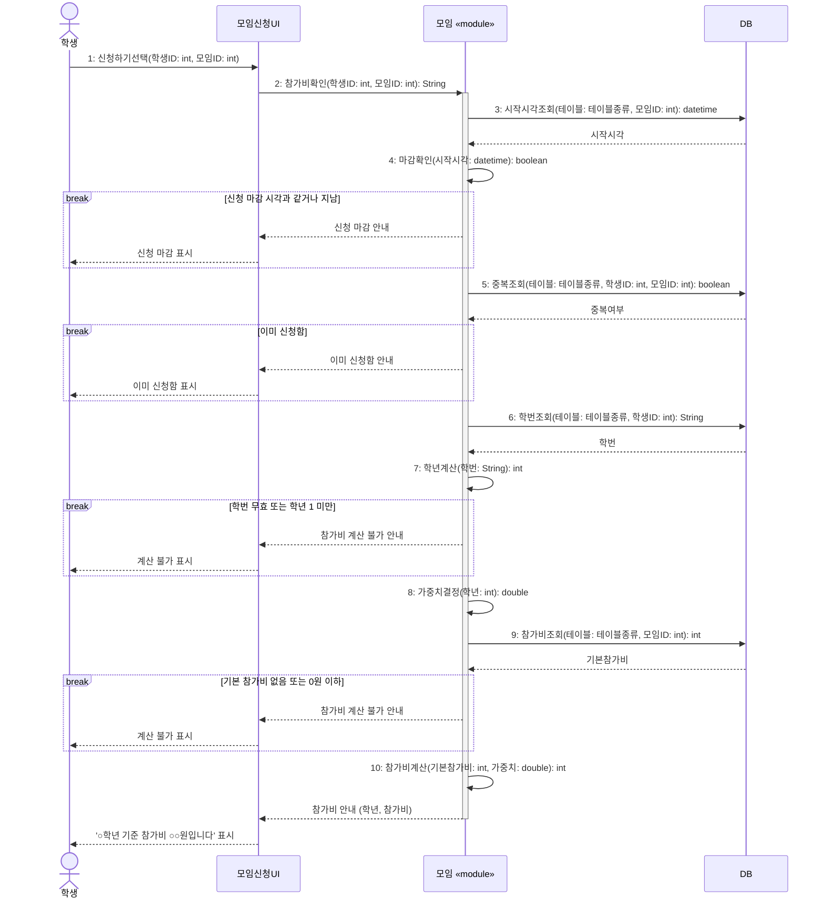

# seq-02-1 참가비 계산 (초안)

> 발표용 규칙(presentation/RULES.md)과 11/23 피드백(FEEDBACK #31~41)을 반영한 초안이다. 설혜원 님 초안(draft/hyewon/07, 10)과 같은 기준으로 그렸다. 원본 `sequence/seq-02-1.md`(양수현)는 고치지 않았다.

## 참여 객체

| 객체 | 종류 | 비고 |
|---|---|---|
| 학생 | 액터 | '신청하기'를 누르는 학생 (#34) |
| 모임신청UI | UI | 원본 학생UI (#24) |
| 모임 «module» | 담당 객체 | 원본 신청확인및참가비계산. 1, 2-1, 2-2를 맡는 주체 (#27, class-diagram/draft-restructure.md) |
| DB | DB | DB 하나. 모든 함수의 첫 매개변수가 테이블종류 |

시작 방식: **사람이 누름** (학생 → 모임신청UI)

## 다이어그램

화살표: `->>` 동기(응답을 기다림, 응답은 점선), `-)` 비동기(기다리지 않음) (#36).

## 메모

- 테이블종류 값: 3·9번 모임, 5번 신청, 6번 회원.
- '신청하기'는 모임 상태가 '모집중'인 공지에만 보인다 (req Requirements, Pre-condition). 그래서 '모집중' 확인과 신청 불가 분기를 그리지 않는다.
- 정지된 학생은 로그인 단계에서 막힌다고 보고(계정 상태 '정상'이 Pre-condition), 정지 확인과 앱 강제 종료를 그리지 않는다.
- 4번 마감확인: 신청 마감 시각 = 모임 시작 시각 전날 18:00. 현재 시각이 마감 시각보다 이르면 참이다. 화면을 열어 둔 채 마감이 지난 뒤 누를 수 있어서 남겨 둔다.
- 2번은 화면이 결과를 기다리는 동기 호출이다. 성공이면 참가비 안내, 실패면 그 사유 안내를 응답으로 한 번 돌려준다. 원본처럼 실패마다 메시지알림을 따로 보내지 않는다 (#36).
- 실패는 break로 그렸다. break 안에서 응답을 돌려주고 기능이 끝난다 (#32 실패 흐름).
- 7번 학년 = 현재 연도 − 학번 앞 네 자리 + 1. 4-2와 같이 쓰는 공통 객체 후보다 (원본 '정리할 것').
- 8번 가중치: 1~2학년 1.0, 3학년 1.1, 4학년 이상 1.2
- 10번 참가비 = 기본 참가비 × 가중치

## 메시지 ↔ Action 대응표

| 메시지 | Action (draft req-02-1) |
|---|---|
| 1~4 | 1 |
| 5 | 2 |
| 6~7 | 3 |
| 8 | 4 |
| 9 | 5 |
| 10, 참가비 안내 | 6 |

## 메시지 ↔ 함수 대조표

| 메시지 | 받는 클래스 | 함수 (매개변수는 자료형만) | 동기/비동기 |
|---|---|---|---|
| 1 신청하기선택 | 모임신청UI | +신청하기선택(int, int) | 동기 (액터) |
| 2 참가비확인 | 모임 | +참가비확인(int, int): String | 동기 |
| 3 시작시각조회 | DB | +시작시각조회(테이블종류, int): datetime | 동기 |
| 4 마감확인 | 모임 | -마감확인(datetime): boolean | 자기 호출 |
| 5 중복조회 | DB | +중복조회(테이블종류, int, int): boolean | 동기 |
| 6 학번조회 | DB | +학번조회(테이블종류, int): String | 동기 |
| 7 학년계산 | 모임 | -학년계산(String): int | 자기 호출 |
| 8 가중치결정 | 모임 | -가중치결정(int): double | 자기 호출 |
| 9 참가비조회 | DB | +참가비조회(테이블종류, int): int | 동기 |
| 10 참가비계산 | 모임 | -참가비계산(int, double): int | 자기 호출 |

메시지 10개 = 함수 10개.

| 클래스 | 속성 | 함수 |
|---|---|---|
| 모임 «module» | | +참가비확인(int, int): String, -마감확인(datetime): boolean, -학년계산(String): int, -가중치결정(int): double, -참가비계산(int, double): int |
| DB | | 시작시각조회, 중복조회, 학번조회, 참가비조회 (4개) |
| 모임신청UI | | +신청하기선택(int, int) |
| 학생UI «abstract» | | (모임신청UI의 부모) |
| 테이블종류 «enumeration» | 모임, 신청, 회원 | |

클래스 5개. 모임은 한 번 계산하고 끝나 계속 들고 있을 상태가 없으므로 속성을 두지 않는다 (#25). 관계는 상속(모임신청UI → 학생UI)만 빈 삼각형이고 나머지는 선만 긋는다. interface는 쓰지 않는다 (#37, #40).

## 함수 이름 (#31 단순명료, 복합 명사 3개 이하)

| 원본 | 초안 |
|---|---|
| 신청하기선택 (학생UI → 담당 객체) | 신청하기선택 (액터 → 화면), 참가비확인 (화면 → 모임) |
| 모임상태조회 | 없음 ('모집중' 공지에만 버튼) |
| 시작시각조회 | 시작시각조회 + 마감확인 (계산을 드러냄) |
| 중복신청조회 | 중복조회 |
| 정지기록조회, 계정상태조회, 계정정지안내표시및강제종료 | 없음 (Pre-condition으로) |
| 학번조회 | 학번조회 |
| 학년계산 | 학년계산 |
| 학년가중치결정 | 가중치결정 |
| 기본참가비조회 | 참가비조회 |
| 참가비계산 | 참가비계산 |
| 메시지알림 (3, 5, 7, 13, 16), 참가비안내표시 | 없음 (2번의 응답) |

## 원본(seq-02-1)과 달라진 점

| 위치 | 원본 | 초안 | 근거 |
|---|---|---|---|
| 라이프라인 | 학생UI, 신청확인및참가비계산, 모임DB, 신청DB, 정지DB, 프로필DB | 학생(액터), 모임신청UI, 모임, DB | #24, #26, #27, #34 |
| 모집중 확인 | alt (아니면 메시지알림) | 삭제 | 버튼이 '모집중' 공지에만 있음 |
| 정지 확인 | 정지기록조회, 계정상태조회, 강제 종료 | 삭제 | 로그인 단계에서 막힘 (Pre-condition) |
| 마감 확인 | alt 조건 안에서 계산 (메시지 없음) | 4번 마감확인 자기 호출 | 계산을 메시지로 드러냄 (#17) |
| 실패 처리 | alt 다섯 겹 중첩 + 메시지알림 | break 네 개, 2번의 응답으로 안내 | #32, #36, 읽기 쉽게 |
| 메시지 수 | 18 | 10 | #38 상세 수준 맞춤 |
