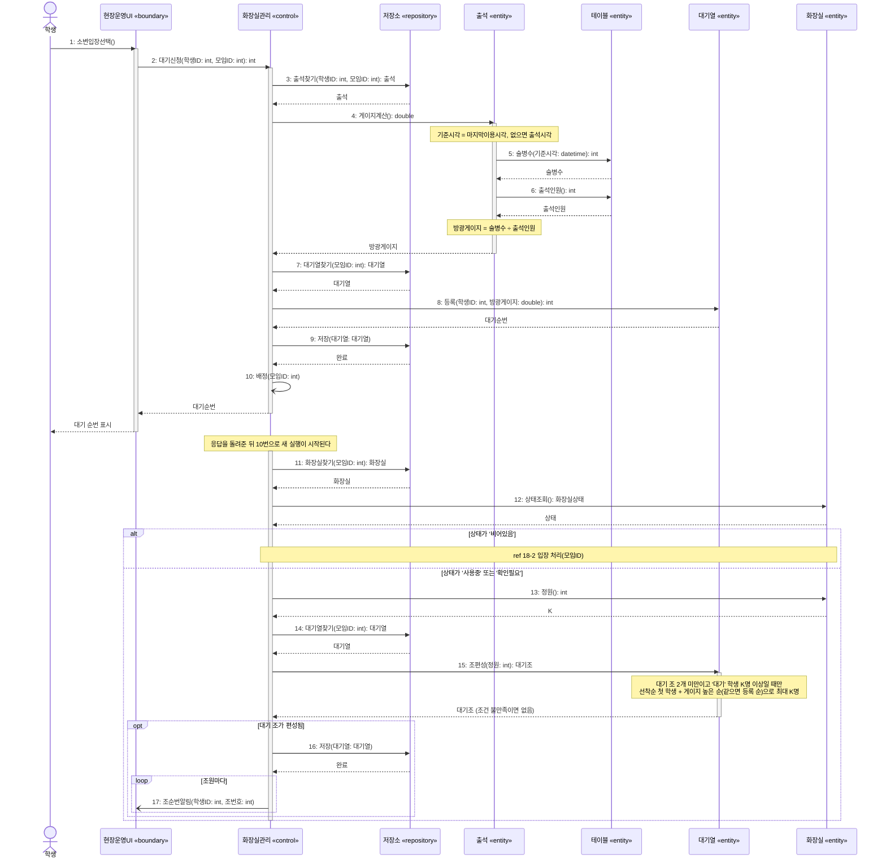

# seq-18-1 화장실 대기 등록 — BCE 비교안

> 같은 요구사항(req-18-1)을 교과서식 객체 설정(Boundary·Control·Entity + Information Expert)으로 다시 그린 비교안이다. 기존 초안 `seq-18-1.md`는 고치지 않았다. 팀 규칙·피드백은 고려하지 않고 이론 기준으로만 그렸다.

## 객체를 정한 과정

1. **Actor**: 학생
2. **Boundary**: 액터가 누르는 화면 1개 → 현장운영UI
3. **Control**: 유스케이스 흐름을 조율하는 객체 1개 → 화장실관리 (18-2와 같은 Control)
4. **Entity**: Action의 명사에서 뽑고 "그 정보를 누가 아는가"(Information Expert)로 일을 나눔

| 명사 (req-18-1) | Entity | 맡는 일 |
|---|---|---|
| 출석 시각, 마지막 이용 시각, 테이블 번호 | 출석 | 기준 시각을 정하고 방광 게이지를 계산 |
| 테이블 출석 인원, 술 주문 병 수 | 테이블 | 자기 테이블의 출석 인원과 기준 시각 이후 술 병 수를 앎 |
| 대기 학생 목록, 대기 조, 대기 순번 | 대기열 | 등록, 조 편성 규칙 (최대 2조, 선착순 첫 학생 + 게이지 순) |
| 화장실 상태, 소변기·대변기 수 | 화장실 | 상태와 한 조 정원 K를 앎 |

5. **영속성**: DB 테이블을 라이프라인으로 두지 않고, Entity를 찾고 저장하는 저장소 «repository» 1개로 감춘다.

## 다이어그램

화살표: `->>` 동기(응답은 점선), `-)` 비동기.

## 메모

- 1번은 버튼 누르기라 매개변수가 없다. 학생ID·모임ID는 화면이 이미 알고 2번에서 넘긴다.
- 4~6번: 게이지 계산을 Control이 아닌 **출석**이 한다. 기준 시각(마지막 이용 시각, 없으면 출석 시각)과 앉은 테이블을 아는 객체가 출석이기 때문이다. 테이블은 출석이 참조로 들고 있어 따로 찾지 않는다.
- 10번: 대기 순번을 먼저 돌려주고 배정을 이어서 하려고 **자기 자신에게 비동기 메시지**를 보낸다. 2번의 실행(활성 막대)은 응답과 함께 끝나고, 10번이 새 실행을 연다.
- 12번 alt: 화장실이 비어 있으면 조를 만들지 않고 18-2의 **입장 처리**를 ref로 부른다. 기존 초안에서 "DB 저장 → Found Message"로 이어지던 연결이 여기서 명시적인 호출이 된다.
- 15번: 대기 조 수 확인, K명 이상 확인, 선택 규칙, 조번호 부여가 모두 대기열 안에 있다. 그래서 기존의 대기열조회·조번호 출처 문제가 사라진다.
- 저장소의 `저장`은 Entity 단위로 저장한다. 어느 테이블에 쓰는지는 저장소 안의 일이라 다이어그램에 드러나지 않는다.

## 메시지 ↔ Action 대응표

| 메시지 | Action (req-18-1) |
|---|---|
| 1~6 | 1, 2 |
| 7~9, 대기순번 | 3 |
| 10~14 | 4 |
| 15~17 | 5, 6 |

## 클래스 (이 시퀀스에서 쓰는 것)

| 클래스 | 속성 | 연산 |
|---|---|---|
| 현장운영UI «boundary» | | +소변입장선택(), +조순번알림(int, int) |
| 화장실관리 «control» | | +대기신청(int, int): int, -배정(int) |
| 저장소 «repository» | | +출석찾기(int, int): 출석, +대기열찾기(int): 대기열, +화장실찾기(int): 화장실, +저장(대기열) |
| 출석 «entity» | 학생ID, 모임ID, 출석시각, 마지막이용시각, 테이블 | +게이지계산(): double |
| 테이블 «entity» | 테이블번호 | +술병수(datetime): int, +출석인원(): int |
| 대기열 «entity» | 모임ID, 대기학생목록: List<대기학생>, 대기조목록: List<대기조> | +등록(int, double): int, +조편성(int): 대기조 |
| 화장실 «entity» | 상태: 화장실상태, 소변기수, 대변기수 | +상태조회(): 화장실상태, +정원(): int |
| 대기학생 «dataType» | 학생ID, 등록시각, 방광게이지, 상태 | |
| 대기조 «dataType» | 조번호, 조원목록: List<int> | |
| 화장실상태 «enumeration» | 비어있음, 사용중, 확인필요 | |

## 기존 초안과 비교

| 항목 | 기존 (seq-18-1.md) | 비교안 |
|---|---|---|
| 라이프라인 | 학생, 현장운영UI, 화장실 «module», 테이블 «module», DB (5개) | 학생, 현장운영UI, 화장실관리, 저장소, 출석, 테이블, 대기열, 화장실 (8개) |
| 일의 분배 | 화장실이 조회·계산·편성·저장을 모두 함 | Control은 순서만 정하고, 계산·규칙은 정보를 가진 Entity가 함 |
| DB 호출 | 9번 (테이블종류 매개변수 포함) | 저장소 6번 (찾기·저장만, 테이블종류 없음) |
| 게이지 계산 | 화장실이 DB 4번 조회 후 자기 호출 | 출석에게 한 번 요청, 출석이 테이블에 물음 |
| 조 편성 조건 | 화장실이 대기열현황을 받아 alt로 판단 | 대기열.조편성 안에 캡슐화 |
| 응답 후 계속 | 동기 응답 뒤에 같은 활성 막대로 이어짐 | 비동기 자기 호출(10번)로 새 실행 |
| 비어있을 때 | 아무것도 안 함 (18-2가 Found Message로 시작) | ref 18-2 입장 처리를 명시적으로 부름 |
| 메시지 수 | 15 | 17 |

## 팀과 정할 것

- 이 비교안은 팀 규칙 몇 가지와 부딪친다. 쓰려면 먼저 팀이 정해야 한다.
  - PPT에 없는 객체(화장실관리, 저장소, 출석, 대기열)를 새로 들인다.
  - DB 하나 + 테이블종류 방식을 쓰지 않는다.
  - 기능 사이를 ref로 잇는다.
