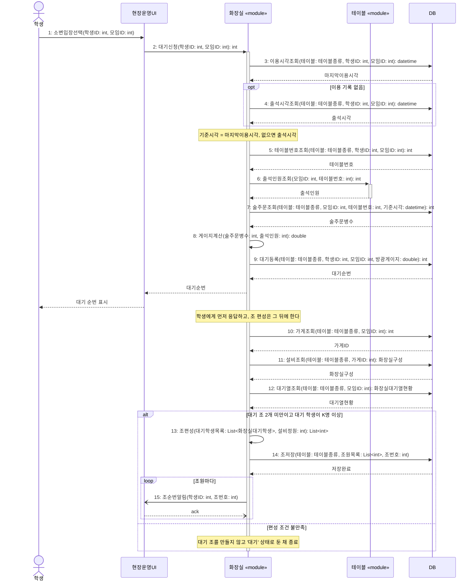

# seq-18-1 화장실 대기 등록 (초안)

> 발표용 규칙(presentation/RULES.md)과 11/23 피드백(FEEDBACK #31~41)을 반영한 초안이다. 설혜원 님 초안(draft/hyewon/07, 10)과 같은 기준으로 그렸다. 원본 `sequence/seq-18-1.md`는 고치지 않았다.

## 참여 객체

| 객체 | 종류 | 비고 |
|---|---|---|
| 학생 | 액터 | '소변 입장'을 누르는 남학생 (#34) |
| 현장운영UI | UI | 원본 학생UI (#24) |
| 화장실 «module» | 담당 객체 | 원본 화장실대기등록및조편성. 18-2와 같은 클래스 (#27, #31) |
| 테이블 «module» | 공통 객체 | 원본 테이블출석현황. 출석인원조회를 재사용 |
| DB | DB | DB 하나. 모든 함수의 첫 매개변수가 테이블종류 |

시작 방식: **사람이 누름** (학생 → 현장운영UI)

## 다이어그램

화살표: `->>` 동기(응답을 기다림, 응답은 점선), `-)` 비동기(기다리지 않음, 받았다는 ack만 점선) (#36).

## 메모

- 테이블종류 값: 3·9·12·14번 화장실대기, 4번 출석, 5번 배치, 7번 주문, 10번 모임, 11번 가게.
- 1번 '소변 입장'은 출석했고 대기 중이 아닌 남학생의 화면에만 보인다 (req Requirements, Pre-condition). 그래서 출석 여부·중복 대기 확인과 등록 불가 분기를 그리지 않는다.
- 2번은 화면이 대기 순번을 기다리는 동기 호출이다. 9번 뒤에 대기순번을 한 번 돌려주고, 조 편성(10~15)은 그 뒤에 한다. 학생이 조 편성까지 기다리지 않는다 (11/23 배달 앱 예시).
- 6번 출석인원조회는 공통 객체 테이블의 함수를 재사용한다.
- 8번 방광 게이지 = 술 주문 병 수 ÷ 테이블 출석 인원
- 11번 설비정원 K = 소변기 수 + 대변기 수
- 13번 조편성은 선착순 첫 학생 1명과 나머지 중 방광 게이지가 높은 순 K − 1명(같으면 등록 시각 순)을 고른다.
- 14번에서 조원의 상태가 '대기조'로 저장된다. 화장실이 '비어있음'이면 이 저장으로 18-2가 시작된다 (18-2 메모, #41).
- 화장실은 2번부터 조 편성이 끝날 때까지 기능이 끝나지 않으므로 활성 막대를 끝까지 잇는다.

## 메시지 ↔ Action 대응표

| 메시지 | Action (draft req-18-1) |
|---|---|
| 1~4 | 1 |
| 5~8 | 2 |
| 9, 대기순번 | 3 |
| 10~12 | 4 |
| 13~15 | 5, 6 |

## 메시지 ↔ 함수 대조표

| 메시지 | 받는 클래스 | 함수 (매개변수는 자료형만) | 동기/비동기 |
|---|---|---|---|
| 1 소변입장선택 | 현장운영UI | +소변입장선택(int, int) | 동기 (액터) |
| 2 대기신청 | 화장실 | +대기신청(int, int): int | 동기 |
| 3 이용시각조회 | DB | +이용시각조회(테이블종류, int, int): datetime | 동기 |
| 4 출석시각조회 | DB | +출석시각조회(테이블종류, int, int): datetime | 동기 |
| 5 테이블번호조회 | DB | +테이블번호조회(테이블종류, int, int): int | 동기 |
| 6 출석인원조회 | 테이블 | +출석인원조회(int, int): int | 동기 |
| 7 술주문조회 | DB | +술주문조회(테이블종류, int, int, datetime): int | 동기 |
| 8 게이지계산 | 화장실 | -게이지계산(int, int): double | 자기 호출 |
| 9 대기등록 | DB | +대기등록(테이블종류, int, int, double): int | 동기 |
| 10 가게조회 | DB | +가게조회(테이블종류, int): int | 동기 |
| 11 설비조회 | DB | +설비조회(테이블종류, int): 화장실구성 | 동기 |
| 12 대기열조회 | DB | +대기열조회(테이블종류, int): 화장실대기열현황 | 동기 |
| 13 조편성 | 화장실 | -조편성(List<화장실대기학생>, int): List<int> | 자기 호출 |
| 14 조저장 | DB | +조저장(테이블종류, List<int>, int) | 동기 |
| 15 조순번알림 | 현장운영UI | +조순번알림(int, int) | 비동기 + ack |

메시지 15개 = 함수 15개.

| 클래스 | 속성 | 함수 |
|---|---|---|
| 화장실 «module» | -모임ID: int | +대기신청(int, int): int, -게이지계산(int, int): double, -조편성(List<화장실대기학생>, int): List<int> |
| 테이블 «module» | | +출석인원조회(int, int): int |
| DB | | 이용시각조회, 출석시각조회, 테이블번호조회, 술주문조회, 대기등록, 가게조회, 설비조회, 대기열조회, 조저장 (9개) |
| 현장운영UI | | +소변입장선택(int, int), +조순번알림(int, int) |
| 학생UI «abstract» | | (현장운영UI의 부모) |
| 테이블종류 «enumeration» | 화장실대기, 출석, 배치, 주문, 모임, 가게 | |
| 화장실구성 «dataType» | 소변기수: int, 대변기수: int | |
| 화장실대기열현황 «dataType» | 대기조수: int, 대기학생목록: List<화장실대기학생> | |
| 화장실대기학생 «dataType» | 학생ID: int, 등록시각: datetime, 방광게이지: double | |

클래스 9개. 관계는 상속(현장운영UI → 학생UI)만 빈 삼각형이고, 나머지는 선만 긋는다. interface는 쓰지 않는다. 여러 디바이스를 하나로 묶는 경우가 아니기 때문이다 (#37, #40).

## 함수 이름 (#31 단순명료, 복합 명사 3개 이하)

| 원본 | 초안 |
|---|---|
| 소변입장신청 | 소변입장선택 (액터 → 화면), 대기신청 (화면 → 화장실) |
| 출석여부조회, 대기상태조회, 메시지알림(등록 불가) | 없음 (Pre-condition으로) |
| 마지막이용시각조회 | 이용시각조회 |
| 학생테이블번호조회 | 테이블번호조회 |
| 테이블출석인원조회 (테이블출석현황) | 출석인원조회 (테이블) |
| 특정시각이후술주문병수조회 | 술주문조회 |
| 방광게이지계산 | 게이지계산 |
| 대기순번표시 | 없음 (2번의 응답) |
| 가게ID조회 | 가게조회 |
| 화장실설비구성조회 | 설비조회 |
| 대기조수및대기목록조회 | 대기열조회 |
| 대기조편성 | 조편성 |
| 대기조상태변경 | 조저장 |
| 대기조순번알림 | 조순번알림 |

## 원본(seq-18-1)과 달라진 점

| 위치 | 원본 | 초안 | 근거 |
|---|---|---|---|
| 라이프라인 | 학생UI, 화장실대기등록및조편성, 테이블출석현황, 출석DB, 화장실대기열DB, 배치DB, 주문DB, 모임DB, 가게DB (9개) | 학생(액터), 현장운영UI, 화장실, 테이블, DB (5개) | #24, #26, #27, #34 |
| 등록 불가 분기 | alt (출석 없음 또는 이미 대기 중 → 메시지알림) | 그리지 않음. 버튼 표시 조건과 Pre-condition으로 | 설혜원 초안 "단순 검증 간소화" |
| 대기 순번 | 12번 대기순번표시 (비동기 알림) | 2번 동기 호출의 응답 | #36, 11/23 동기·비동기 |
| DB 함수 | DB마다 다른 클래스 | DB 하나 + 첫 매개변수 테이블종류 | #26, #33·#35 (어느 테이블인지 보이게) |
| 화살표 | 구분 없이 `->>`, 알림만 `-)` | 동기/비동기 구분, 비동기는 ack | #36 |
| 함수 이름 | 최대 7단어 (특정시각이후술주문병수조회) | 3단어 이하 | #31 |
| 메시지 수 | 18 | 15 | #38 다른 기능(10번 13개)과 상세 수준 맞춤 |
