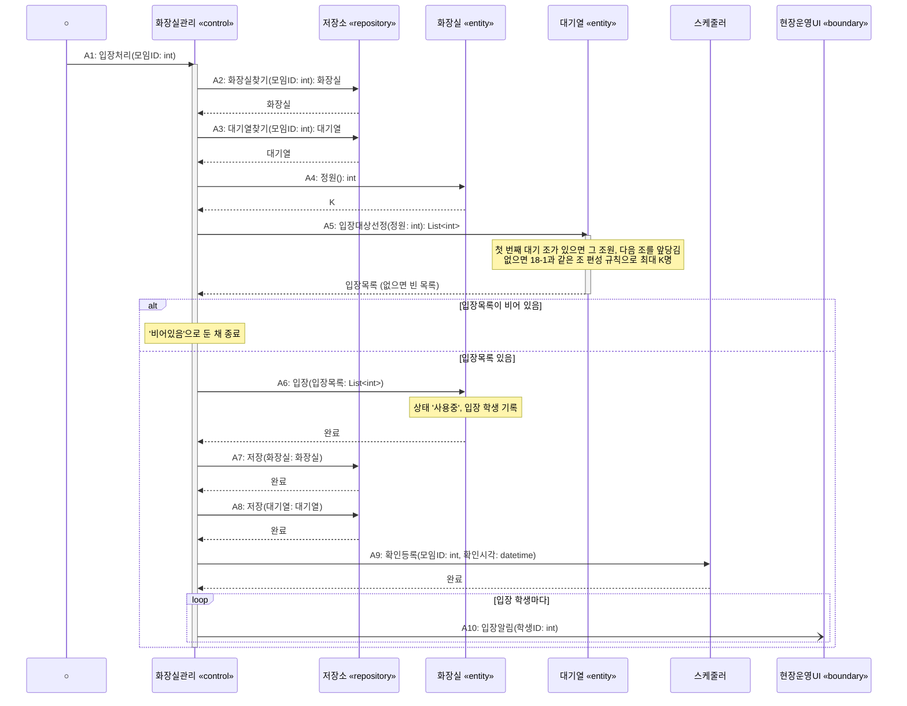
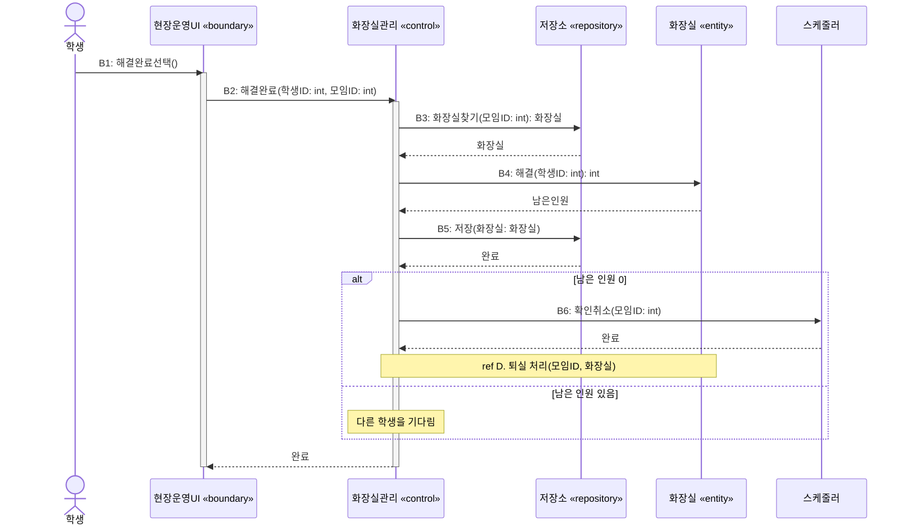
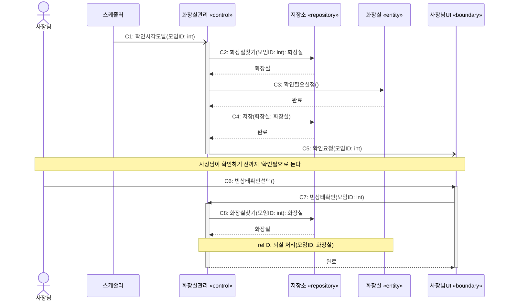
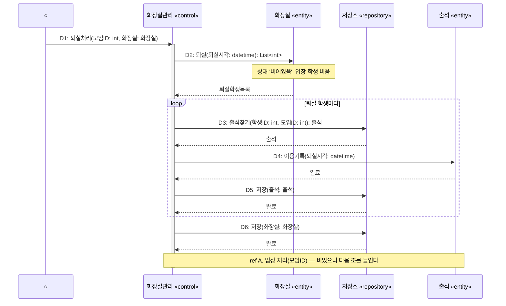

# seq-18-2 화장실 입장 관리 — BCE 분할 비교안

> 같은 요구사항(req-18-2)을 교과서식 객체 설정(Boundary·Control·Entity + Information Expert)으로 다시 그리고, **시작 사건마다 다이어그램을 나눈** 비교안이다. 기존 초안 `seq-18-2.md`는 고치지 않았다. 팀 규칙·피드백은 고려하지 않고 이론 기준으로만 그렸다. 객체는 18-1 비교안(`../18-1/seq-18-1-bce.md`)과 같다.

## 나눈 기준

기존 초안 한 장에는 시작 사건이 4가지(데이터 변화, 학생의 해결 완료, 스케줄러 콜백, 사장님 확인) 들어 있었다. "다이어그램 1개 = 시작 사건 1개(시나리오 1개)"로 나누고, 두 군데서 똑같이 쓰는 퇴실 처리는 따로 떼어 ref로 부른다.

| sd | 시작 사건 | 부르는 곳 | Action (req-18-2) |
|---|---|---|---|
| A. 입장 처리 | 화장실이 비었다 | 18-1 (비어 있을 때 대기 등록), D. 퇴실 처리 | 1~4 |
| B. 해결 완료 | 학생이 '해결 완료'를 누름 | 학생 | 5 |
| C. 확인 시각 도달 | 스케줄러 콜백 → 사장님 확인 | 스케줄러, 사장님 | 7 |
| D. 퇴실 처리 | (공통 절차) | B, C | 6 |

```
18-1 ──ref──▶ A. 입장 처리 ──(확인등록)──▶ 스케줄러
                  ▲                          │
                  │ref                       ▼
             D. 퇴실 처리 ◀──ref── B. 해결 완료 (전원 완료)
                  ▲
                  └────ref──── C. 확인 시각 도달 (사장님 확인)
```

## 객체

| 객체 | 종류 | 맡는 일 |
|---|---|---|
| 학생, 사장님 | Actor | |
| 현장운영UI, 사장님UI | Boundary | 화면 |
| 화장실관리 | Control | 각 sd의 흐름 조율 (18-1과 같음) |
| 저장소 | Repository | Entity 찾기·저장 |
| 화장실 | Entity | 상태, 정원 K, 입장 학생과 해결 완료 여부, 퇴실 |
| 대기열 | Entity | 입장 대상 고르기 (첫 대기 조, 없으면 18-1과 같은 조 편성 규칙), 대기 조 앞당기기 |
| 출석 | Entity | 마지막 이용 시각 기록 (18-1 게이지 계산에 쓰임) |
| 스케줄러 | 외부 컴포넌트 | 확인 시각 등록·취소·콜백 |

화살표: `->>` 동기(응답은 점선), `-)` 비동기. `○`는 다른 다이어그램에서 들어오는 메시지(게이트)다. StarUML에서는 Gate나 Found Message로 그린다.

## A. 입장 처리



## B. 해결 완료



## C. 확인 시각 도달



## D. 퇴실 처리 (B·C 공통)



## 메모

- **A5 입장대상선정**: 대기 조가 있는지에 따른 분기(기존 2번 + alt)와 18-1과 같은 조 편성 규칙이 모두 대기열 안에 있다. 기존 초안의 가게조회·설비조회·대기열조회 3번이 A4 정원() 한 번으로 줄었다. 설비 수는 화장실이 안다.
- **A6~A8**: 화장실 '사용중'과 입장 학생 기록은 화장실이, 대기 조 앞당기기는 대기열이 한다. 둘을 한 번에 저장해야 하면(트랜잭션) 저장소에 `저장(화장실, 대기열)` 하나로 합칠 수 있다.
- **B4 해결**: 화장실이 입장 학생과 해결 여부를 알고 있어서 남은 인원을 바로 계산한다. '확인필요' 상태에서는 화면에서 버튼이 숨겨지므로(req Requirements) B는 '사용중'일 때만 온다.
- **B와 C 중 하나만 일어난다**: 전원이 완료하면 B6에서 확인 시각을 취소하므로 C1이 오지 않는다. 확인 시각이 먼저 오면 C3 뒤로는 해결 완료 버튼이 사라져 B가 오지 않는다. 기존 초안의 `loop` + `opt`를 따로 그릴 필요가 없다.
- **C의 두 실행**: C1(스케줄러)과 C7(사장님)은 서로 다른 시작 사건이라 활성 막대를 나눴다. 그 사이 화장실관리는 실행 중이 아니다.
- **D 마지막 ref**: 퇴실로 화장실이 비면 입장 처리를 다시 부른다. 기존 초안의 "퇴실저장 → DB 변화 → Found Message"를 명시적인 호출로 바꿨다.
- **D4 이용기록**: 마지막 이용 시각은 출석에 둔다. 18-1의 게이지계산이 이 값을 기준 시각으로 쓴다.

## 메시지 ↔ Action 대응표

| 메시지 | Action (req-18-2) |
|---|---|
| A1~A5 | 1, 2 |
| A6~A8, A10 | 3 |
| A9 | 4 |
| B1~B6 | 5 |
| D1~D6 | 6 |
| C1~C8 | 7 |

## 클래스 (이 시퀀스에서 쓰는 것, 18-1 비교안과 합침)

| 클래스 | 속성 | 연산 (★ = 18-2에서 새로 씀) |
|---|---|---|
| 현장운영UI «boundary» | | +소변입장선택(), +조순번알림(int, int), ★+입장알림(int), ★+해결완료선택() |
| 사장님UI «boundary» | | ★+확인요청(int), ★+빈상태확인선택() |
| 화장실관리 «control» | | +대기신청(int, int): int, -배정(int), ★+입장처리(int), ★+해결완료(int, int), ★+확인시각도달(int), ★+빈상태확인(int), ★-퇴실처리(int, 화장실) |
| 저장소 «repository» | | +출석찾기(int, int): 출석, +대기열찾기(int): 대기열, +화장실찾기(int): 화장실, +저장(대기열), ★+저장(화장실), ★+저장(출석) |
| 화장실 «entity» | 상태: 화장실상태, 소변기수, 대변기수, 입장목록: List<int>, 해결목록: List<int> | +상태조회(), +정원(): int, ★+입장(List<int>), ★+해결(int): int, ★+확인필요설정(), ★+퇴실(datetime): List<int> |
| 대기열 «entity» | 모임ID, 대기학생목록, 대기조목록 | +등록(int, double): int, +조편성(int): 대기조, ★+입장대상선정(int): List<int> |
| 출석 «entity» | 학생ID, 모임ID, 출석시각, 마지막이용시각, 테이블 | +게이지계산(): double, ★+이용기록(datetime) |
| 스케줄러 | | ★+확인등록(int, datetime), ★+확인취소(int) |

`입장대상선정`과 `조편성`은 대기열 안에서 같은 선택 규칙(선착순 첫 학생 + 게이지 순)을 private 연산으로 함께 쓴다.

## 기존 초안과 비교

| 항목 | 기존 (seq-18-2.md) | 비교안 |
|---|---|---|
| 다이어그램 수 | 1장 (시작 사건 4개) | 4장 (A 입장, B 해결 완료, C 확인 시각, D 퇴실 공통) |
| 라이프라인 | 8개 (● 포함) | A 7, B 6, C 6, D 5 |
| 시작 | Found Message ("DB에 저장되면") | 게이트로 들어오는 입장처리(18-1, D에서 명시적으로 부름) |
| 대기 조 유무 분기 | 화장실이 alt로 판단, DB 4번 조회 | 대기열.입장대상선정 안에 캡슐화 |
| 활성 막대 | 1번부터 끝까지 이어짐 (몇 분 대기 포함) | 시작 사건마다 새 실행 |
| 해결 완료 vs 시간 초과 | loop + opt를 한 장에 | B와 C로 나누고, 둘 중 하나만 일어나는 이유를 메모에 적음 |
| 퇴실 저장 | 14번과 20번에 같은 메시지 두 번 | D 하나를 B와 C에서 ref로 부름 |
| 메시지 수 | 20 | A 10 + B 6 + C 8 + D 6 = 30 (장마다 10개 이하) |

## 팀과 정할 것

- 18-1 비교안과 같은 점: 새 객체(화장실관리, 저장소, 대기열, 출석)를 들이고, DB 하나 + 테이블종류를 쓰지 않는다.
- 기능 사이를 ref로 잇고(18-1 → A, D → A), 데이터 변화로 시작하는 Found Message를 쓰지 않는다.
- 요구사항 하나에 다이어그램 4장을 둔다. 발표에는 A와 B만 싣고 C·D는 부록으로 둘 수도 있다.
