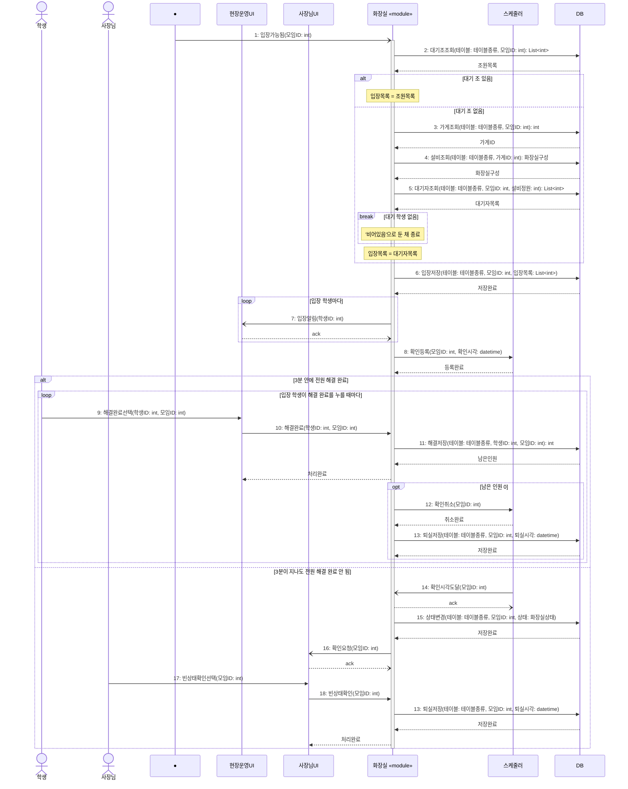

# seq-18-2 화장실 입장 관리 (초안)

> 발표용 규칙(presentation/RULES.md)과 11/23 피드백(FEEDBACK #31~41)을 반영한 초안이다. 설혜원 님 초안(draft/hyewon/07, 10)과 같은 기준으로 그렸다. 원본 `sequence/seq-18-2.md`는 고치지 않았다.

## 참여 객체

| 객체 | 종류 | 비고 |
|---|---|---|
| 학생 | 액터 | 입장해서 '해결 완료'를 누르는 학생 (#34) |
| 사장님 | 액터 | 3분이 지나면 빈 상태를 확인하는 사장님 (#34) |
| 현장운영UI | UI | 원본 학생UI (#24) |
| 사장님UI | UI | 그대로 |
| 화장실 «module» | 담당 객체 | 원본 화장실입장및퇴실관리. 18-1과 같은 클래스 (#27, #31) |
| 스케줄러 | 공통 객체 | 확인 시각을 등록받고, 그 시각에 알린다 (#29). 7번 초안의 스케줄러와 같은 클래스 |
| DB | DB | DB 하나. 모든 함수의 첫 매개변수가 테이블종류 |

시작 방식: **데이터 변화** (화장실 '비어있음' 저장, 또는 비어 있는 동안 대기 기록 저장) → Found Message

## 다이어그램

화살표: `->>` 동기(응답을 기다림, 응답은 점선), `-)` 비동기(기다리지 않음, 받았다는 ack만 점선) (#36).

## 메모

- 테이블종류 값: 2·5·6·11·13·15번 화장실대기, 3번 모임, 4번 가게.
- 1번 Found Message는 DB에 화장실 '비어있음'이 저장되거나(13번 퇴실저장 포함), 화장실이 '비어있음'인 동안 대기 기록이 저장되면(18-1의 9번 대기등록, 14번 조저장) 온다. 보낸 객체가 없어 기다릴 주체가 없으므로 비동기다.
- 1번 시작 조건에 "비어 있는 동안 대기 등록"을 더했다. 원본은 "비어있음이 될 때"만 시작해서, 이미 비어 있는 화장실에 대기를 등록하면 아무도 입장하지 못했다 (#41 정합성).
- 4번 설비정원 K = 소변기 수 + 대변기 수. 5번은 '대기' 학생을 등록 시각 순으로 최대 K명 돌려준다.
- 6번은 화장실 '사용중', 입장 학생 '이용', 다음 대기 조 앞당김을 한 번에 저장한다. 일부만 바뀌는 일이 없다.
- 8번 확인시각 = 지금 + 3분. 원본의 "3분이 지나도"를 스케줄러로 바꿨다 (#29).
- 11번은 해결 완료를 저장하고, 입장 학생 중 아직 누르지 않은 인원을 돌려준다. 0이면 마지막 학생이다.
- 13번 퇴실저장은 입장 학생 '퇴실', 마지막 이용 시각 = 퇴실시각, 화장실 '비어있음'을 한 번에 저장한다. 3분 안 완료와 사장님 확인 두 경우에 같은 함수를 쓰므로 번호도 같게 했다. 이 저장으로 다음 1번이 온다.
- 15번은 화장실을 '확인필요'로 바꾼다. '확인필요'인 동안은 1번이 오지 않으므로 다음 대기 조가 들어가지 않는다 (req Requirements).
- 화장실은 1번부터 퇴실 저장까지 기능이 끝나지 않으므로 활성 막대를 끝까지 잇는다.

## 메시지 ↔ Action 대응표

| 메시지 | Action (draft req-18-2) |
|---|---|
| 1~2 | 1 |
| 3~5 | 2 |
| 6~7 | 3 |
| 8 | 4 |
| 9~12 | 5 |
| 13 | 6 |
| 14~18 | 7 |

## 메시지 ↔ 함수 대조표

| 메시지 | 받는 클래스 | 함수 (매개변수는 자료형만) | 동기/비동기 |
|---|---|---|---|
| 1 입장가능됨 | 화장실 | +입장가능됨(int) | 비동기 (Found) |
| 2 대기조조회 | DB | +대기조조회(테이블종류, int): List<int> | 동기 |
| 3 가게조회 | DB | +가게조회(테이블종류, int): int | 동기 (18-1과 같은 함수) |
| 4 설비조회 | DB | +설비조회(테이블종류, int): 화장실구성 | 동기 (18-1과 같은 함수) |
| 5 대기자조회 | DB | +대기자조회(테이블종류, int, int): List<int> | 동기 |
| 6 입장저장 | DB | +입장저장(테이블종류, int, List<int>) | 동기 |
| 7 입장알림 | 현장운영UI | +입장알림(int) | 비동기 + ack |
| 8 확인등록 | 스케줄러 | +확인등록(int, datetime) | 동기 |
| 9 해결완료선택 | 현장운영UI | +해결완료선택(int, int) | 동기 (액터) |
| 10 해결완료 | 화장실 | +해결완료(int, int) | 동기 |
| 11 해결저장 | DB | +해결저장(테이블종류, int, int): int | 동기 |
| 12 확인취소 | 스케줄러 | +확인취소(int) | 동기 |
| 13 퇴실저장 | DB | +퇴실저장(테이블종류, int, datetime) | 동기 |
| 14 확인시각도달 | 화장실 | +확인시각도달(int) | 비동기 + ack |
| 15 상태변경 | DB | +상태변경(테이블종류, int, 화장실상태) | 동기 |
| 16 확인요청 | 사장님UI | +확인요청(int) | 비동기 + ack |
| 17 빈상태확인선택 | 사장님UI | +빈상태확인선택(int) | 동기 (액터) |
| 18 빈상태확인 | 화장실 | +빈상태확인(int) | 동기 |

메시지 18개 = 함수 18개 (13번은 두 곳에서 부르지만 함수 하나).

| 클래스 | 속성 | 함수 |
|---|---|---|
| 화장실 «module» | -모임ID: int, -입장목록: List<int> | +입장가능됨(int), +해결완료(int, int), +확인시각도달(int), +빈상태확인(int) |
| 스케줄러 | | +확인등록(int, datetime), +확인취소(int) |
| DB | | 대기조조회, 가게조회, 설비조회, 대기자조회, 입장저장, 해결저장, 퇴실저장, 상태변경 (8개) |
| 현장운영UI | | +입장알림(int), +해결완료선택(int, int) |
| 사장님UI | | +확인요청(int), +빈상태확인선택(int) |
| 학생UI «abstract» | | (현장운영UI의 부모) |
| 테이블종류 «enumeration» | 화장실대기, 모임, 가게 | |
| 화장실상태 «enumeration» | 비어있음, 사용중, 확인필요 | |
| 화장실구성 «dataType» | 소변기수: int, 대변기수: int | |

클래스 9개. 화장실의 입장목록은 해결 완료를 기다리는 동안 계속 들고 있어야 하는 상태라 속성으로 둔다 (#25). 관계는 상속(현장운영UI → 학생UI)만 빈 삼각형이고 나머지는 선만 긋는다. interface는 쓰지 않는다 (#37, #40).

## 함수 이름 (#31 단순명료, 복합 명사 3개 이하)

| 원본 | 초안 |
|---|---|
| 화장실비어있음저장됨 | 입장가능됨 (시작 조건이 넓어져서) |
| 첫번째대기조조회 | 대기조조회 |
| 가게ID조회 | 가게조회 |
| 화장실설비구성조회 | 설비조회 |
| 선착순대기학생목록조회 | 대기자조회 |
| 화장실상태변경 + 학생상태변경 + 다음대기조앞당김 | 입장저장 (한 번에) |
| 화장실입장알림 | 입장알림 |
| (없음, ⏱ 3분) | 확인등록, 확인취소, 확인시각도달 (스케줄러) |
| 해결완료선택 (학생UI → 담당 객체) | 해결완료선택 (액터 → 화면), 해결완료 (화면 → 화장실) |
| 해결완료기록및전원완료여부조회 | 해결저장 (남은 인원을 돌려줌) |
| 퇴실처리및화장실비어있음갱신 | 퇴실저장 |
| 화장실상태변경 ('확인필요') | 상태변경 |
| 화장실확인요청알림 | 확인요청 |
| 빈상태확인 (사장님UI → 담당 객체) | 빈상태확인선택 (액터 → 화면), 빈상태확인 (화면 → 화장실) |

## 원본(seq-18-2)과 달라진 점

| 위치 | 원본 | 초안 | 근거 |
|---|---|---|---|
| 라이프라인 | 화장실입장및퇴실관리, 화장실대기열DB, 모임DB, 가게DB, 학생UI, 사장님UI | 학생·사장님(액터), 현장운영UI, 사장님UI, 화장실, 스케줄러, DB | #24, #26, #27, #34 |
| 시작 조건 | '비어있음' 저장 | '비어있음' 저장 또는 비어 있는 동안 대기 저장 | #41 정합성 (18-1과 이어지는 부분) |
| 대기 학생 없음 | alt 안 Note 뒤에도 입장 흐름이 이어짐 | break로 종료 | #32 실패 흐름을 분명하게 |
| 3분 확인 | alt [3분 미확인 시] (누가 재는지 없음) | 스케줄러 등록 → 도달 알림 / 전원 완료면 취소 | #21, #29 |
| 해결 완료 | alt [입장 학생 전원 해결 완료] 안에서 한 번만 그림 | loop [누를 때마다] + opt [남은 인원 0] | 학생마다 따로 누르는 흐름을 그대로 |
| 입장 저장 | 6·7·8번 세 번 | 6번 한 번 | 일부만 바뀌지 않게, #38 상세 수준 |
| 화살표 | 구분 없음 | 동기/비동기 구분, 비동기는 ack | #36 |
| 메시지 수 | 16 | 18 (스케줄러 3개, 액터 2개 추가, DB 저장 2개 합침) | |
