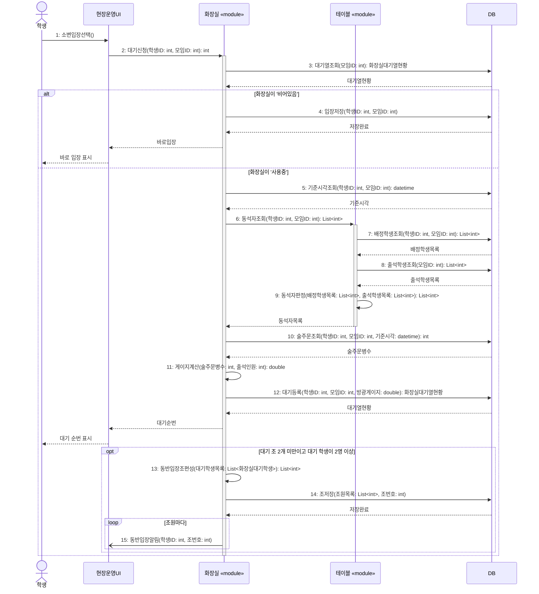

# seq-18-1 화장실 동반 입장 (v2, 함수 줄인 안)

[seq-18-1.md](seq-18-1.md)(v1)와 흐름은 같고, 조회 세 곳을 합쳐 메시지 19 → 15개, 함수 18 → 15개로 줄였다. 맨 아래 "v1과 달라진 점" 참고.

## 참여 객체

| 객체 | 종류 | 비고 |
|---|---|---|
| 학생 | 액터 | '소변 입장'을 누르는 남학생 (#34) |
| 현장운영UI | UI | 원본 학생UI (#24) |
| 화장실 «module» | 담당 객체 | 화장실 입장·대기·동반 입장 조 편성 담당 (#27, #31) |
| 테이블 «module» | 공통 객체 | 배정과 출석을 합쳐 동석자를 판정하는 공통 모듈. 7·10번과 같은 `동석자조회`를 쓴다 |
| DB | DB | DB 하나. 필요한 값을 조회·저장한다 |

시작 방식: **사람이 누름** (학생 → 현장운영UI)

## 다이어그램

화살표: `->>` 동기(응답을 기다림, 응답은 점선), `-)` 비동기(기다리지 않음) (#36).

## 발표 때 말할 내용 (슬라이드에는 넣지 않음)

- **목적:** 소변기 1개와 대변기 1개가 있는 한 칸 화장실은 문이 하나라 한 번에 한 조만 들어간다. 한 명씩 들어가면 설비 하나가 놀게 되므로, 2명씩 짝지어 같이 들어가게 해 대기를 줄인다.
- **한 조 인원 2명은 시스템 상수:** 이 기능은 소변기 1·대변기 1인 한 칸 화장실 전용이라 설비를 매번 조회하지 않는다 (#19 고정값은 상수). 설비가 다른 가게는 상수만 바꾸면 된다.
- **버튼 표시 조건:** '소변 입장'은 출석했고 대기 중이 아닌 남학생의 화면에만 보인다. 그래서 등록 불가 분기를 그리지 않는다.
- **화면이 보내는 값:** 학생은 버튼만 누른다(1번). 화면은 로그인한 학생ID와 지금 들어와 있는 모임ID를 들고 있다가 2번에 넣어 보낸다.
- **먼저 비었는지 본다 (3번):** 화장실이 비어 있으면 대기로 등록하지 않고 입장을 저장(학생 '이용', 화장실 '사용중')한 뒤 바로 입장을 돌려주고(return) 끝낸다. break는 반복문에 쓰는 것이라 쓰지 않고, alt의 첫 칸에서 응답을 돌려주고 끝내는 것으로 그렸다.
- **2번 반환값:** 바로 입장이면 0, 아니면 대기 순번
- **기준 시각 (5번):** 마지막 화장실 이용 시각. 처음이면 출석 시각. 화장실을 다녀온 뒤에 마신 양만 세려는 것이다.
- **테이블 «module» (6~9번):** 이 학생과 같은 테이블에 배정된 학생(7번)과 모임에 출석한 학생(8번)을 조회해, 둘 다에 있는 학생만 동석자로 판정한다(9번). 배정됐지만 오지 않은 학생은 빠진다. 6번 `동석자조회`는 7·10번과 같은 함수다.
- **출석 인원:** 6번 동석자목록의 크기
- **술 주문 (10번):** 이 학생이 앉은 테이블에서 기준 시각 이후 주문한 술 병 수. 판정 없이 꺼내기만 하는 값이라 화장실이 DB에 바로 묻는다.
- **방광 게이지 (11번):** 술 주문 병 수 ÷ 테이블 출석 인원. 술은 테이블 단위로 주문하므로 1인당 양을 추정한다. 누구와 짝지을지 정하는 데만 쓰고 학생에게는 보이지 않는다.
- **대기 등록 (12번):** 대기로 저장하고, 방금 등록한 학생을 포함한 대기열 현황을 돌려받는다. 대기 순번은 그 목록에서 이 학생의 위치다.
- **순번 먼저, 조 편성은 나중:** 12번 뒤에 대기 순번을 먼저 돌려주고, 조 편성(13~15)은 그 뒤에 한다 (11/23 배달 앱 예시). 그래서 화장실 활성 막대가 끝까지 이어진다.
- **동반입장조편성 (13번):** 대기 학생 중 방광 게이지가 높은 순으로 2명 (같으면 먼저 등록한 학생). 급한 사람부터 짝지어 들여보낸다.
  - 질문 대비 "게이지 낮은 학생은 계속 밀리지 않나?": 게이지는 마지막 이용 이후의 술 주문으로 계산하므로, 화장실을 다녀온 학생은 게이지가 내려가 순서가 자연스럽게 돌아온다.
- **조번호:** 12번 대기열현황의 대기조수 + 1
- **조건이 안 맞으면:** '대기' 상태로 둔 채 끝난다. 다음 학생이 누를 때 2명이 되면 조가 만들어진다.
- **15번:** 알리기만 하고 기다리지 않는 비동기 메시지다.
- **범위 밖:** 조가 실제로 들어가고 나오는 것(입장·퇴실)은 이 발표 범위 밖이다. "화장실이 비면 대기 조가 들어가고, 퇴실하면 다음 조가 들어간다"로 말한다 (#41).

## 메시지 ↔ Action 대응표

| 메시지 | Action |
|---|---|
| 1~4, 바로입장 | 1 |
| 5 | 2 |
| 6~11 | 3 |
| 12, 대기순번 | 4, 5 |
| 13~15 | 6 |

## 메시지 ↔ 함수 대조표

| 메시지 | 받는 클래스 | 함수 (매개변수는 자료형만) | 동기/비동기 |
|---|---|---|---|
| 1 소변입장선택 | 현장운영UI | +소변입장선택() | 동기 (액터) |
| 2 대기신청 | 화장실 | +대기신청(int, int): int | 동기 |
| 3 대기열조회 | DB | +대기열조회(int): 화장실대기열현황 | 동기 |
| 4 입장저장 | DB | +입장저장(int, int) | 동기 |
| 5 기준시각조회 | DB | +기준시각조회(int, int): datetime | 동기 |
| 6 동석자조회 | 테이블 | +동석자조회(int, int): List<int> | 동기 (7·10번과 같은 함수) |
| 7 배정학생조회 | DB | +배정학생조회(int, int): List<int> | 동기 |
| 8 출석학생조회 | DB | +출석학생조회(int): List<int> | 동기 |
| 9 동석자판정 | 테이블 | -동석자판정(List<int>, List<int>): List<int> | 자기 호출 |
| 10 술주문조회 | DB | +술주문조회(int, int, datetime): int | 동기 |
| 11 게이지계산 | 화장실 | -게이지계산(int, int): double | 자기 호출 |
| 12 대기등록 | DB | +대기등록(int, int, double): 화장실대기열현황 | 동기 |
| 13 동반입장조편성 | 화장실 | -동반입장조편성(List<화장실대기학생>): List<int> | 자기 호출 |
| 14 조저장 | DB | +조저장(List<int>, int) | 동기 |
| 15 동반입장알림 | 현장운영UI | +동반입장알림(int, int) | 비동기 |

메시지 15개 = 함수 15개.

## 클래스 (7개)

| 클래스 | 속성 | 함수 |
|---|---|---|
| 화장실 «module» | -모임ID: int | +대기신청(int, int): int, -게이지계산(int, int): double, -동반입장조편성(List<화장실대기학생>): List<int> |
| 테이블 «module» | | +동석자조회(int, int): List<int>, -동석자판정(List<int>, List<int>): List<int> |
| DB | | 대기열조회, 입장저장, 기준시각조회, 배정학생조회, 출석학생조회, 술주문조회, 대기등록, 조저장 (8개) |
| 현장운영UI | | +소변입장선택(), +동반입장알림(int, int) |
| 학생UI «abstract» | | (현장운영UI의 부모) |
| 화장실대기열현황 «dataType» | 화장실상태: String, 대기조수: int, 대기학생목록: List<화장실대기학생> | |
| 화장실대기학생 «dataType» | 학생ID: int, 등록시각: datetime, 방광게이지: double | |

화장실상태는 대기열현황의 칸으로만 쓰므로 enum 상자 대신 String으로 적었다 (StarUML 8.1과 같음).

## v1과 달라진 점

| 위치 | v1 | v2 | 이유 |
|---|---|---|---|
| 기준 시각 | 5 이용시각조회 + opt 6 출석시각조회 | 5 기준시각조회 하나 | DB가 마지막 이용 시각, 없으면 출석 시각을 돌려준다. opt 블록이 없어진다 |
| 테이블 번호 | 7 테이블번호조회 → 8 배정테이블조회, 13 술주문조회(모임ID, 테이블번호, 기준시각) | 10 술주문조회(학생ID, 모임ID, 기준시각) | 테이블 번호는 술 주문을 찾는 데만 썼다. DB가 이 학생의 테이블 주문을 바로 찾는다. 테이블 모듈에는 동석자조회만 남아 7·10번과 같은 모양이 된다 |
| 대기열 다시 조회 | 15 대기등록(…): int 뒤 16 대기열조회 | 12 대기등록(…): 화장실대기열현황 | 등록하면서 갱신된 대기열을 돌려받는다. 대기 순번은 그 목록에서의 위치 |
| 개수 | 메시지 19, 함수 18, DB 함수 10 | 메시지 15, 함수 15, DB 함수 8 | |

v2로 정하면 [req-18-1.md](req-18-1.md)의 Action 2(기준 시각), 3(테이블 번호), 4~5(대기 등록·대기열)를 같이 고친다.
