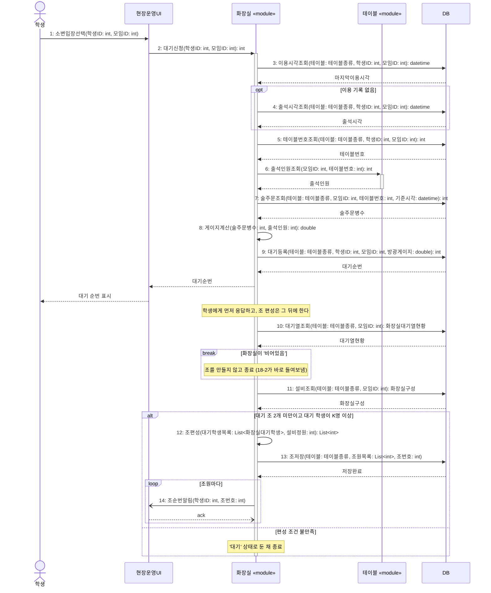

# seq-18-1 화장실 대기 등록

## 참여 객체

| 객체 | 종류 | 비고 |
|---|---|---|
| 학생 | 액터 | '소변 입장'을 누르는 남학생 (#34) |
| 현장운영UI | UI | 원본 학생UI (#24) |
| 화장실 «module» | 담당 객체 | 18-2와 같은 클래스 (#27, #31) |
| 테이블 «module» | 공통 객체 | 출석인원조회 재사용 |
| DB | DB | DB 하나. 첫 매개변수가 테이블종류 |

시작 방식: **사람이 누름** (학생 → 현장운영UI)

## 다이어그램

화살표: `->>` 동기(응답을 기다림, 응답은 점선), `-)` 비동기(기다리지 않음, 받았다는 ack만 점선) (#36).

## 메모

- 테이블종류 값: 3·9·10·13번 화장실대기, 4번 출석, 5번 배치, 7번 주문, 11번 가게.
- 1번 '소변 입장'은 출석했고 대기 중이 아닌 남학생의 화면에만 보인다. 그래서 등록 불가 분기를 그리지 않는다.
- 2번은 화면이 대기 순번을 기다리는 동기 호출이다. 9번 뒤에 대기순번을 돌려주고, 조 편성(10~14)은 그 뒤에 한다 (11/23 배달 앱 예시).
- 기준 시각 = 마지막 이용 시각, 없으면 출석 시각
- 6번 출석인원조회는 공통 객체 테이블의 함수를 재사용한다.
- 8번 방광 게이지 = 술 주문 병 수 ÷ 테이블 출석 인원
- 화장실이 비어 있을 때는 9번 대기 저장으로 18-2가 시작되어 이 학생을 바로 들여보낸다. 18-1이 같은 학생으로 조를 만들면 두 기능이 같은 학생을 동시에 바꾸므로, 비어 있으면 여기서 끝낸다 (#41).
- 11번은 모임ID로 그 모임 가게의 설비를 돌려준다. 설비정원 K = 소변기 수 + 대변기 수
- 12번 조편성: 선착순 첫 학생 1명 + 나머지 중 방광 게이지가 높은 순(같으면 등록 시각 순)으로 최대 K명. 18-2도 같은 함수를 쓴다.
- 화장실은 2번부터 조 편성이 끝날 때까지 기능이 끝나지 않으므로 활성 막대를 끝까지 잇는다.

## 메시지 ↔ Action 대응표

| 메시지 | Action |
|---|---|
| 1~4 | 1 |
| 5~8 | 2 |
| 9, 대기순번 | 3 |
| 10 | 4 |
| 11 | 5 |
| 12~14 | 6 |

## 메시지 ↔ 함수 대조표

| 메시지 | 받는 클래스 | 함수 (매개변수는 자료형만) | 동기/비동기 |
|---|---|---|---|
| 1 소변입장선택 | 현장운영UI | +소변입장선택(int, int) | 동기 (액터) |
| 2 대기신청 | 화장실 | +대기신청(int, int): int | 동기 |
| 3 이용시각조회 | DB | +이용시각조회(테이블종류, int, int): datetime | 동기 |
| 4 출석시각조회 | DB | +출석시각조회(테이블종류, int, int): datetime | 동기 |
| 5 테이블번호조회 | DB | +테이블번호조회(테이블종류, int, int): int | 동기 |
| 6 출석인원조회 | 테이블 | +출석인원조회(int, int): int | 동기 |
| 7 술주문조회 | DB | +술주문조회(테이블종류, int, int, datetime): int | 동기 |
| 8 게이지계산 | 화장실 | -게이지계산(int, int): double | 자기 호출 |
| 9 대기등록 | DB | +대기등록(테이블종류, int, int, double): int | 동기 |
| 10 대기열조회 | DB | +대기열조회(테이블종류, int): 화장실대기열현황 | 동기 |
| 11 설비조회 | DB | +설비조회(테이블종류, int): 화장실구성 | 동기 |
| 12 조편성 | 화장실 | -조편성(List<화장실대기학생>, int): List<int> | 자기 호출 |
| 13 조저장 | DB | +조저장(테이블종류, List<int>, int) | 동기 |
| 14 조순번알림 | 현장운영UI | +조순번알림(int, int) | 비동기 + ack |

메시지 14개 = 함수 14개.

## 클래스 (이 장만, 9개)

| 클래스 | 속성 | 함수 |
|---|---|---|
| 화장실 «module» | -모임ID: int | +대기신청(int, int): int, -게이지계산(int, int): double, -조편성(List<화장실대기학생>, int): List<int> |
| 테이블 «module» | | +출석인원조회(int, int): int |
| DB | | 이용시각조회, 출석시각조회, 테이블번호조회, 술주문조회, 대기등록, 대기열조회, 설비조회, 조저장 (8개) |
| 현장운영UI | | +소변입장선택(int, int), +조순번알림(int, int) |
| 학생UI «abstract» | | (현장운영UI의 부모) |
| 테이블종류 «enumeration» | 화장실대기, 출석, 배치, 주문, 가게 | |
| 화장실대기열현황 «dataType» | 화장실상태: String, 대기조수: int, 대기학생목록: List<화장실대기학생> | |
| 화장실대기학생 «dataType» | 학생ID: int, 등록시각: datetime, 방광게이지: double | |
| 화장실구성 «dataType» | 소변기수: int, 대변기수: int | |

화장실상태는 이 장에서 대기열현황의 칸으로만 쓰므로 enum 상자 대신 String으로 적었다 (StarUML 8.1과 같음). 두 장을 같이 보여 줄 때는 README의 12개 클래스를 쓴다.
