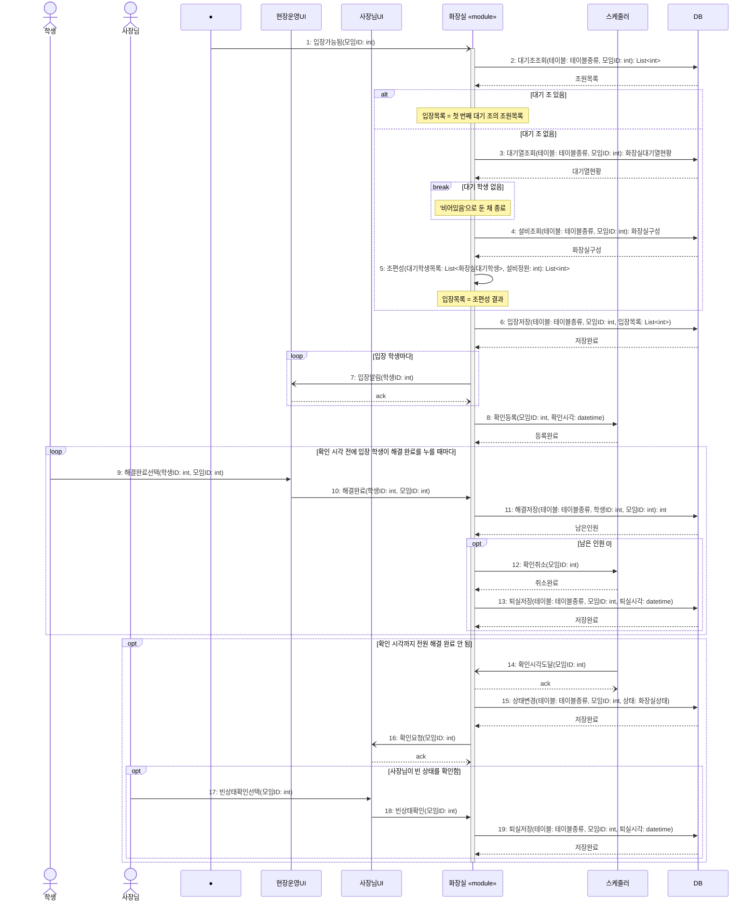

# seq-18-2 화장실 입장 및 퇴실

## 참여 객체

| 객체 | 종류 | 비고 |
|---|---|---|
| 학생 | 액터 | 입장해서 '해결 완료'를 누르는 학생 (#34) |
| 사장님 | 액터 | 3분이 지나면 빈 상태를 확인하는 사장님 (#34) |
| 현장운영UI | UI | 원본 학생UI (#24) |
| 사장님UI | UI | 그대로 |
| 화장실 «module» | 담당 객체 | 18-1과 같은 클래스 (#27, #31) |
| 스케줄러 | 공통 객체 | 확인 시각을 등록받고 그 시각에 알린다 (#29) |
| DB | DB | DB 하나. 첫 매개변수가 테이블종류 |

시작 방식: **데이터 변화** (화장실 '비어있음' 저장, 또는 비어 있는 동안 대기 저장) → Found Message

## 다이어그램

화살표: `->>` 동기(응답을 기다림, 응답은 점선), `-)` 비동기(기다리지 않음, 받았다는 ack만 점선) (#36).

## 메모

- 테이블종류 값: 2·3·6·11·13·15·19번 화장실대기, 4번 가게.
- 1번 Found Message는 화장실 '비어있음' 저장(13·19번 퇴실저장 포함), 또는 화장실이 비어 있는 동안 18-1의 대기 저장으로 온다. 보낸 객체가 없어 기다릴 주체가 없으므로 비동기다.
- 3~5번은 대기 조가 없을 때다. 18-1과 같은 조편성 함수로 최대 K명을 고른다. 4번 설비정원 K = 소변기 수 + 대변기 수
- 6번은 화장실 '사용중', 입장 학생 '이용', 다음 대기 조 앞당김(2조 → 1조)을 한 번에 저장한다.
- 8번 확인시각 = 지금 + 3분 (#29).
- 9~13번 loop는 확인 시각 전에만 돈다. 일부만 누르고 3분이 지나면 아래 opt로 간다. '확인필요'가 되면 '해결 완료' 버튼이 사라지므로 사장님 확인과 겹치지 않는다.
- 10번과 18번은 응답 내용이 없는 동기 호출이라 응답 화살표를 그리지 않는다 (#36).
- 11번은 해결 완료를 저장하고 '이용' 학생 중 아직 누르지 않은 인원을 돌려준다.
- 13번과 19번은 같은 함수 퇴실저장이다. 입장 학생 '퇴실', 마지막 이용 시각 = 퇴실시각, 화장실 '비어있음'을 한 번에 저장한다. 이 저장으로 다음 1번이 와서 다음 조가 들어간다.
- 15번은 화장실을 '확인필요'로 바꾼다. '확인필요'인 동안은 1번이 오지 않으므로 다음 조가 들어가지 않는다.
- 17~18번은 16번 확인 요청에 대한 사장님의 응답이라 opt로 둔다 (3번의 알림선택과 같은 방식).
- 화장실은 1번부터 퇴실 저장까지 기능이 끝나지 않으므로 활성 막대를 끝까지 잇는다.

## 메시지 ↔ Action 대응표

| 메시지 | Action |
|---|---|
| 1~2 | 1 |
| 3~5 | 2 |
| 6~8 | 3 |
| 9~13 | 4, 6 |
| 14~19 | 5, 6 |

## 메시지 ↔ 함수 대조표

| 메시지 | 받는 클래스 | 함수 (매개변수는 자료형만) | 동기/비동기 |
|---|---|---|---|
| 1 입장가능됨 | 화장실 | +입장가능됨(int) | 비동기 (Found) |
| 2 대기조조회 | DB | +대기조조회(테이블종류, int): List<int> | 동기 |
| 3 대기열조회 | DB | +대기열조회(테이블종류, int): 화장실대기열현황 | 동기 (18-1과 같은 함수) |
| 4 설비조회 | DB | +설비조회(테이블종류, int): 화장실구성 | 동기 (18-1과 같은 함수) |
| 5 조편성 | 화장실 | -조편성(List<화장실대기학생>, int): List<int> | 자기 호출 (18-1과 같은 함수) |
| 6 입장저장 | DB | +입장저장(테이블종류, int, List<int>) | 동기 |
| 7 입장알림 | 현장운영UI | +입장알림(int) | 비동기 + ack |
| 8 확인등록 | 스케줄러 | +확인등록(int, datetime) | 동기 |
| 9 해결완료선택 | 현장운영UI | +해결완료선택(int, int) | 동기 (액터) |
| 10 해결완료 | 화장실 | +해결완료(int, int) | 동기 |
| 11 해결저장 | DB | +해결저장(테이블종류, int, int): int | 동기 |
| 12 확인취소 | 스케줄러 | +확인취소(int) | 동기 |
| 13 퇴실저장 | DB | +퇴실저장(테이블종류, int, datetime) | 동기 |
| 14 확인시각도달 | 화장실 | +확인시각도달(int) | 비동기 + ack |
| 15 상태변경 | DB | +상태변경(테이블종류, int, 화장실상태) | 동기 |
| 16 확인요청 | 사장님UI | +확인요청(int) | 비동기 + ack |
| 17 빈상태확인선택 | 사장님UI | +빈상태확인선택(int) | 동기 (액터) |
| 18 빈상태확인 | 화장실 | +빈상태확인(int) | 동기 |
| 19 퇴실저장 | DB | (13번과 같은 함수) | 동기 |

메시지 19개, 함수 18개 (13번과 19번이 같은 함수).

## 클래스 (이 장만, 11개)

| 클래스 | 속성 | 함수 |
|---|---|---|
| 화장실 «module» | -모임ID: int | +입장가능됨(int), -조편성(List<화장실대기학생>, int): List<int>, +해결완료(int, int), +확인시각도달(int), +빈상태확인(int) |
| 스케줄러 | | +확인등록(int, datetime), +확인취소(int) |
| DB | | 대기조조회, 대기열조회, 설비조회, 입장저장, 해결저장, 퇴실저장, 상태변경 (7개) |
| 현장운영UI | | +입장알림(int), +해결완료선택(int, int) |
| 사장님UI | | +확인요청(int), +빈상태확인선택(int) |
| 학생UI «abstract» | | (현장운영UI의 부모) |
| 테이블종류 «enumeration» | 화장실대기, 가게 | |
| 화장실상태 «enumeration» | 비어있음, 사용중, 확인필요 | |
| 화장실대기열현황 «dataType» | 화장실상태: 화장실상태, 대기조수: int, 대기학생목록: List<화장실대기학생> | |
| 화장실대기학생 «dataType» | 학생ID: int, 등록시각: datetime, 방광게이지: double | |
| 화장실구성 «dataType» | 소변기수: int, 대변기수: int | |
