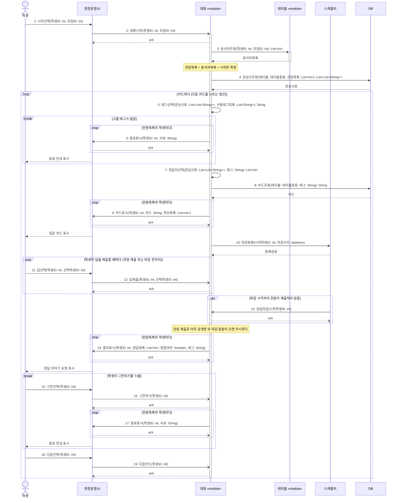

# seq-07 대화 카드 추천 (초안)

> 11/23 수업과 지난 발표 피드백을 반영한 초안이다. 10번 초안과 같은 기준으로 그렸다. 원본 `sequence/seq-07.md`는 고치지 않았다.

## 참여 객체

| 객체 | 종류 | 비고 |
|---|---|---|
| 학생 | 액터 | 대화를 시작하고 답을 고르는 같은 테이블 학생 (#34) |
| 대화 «module» | 담당 객체 | 원본 프로필기반대화주제카드 (#27) |
| 테이블 «module» | 공통 객체 | 동석자조회를 재사용 (10번과 같은 함수, 11/10 면담) |
| 스케줄러 | 공통 객체 | 응답 마감 시각을 등록받고, 그 시각에 알린다 (#29) |
| DB | DB | DB 하나. 첫 매개변수 테이블종류 |
| 현장운영UI | UI | 원본 학생UI (#24) |

시작 방식: **사람이 누름** (학생 → 현장운영UI).

## 다이어그램

화살표: `->>` 동기(닫힌 화살표, 응답을 기다림, 응답은 점선), `-)` 비동기(열린 화살표, 기다리지 않음, 받았다는 ack만 점선).

## 메모

- 테이블종류 값: 4번 회원(관심사 태그), 8번 질문카드.
- 3번 동석자조회는 10번과 같은 함수다. 본인을 제외한 같은 테이블 출석 학생을 돌려준다.
- 혼자 시작하면(동석자 0명) 전원 수가 1이라, 5번 태그선택 규칙(보유 인원 1명 이상, 전원 수 미만)을 만족하는 태그가 없다. 그래서 첫 카드에서 break [고를 태그가 없음]으로 종료된다. 따로 "2명 미만" 분기를 그리지 않는다 (같은 종료를 두 번 그리지 않기).
- 4번 관심사표는 전원목록 순서대로 학생마다 관심사 태그 목록을 담는다. 5·7번은 이 순서로 누가 어떤 태그를 가졌는지 안다.
- 5번 태그선택 규칙 (req Action 2): 후보 태그 = 관심사표의 태그 중 사용태그목록에 없는 것 → 태그마다 보유 인원을 센다 → 보유 인원이 1명 이상이고 전원 수보다 적은 태그만 남긴다 → 보유 인원이 가장 많은 태그 (같으면 무작위). 남은 태그가 없으면 빈 값을 돌려주고 break로 끝낸다. 고른 태그는 사용태그목록에 더한다.
- 7번 정답자선택은 관심사표에서 그 태그를 가진 학생 목록을 돌려준다.
- 8번은 그 태그의 질문 카드 중 하나를 무작위로 돌려준다. 모든 태그에 카드가 하나 이상 있다 (req Pre-condition).
- 9번 후보목록은 받는 학생을 뺀 전원목록이다.
- 10번 마감시각 = 지금 시각 + 1분 (시스템 상수). 시작학생ID로 어느 테이블의 대화인지 구분한다.
- 12번 답제출을 받을 때마다 대화는 선택학생ID를 답목록에 저장한다 (전원목록 순서, 아직 안 낸 학생은 빈 값). 제출 수는 답목록에서 빈 값이 아닌 것의 수로 센다. 전원이 제출하면 바로 14번으로 간다. 아니면 13번 응답마감을 받았을 때 14번으로 간다. 다음 카드로 넘어가면 답목록을 비운다.
- 14번 맞힘여부 = 답목록에서 그 학생의 선택학생ID가 정답목록에 있는지.
- 14번 결과표시: 정답목록과 맞힘여부를 보여 준다. 받는 학생이 정답목록에 있으면 "태그 이야기를 들려주세요"를 함께 보여 준다. 제출하지 않은 학생은 맞힘여부가 거짓이다.
- 15~19번은 같은 테이블 누구든 누를 수 있다. 거의 동시에 눌리면 먼저 도착한 것만 처리한다.
- 대화는 2번부터 대화가 끝날 때까지 기능이 끝나지 않으므로 활성 막대를 끝까지 잇는다.
- 학생이 누르는 메시지(1, 11, 15, 18)와 화면에서 학생에게 가는 점선은 액터와 화면 사이라 대화의 함수가 아니다.

## 메시지 ↔ Action 대응표

| 메시지 | Action (draft req-07) |
|---|---|
| 1~4 | 1 |
| 5~6 | 2 |
| 7~9 | 3 |
| 10 | 4 |
| 11~12 | 5 |
| 13~14 | 6 |
| 15~19 | 7 |

## 메시지 ↔ 함수 대조표

| 메시지 | 받는 클래스 | 함수 (매개변수는 자료형만) | 동기/비동기 |
|---|---|---|---|
| 1 시작선택 | 현장운영UI | +시작선택(int, int) | 동기 (액터) |
| 2 대화시작 | 대화 | +대화시작(int, int) | 비동기 + ack |
| 3 동석자조회 | 테이블 | +동석자조회(int, int): List<int> | 동기 |
| 4 관심사조회 | DB | +관심사조회(테이블종류, List<int>): List<List<String>> | 동기 |
| 5 태그선택 | 대화 | -태그선택(List<List<String>>, List<String>): String | 자기 호출 |
| 6 종료표시 | 현장운영UI | +종료표시(int, String) | 비동기 + ack |
| 7 정답자선택 | 대화 | -정답자선택(List<List<String>>, String): List<int> | 자기 호출 |
| 8 카드조회 | DB | +카드조회(테이블종류, String): String | 동기 |
| 9 카드표시 | 현장운영UI | +카드표시(int, String, List<int>) | 비동기 + ack |
| 10 마감등록 | 스케줄러 | +마감등록(int, datetime) | 동기 |
| 11 답선택 | 현장운영UI | +답선택(int, int) | 동기 (액터) |
| 12 답제출 | 대화 | +답제출(int, int) | 비동기 + ack |
| 13 응답마감 | 대화 | +응답마감(int) | 비동기 + ack |
| 14 결과표시 | 현장운영UI | +결과표시(int, List<int>, boolean, String) | 비동기 + ack |
| 15 그만선택 | 현장운영UI | +그만선택(int) | 동기 (액터) |
| 16 그만하기 | 대화 | +그만하기(int) | 비동기 + ack |
| 17 종료표시 | 현장운영UI | (6번과 같은 함수) | 비동기 + ack |
| 18 다음선택 | 현장운영UI | +다음선택(int) | 동기 (액터) |
| 19 다음카드 | 대화 | +다음카드(int) | 비동기 + ack |

메시지 19개, 함수 18개 (6·17번은 같은 함수 종료표시).

| 클래스 | 속성 | 함수 |
|---|---|---|
| 대화 «module» | -모임ID: int, -전원목록: List<int>, -관심사표: List<List<String>>, -사용태그목록: List<String>, -정답목록: List<int>, -답목록: List<int> | +대화시작, -태그선택, -정답자선택, +답제출, +응답마감, +그만하기, +다음카드 (7개) |
| 테이블 «module» | | +동석자조회(int, int): List<int> |
| 스케줄러 | | +마감등록(int, datetime) |
| DB | | +관심사조회, +카드조회 (2개) |
| 현장운영UI | | +시작선택, +종료표시, +카드표시, +답선택, +결과표시, +그만선택, +다음선택 (7개) |
| 테이블종류 «enumeration» | 회원, 질문카드 | |
| 학생UI «abstract» | | (현장운영UI의 부모) |

클래스 **7개** (스케줄러 포함). 대화의 속성은 카드를 넘기는 동안 계속 들고 있어야 하는 상태라 속성으로 둔다 (#25 "계속 들고 있는 상태만").

## 함수 이름 (공통 1 "복합 명사 3개 이하")

| 원본 | 초안 |
|---|---|
| 대화카드시작선택 | 시작선택 (액터 → 화면), 대화시작 (화면 → 대화) |
| 같은테이블학생조회 (테이블출석현황) | 동석자조회 (테이블) |
| 관심사태그목록조회 | 관심사조회 |
| 질문태그선택 | 태그선택 |
| 관심사보유학생조회 (DB) | 정답자선택 (대화의 자기 호출, DB 호출 없음) |
| 관심사질문카드조회 | 카드조회 |
| 질문카드표시 | 카드표시 |
| 추측답제출 | 답선택 (액터 → 화면), 답제출 (화면 → 대화) |
| 메시지알림 + 이야기공유요청 | 결과표시 |
| 남은관심사태그여부조회 (DB) | 없음 (5번 태그선택이 판단) |
| 다음카드선택, 그만하기선택 | 다음선택·다음카드, 그만선택·그만하기 |
| (게임 종료 메시지알림) | 종료표시 |

## 원본(seq-07)과 달라진 점

| 위치 | 원본 | 초안 | 근거 |
|---|---|---|---|
| 라이프라인 | 학생UI, 프로필기반대화주제카드, 테이블출석현황, 배치DB, 출석DB, 프로필DB, 질문카드DB | 학생(액터), 현장운영UI, 대화, 테이블, 스케줄러, DB | #24, #26, #27, #34 |
| 1번 매개변수 | 화면이 테이블번호를 보냄 | 학생ID, 모임ID만. 테이블은 동석자조회로 | 공통 3 "파라미터가 갑자기 등장" |
| 테이블출석현황 안의 배치·출석 조회 | 그림에 있음 (3·4번) | 테이블 안의 일이라 그리지 않음 | 공통 7 간소화 |
| 정답자 조회 | DB (관심사보유학생조회) | 대화가 관심사표에서 고름 | 이미 받은 관심사표로 판단, DB 호출 줄임 |
| 남은 태그 확인 | DB (남은관심사태그여부조회) | 5번 태그선택이 빈 값 → break | 판단은 담당 객체 |
| 1분 | ⏱ 노트 | 10번 스케줄러 등록, 13번 마감 알림 | #29, 11/23 |
| 반복 구조 | "6번으로 돌아간다" 노트, alt 두 겹 | loop 하나 + break 두 개 (태그 없음, 그만하기) | 1·7·8·13팀 "루프 없이 break", 알아보기 쉽게 |
| 2명 미만 | 없음 | 따로 그리지 않음. 혼자면 태그선택에서 고를 태그가 없어 break로 종료 | 같은 종료를 두 번 그리지 않기 (공통 8) |
| 알림 | 메시지알림 두 번 | 결과표시, 종료표시 | 내용이 그림에 보이게 |
| 메시지 수 | 16 | 19 | |
