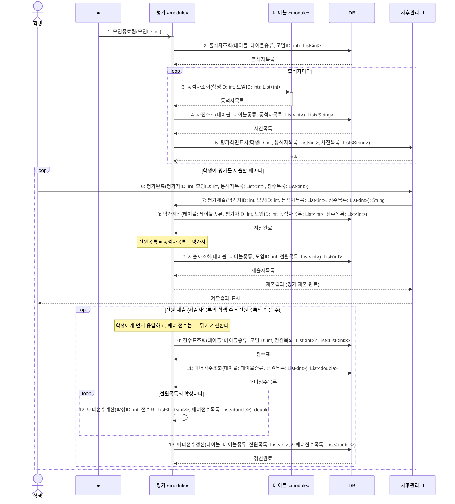

# seq-10 만난 사람 평가 (초안 v2)

> 11/23 수업과 지난 발표 피드백(16팀 + 다른 팀 + 공통 1~11)을 반영한 초안이다. 원본 `sequence/seq-10.md`는 고치지 않았다.

## 참여 객체

| 객체 | 종류 | 비고 |
|---|---|---|
| 학생 | 액터 | 평가를 입력하고 '평가 완료'를 누르는 사람 (16팀 "액터 연결") |
| 평가 «module» | 담당 객체 | 원본 만난사람평가 (#27) |
| 테이블 «module» | 공통 객체 | 원본 테이블출석현황. 동석자조회를 재사용 (11/10 면담) |
| DB | DB | DB 하나. 모든 함수의 첫 매개변수가 테이블종류 (11/11 수업) |
| 사후관리UI | UI | 원본 학생UI (#24) |

시작 방식: **데이터 변화** (DB의 모임 상태가 '종료'가 됨) → Found Message. '종료'를 누가 만드는지는 이 기능의 관심 밖이다.

## 다이어그램

화살표: `->>` 동기(닫힌 화살표, 응답을 기다림, 응답은 점선), `-)` 비동기(열린 화살표, 기다리지 않음, 받았다는 ack만 점선).

## 메모

- 테이블종류 값: 2번 출석, 4·11·13번 회원, 8·9·10번 평가.
- 1번 Found Message는 DB의 모임 상태가 '종료'가 되면 온다. 보낸 객체가 없어 응답을 기다릴 주체가 없으므로 비동기(열린 화살촉)다. 상태를 바꾸는 쪽은 이 기능이 관심 두지 않는다 (교수님 11/23 "그릇이 회수돼 있다고 가정").
- 3번 동석자조회는 본인을 제외한 같은 테이블 출석 학생을 돌려준다. 동석자목록은 3 → 5 → 6 → 7로 이어지므로 제출할 때 다시 조회하지 않는다.
- 5번은 여러 학생에게 보내는 알림이라 비동기다. 화면은 받았다는 ack만 돌려준다.
- 6번 점수는 화면에서 1~5점 중에서만 고른다. 동석자목록과 점수목록은 같은 순서로 짝을 이룬다.
- 중복 제출 확인은 그리지 않는다. 학생은 모임마다 평가를 한 번만 제출한다 (req Pre-condition). 단순 검증은 간단하게 (공통 7), 출석자 0명을 뺀 것과 같은 기준이다.
- 제출결과 다음의 "제출결과 표시"는 화면이 학생에게 결과를 보여 주는 응답이다. 액터에게 가는 응답이라 함수가 늘지 않는다.
- 7번은 화면이 결과를 기다리는 동기 호출이다. 제출결과는 9번 바로 뒤에 한 번 돌려주고, 전원이 제출했을 때만 opt 안에서 10~13번 매너 점수 계산을 한다. 전원 미제출이면 아무것도 더 하지 않으므로 else가 필요 없다. 마지막 학생이 계산이 끝날 때까지 기다리지 않는다 (11/23 배달 앱 예시).
- 10번 점수표는 줄이 평가자, 칸이 평가받는 학생이고, 둘 다 전원목록 순서다. 그래서 "이 점수를 누가 줬는가"는 점수표의 위치로 알 수 있다. 11번 매너점수목록도 전원목록 순서의 갱신 전 매너 점수다. 학생마다 묻지 않고 두 번만 조회한다 (15팀 "조회를 한 번에", 11팀 "조회 병합").
- 12번 매너점수계산은 평가의 자기 호출이다. 그 학생의 열(받은 점수)과, 점수를 준 학생들의 갱신 전 매너 점수로 계산한다. 갱신 전 값을 쓰므로 계산 순서가 결과에 영향을 주지 않는다. loop에서 나온 새매너점수를 전원목록 순서대로 모아 새매너점수목록을 만든다.
- 13번은 테이블 전원의 매너 점수를 한 번에 갱신한다. 일부 학생만 바뀌고 나머지는 안 바뀌는 일이 없다 (4·11팀 "DB 접근 간소화", 트랜잭션).
- 12번 계산식: 새 매너 점수 = (기존 매너 점수 + 받은 점수의 합 + 매너 점수 4점 이상인 평가하는 학생이 준 점수 한 번 더) ÷ (1 + 평가하는 학생 수 + 매너 점수 4점 이상인 평가하는 학생 수)
- 평가는 1번부터 마지막 학생의 계산이 끝날 때까지 기능이 끝나지 않으므로 활성 막대를 끝까지 잇는다 (11/23 "라이프라인은 기능이 끝날 때까지").

## 메시지 ↔ Action 대응표

| 메시지 | Action (draft req-10) |
|---|---|
| 1~2 | 1 |
| 3~5 | 2 |
| 6~7 | 3 |
| 8 | 4 |
| 9 | 5 |
| 제출결과 | 6 |
| 10~13 | 7 |

## 메시지 ↔ 함수 대조표

| 메시지 | 받는 클래스 | 함수 (매개변수는 자료형만) | 동기/비동기 |
|---|---|---|---|
| 1 모임종료됨 | 평가 | +모임종료됨(int) | 비동기 (Found: 보낸 쪽이 없어 기다릴 주체가 없음) |
| 2 출석자조회 | DB | +출석자조회(테이블종류, int): List<int> | 동기 |
| 3 동석자조회 | 테이블 | +동석자조회(int, int): List<int> | 동기 |
| 4 사진조회 | DB | +사진조회(테이블종류, List<int>): List<String> | 동기 |
| 5 평가화면표시 | 사후관리UI | +평가화면표시(int, List<int>, List<String>) | 비동기 + ack |
| 6 평가완료 | 사후관리UI | +평가완료(int, int, List<int>, List<int>) | 동기 (액터) |
| 7 평가제출 | 평가 | +평가제출(int, int, List<int>, List<int>): String | 동기 |
| 8 평가저장 | DB | +평가저장(테이블종류, int, int, List<int>, List<int>) | 동기 |
| 9 제출자조회 | DB | +제출자조회(테이블종류, int, List<int>): List<int> | 동기 |
| 10 점수표조회 | DB | +점수표조회(테이블종류, int, List<int>): List<List<int>> | 동기 |
| 11 매너점수조회 | DB | +매너점수조회(테이블종류, List<int>): List<double> | 동기 |
| 12 매너점수계산 | 평가 | -매너점수계산(int, List<List<int>>, List<double>): double | 자기 호출 |
| 13 매너점수갱신 | DB | +매너점수갱신(테이블종류, List<int>, List<double>) | 동기 (테이블 전원 한 번에) |

메시지 13개 = 함수 13개.

| 클래스 | 속성 | 함수 |
|---|---|---|
| 평가 «module» | -모임ID: int | +모임종료됨(int), +평가제출(int, int, List<int>, List<int>): String, -매너점수계산(int, List<List<int>>, List<double>): double |
| 테이블 «module» | | +동석자조회(int, int): List<int> |
| DB | | 출석자조회, 사진조회, 평가저장, 제출자조회, 점수표조회, 매너점수조회, 매너점수갱신 (7개) |
| 사후관리UI | | +평가화면표시(int, List<int>, List<String>), +평가완료(int, int, List<int>, List<int>) |
| 테이블종류 «enumeration» | 출석, 회원, 평가 | |
| 학생UI «abstract» | | (사후관리UI의 부모) |

클래스 6개. 데이터 클래스는 쓰지 않는다 (int·List·String·double만).

## 함수 이름 (공통 1 "복합 명사 3개 이하")

| 원본 | 초안 v2 |
|---|---|
| 모임종료저장됨 | 모임종료됨 |
| 출석학생조회 | 출석자조회 |
| 같은테이블학생조회 (테이블출석현황) | 동석자조회 (테이블) |
| 프로필사진조회 | 사진조회 |
| 평가완료선택 | 평가완료 (액터 → 화면), 평가제출 (화면 → 평가) |
| 평가저장 + 테이블평가전원제출여부조회 | 평가저장, 제출자조회 |
| 받은점수목록조회 (학생마다) | 점수표조회 (한 번) |
| 매너점수조회 (학생마다) | 매너점수조회 (한 번, 목록) |
| 매너점수계산 | 매너점수계산 (매개변수에 점수표·매너점수목록) |
| 매너점수갱신 | 매너점수갱신 |

새 용어: 출석자, 동석자, 제출자, 점수표 (GLOSSARY에 없음).

## 원본(seq-10)과 달라진 점

| 위치 | 원본 | 초안 v2 | 근거 |
|---|---|---|---|
| 라이프라인 | 만난사람평가, 테이블출석현황, 출석DB, 프로필DB, 평가DB, 학생UI | 학생(액터), 평가, 테이블, DB, 사후관리UI | #24, #26, #27, 16팀 액터 연결 |
| 출석 학생 없음 | else 없음 | 그리지 않음. loop [출석자마다]가 0명이면 돌지 않고, req Pre-condition에 "출석자가 1명 이상" | 공통 8 "불필요한 디테일 간소화" |
| 사진 | 학생마다 한 장씩 (loop) | 동석자 사진을 한 번에 | 공통 4·7, 11팀 조회 병합 |
| 중복 제출 확인 | 없음 | 그리지 않음. req Pre-condition에 "모임마다 한 번만 제출" | 공통 7 "단순 조회·validate 간소화" |
| 전원 제출 판단 | 테이블평가전원제출여부조회 (DB가 판단) | 제출자조회 + 평가가 학생 수 비교 | 판단은 담당 객체 |
| 같은 테이블 재조회 | 8번에서 다시 조회 | 7번에서 받은 동석자목록을 씀 | "이미 받았는데 왜 또?" |
| 점수·매너 점수 조회 | 학생마다 매너점수조회, 받은점수목록조회 (loop 안에서 2번씩) | 점수표조회, 매너점수조회 각 한 번 | 15팀 "SQL 한 번에" |
| 매너 점수 갱신 | 학생마다 갱신 (loop 안) | 계산만 loop, 갱신은 목록으로 한 번 | 4·11팀 "DB 접근 간소화", 일부만 바뀌지 않게 |
| 저장·갱신 응답 | 없음 | 응답 점선 | 12팀 "DB 돌아오는 흐름", 9팀 "반환 명확히" |
| 제출 결과 | 메시지알림, 계산 뒤 | 7번의 응답으로 9번 뒤에 한 번, 계산은 opt [전원 제출] 안 | 11/23 동기·비동기, 같은 내용 두 번 그리지 않기 |
| 메시지 수 | 14 | 13 | |
