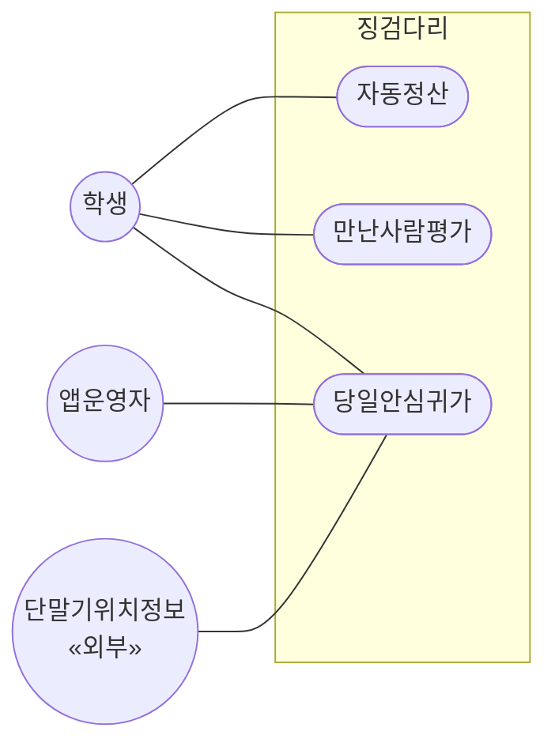

# 1. 유스케이스 다이어그램

기준: [usecase/usecase-v2.md](../../../usecase/usecase-v2.md) (11/10 미팅 기준 초안, '시간' 액터 없음) · 8개 기능 축소 기준  
참고: [draft/sungmin/15/req-15.md](req-15.md), [draft/sungmin/15/seq-15.md](seq-15.md)

## ③ 모임 종료·사후 관리 단계 (발표용 메인)

15번(당일안심귀가)이 8개 기능 중 어느 흐름 속에 있는지 보여 준다.

- 15번은 DB의 모임 상태가 `'종료'`로 바뀌면 시작한다 (데이터 변화, `seq-15 #1 모임종료감지`).
- 연결 액터는 귀가 모니터링·안전 확인 응답 대상인 **학생**, 미응답 시 긴급 문자를 받는 **앱운영자**, 현재 위치 좌표를 조회하는 외부 시스템 **단말기위치정보 `«외부»`**다.
- `자동정산`(9), `만난사람평가`(10), `당일안심귀가`(15)는 모임 종료 시점(상태 `'종료'`)을 계기로 각자 독립적으로 동작하므로 `«include»` / `«extend»`로 잇지 않는다.
