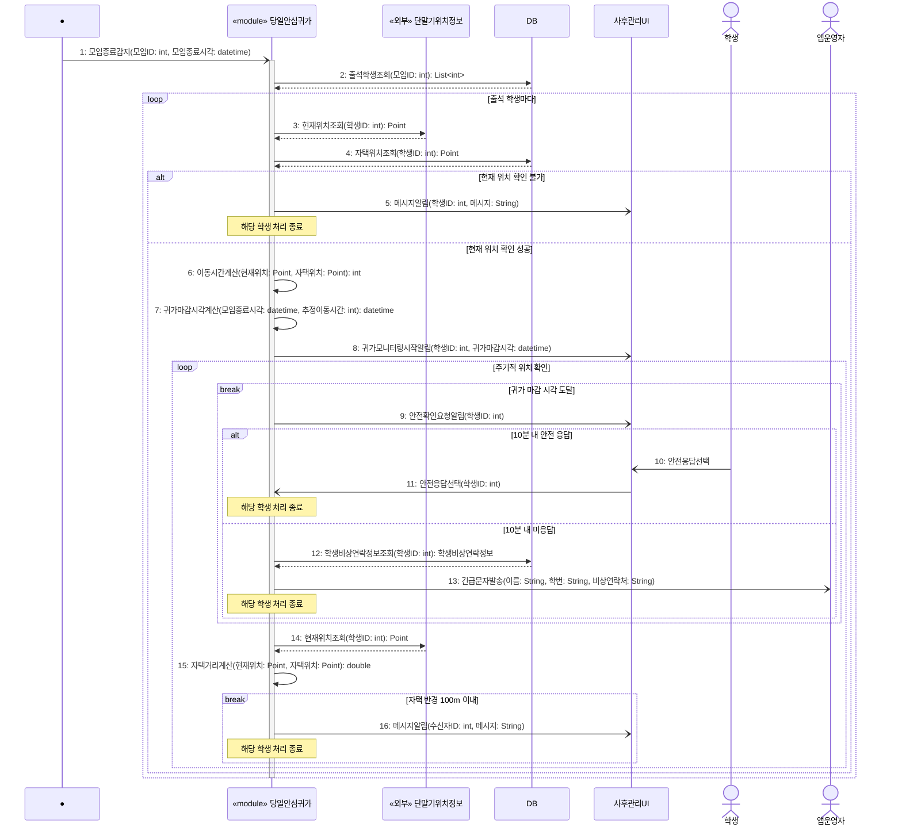

# seq-15 당일안심귀가 (v3)

## 참여 객체

| 객체 | 종류 | 클래스 파일 |
|---|---|---|
| 당일안심귀가 | 담당 객체 | classes/SafeReturnHome.md |
| DB | DB | classes/MeetingDB.md, classes/AttendanceDB.md, classes/ProfileDB.md |
| 단말기위치정보 | 외부 | classes/DeviceLocation.md |
| 사후관리UI | UI | classes/StudentUI.md |
| 학생 | 액터 | |
| 앱운영자 | 액터 | |

시작 방식: **데이터 변화** (DB의 모임 상태가 '종료'로 변경됨) → Found Message

## 다이어그램

## 메시지 ↔ Action 대응표

| 메시지 | Action |
|---|---|
| 1~4 | 1 |
| 5 | 2 |
| 6 | 3, 4, 5 |
| 7~8 | 6 |
| 9~13 | 8 |
| 14~16 | 7 |

## 메모

- 1번 시작 메시지는 '9. 자동 정산'에서 모임 상태가 '종료'로 저장될 때 발생하는 Found Message다.
- 3번 현재위치조회에서 단말기 위치 정보를 얻지 못하면 이동시간계산을 수행하지 않고 5번 알림 후 해당 학생 처리를 종료한다.
- 5번 메시지알림(위치확인불가)은 단말기 위치 정보를 얻지 못했을 때 사후관리UI에 알리고 모니터링 대상에서 제외하는 Action 2의 예외 처리다.
- 7번 귀가 마감 시각은 모임 종료 시각 + 추정 이동 시간 + 30분(여유 버퍼)으로 계산된다.
- `loop [주기적 위치 확인]`은 **귀가 마감 시각 도달(`9~13번`)** 또는 **자택 반경 100m 이내 진입(`16번`)** 중 하나를 만족하면 해당 `break` 블록을 수행하고 반복을 종료한다.
- 9번 확인 요청 후 10분 타이머가 동작하며, 미응답 시 비상 연락처를 포함한 SMS 외부 서비스 호출(13번)이 발생한다.
- 5, 8, 9, 13, 16번 알림·문자는 비동기로 발송된다.
- 5, 16번은 화면에 잠깐 보여 주고 끝나는 알림이라 메시지알림으로 보낸다 (FEEDBACK #25). 메시지는 5번 위치확인불가, 16번 안전귀가 안내이고, 원래 넘기던 값(사유, 금액 등)은 메시지 문장에 담는다.
