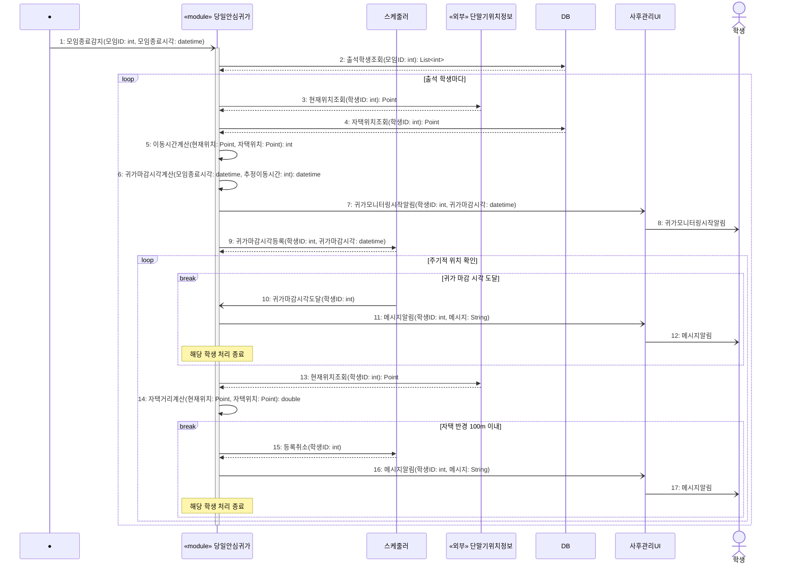

# seq-15 당일안심귀가 (v5)

## 참여 객체

| 객체 | 종류 | 클래스 파일 |
|---|---|---|
| 당일안심귀가 | 담당 객체 | classes/SafeReturnHome.md |
| 스케줄러 | 공통 객체 | 마감 시각을 등록받고 그 시각에 알린다 (#29) |
| DB | DB | classes/MeetingDB.md, classes/AttendanceDB.md, classes/ProfileDB.md |
| 단말기위치정보 | 외부 | classes/DeviceLocation.md |
| 사후관리UI | UI | classes/StudentUI.md |
| 학생 | 액터 | |

시작 방식: **데이터 변화** (DB의 모임 상태가 '종료'로 변경됨) → Found Message

## 다이어그램

## 메시지 ↔ Action 대응표

| 메시지 | Action |
|---|---|
| 1~4 | 1 |
| 5 | 3, 4, 5 |
| 6~9 | 6 |
| 10~12 | 8 |
| 13~17 | 7 |

## 메모

- 1번 시작 메시지는 '9. 자동 정산'에서 모임 상태가 '종료'로 저장될 때 발생하는 Found Message다.
- 6번 귀가 마감 시각은 모임 종료 시각 + 추정 이동 시간 + 30분(여유 버퍼)으로 계산되며, 9번으로 `스케줄러`에 등록된다.
- `loop [주기적 위치 확인]` 중 자택 반경 100m 이내에 진입하면 `15: 등록취소`로 스케줄러 예약을 취소하고 `16~17번` 알림 후 해당 학생 처리를 종료한다.
- 마감 시각까지 진입하지 못하면 `스케줄러`가 `10: 마감시각도달`을 알리고, `사후관리UI`를 통해 학생에게 `11~12번` 미귀가/안전 확인 안내 알림을 보낸 뒤 해당 학생 처리를 종료한다.
- 7, 8, 10, 11, 12, 16, 17번 알림·신호는 비동기로 발송된다.
- 11, 16번은 화면에 잠깐 보여 주고 끝나는 알림이라 메시지알림으로 보낸다 (FEEDBACK #25). 메시지는 11번 마감시각 미귀가 안내, 16번 안전귀가 안내이고, 원래 넘기던 값(사유, 금액 등)은 메시지 문장에 담는다.
