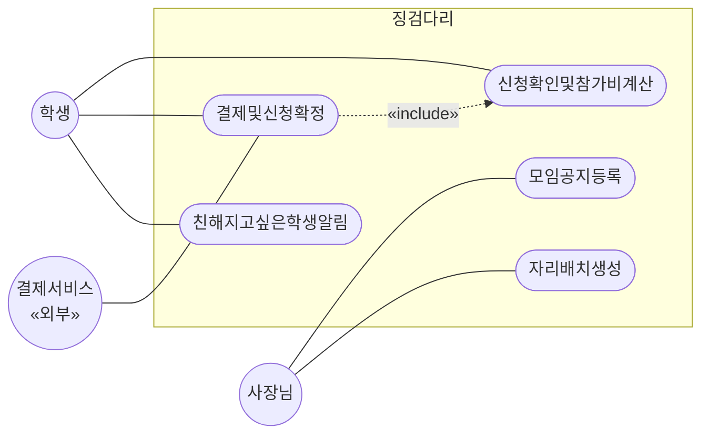

# 1. 유스케이스 다이어그램

기준: [usecase/usecase-v2.md](../../usecase/usecase-v2.md) (11/10 미팅 기준 초안, '시간' 액터 없음)

## ① 모임 생성·신청 단계 (발표용 메인)

3번이 어느 흐름 속에 있는지 보여 준다.

- 3번은 결제완료가 DB에 저장되면 시작한다 (데이터 변화). 액터 학생은 **알림을 받는 학생**(관심 등록한 학생)이다.
- 3번은 2-2와 include/extend로 잇지 않는다. 결제한 학생과 알림 받는 학생이 달라서 독립 유스케이스다 ([usecase/usecase.md](../../usecase/usecase.md) 메모, 11/08).
