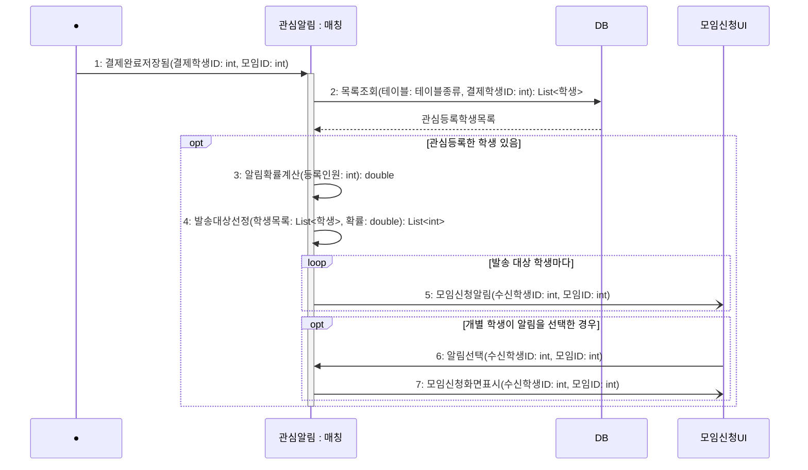

# 2. 시퀀스 다이어그램 (3번 발표용)

원본: [sequence/seq-03.md](../../sequence/seq-03.md) (최성민, a13bd6e). 흐름(시작 방식, 메시지 7개, opt/loop 구조)은 원본 그대로 두고, 클래스 다이어그램 개념에 맞춰 **이름과 타입만** 바꿨다.

- 1번은 2-2에서 DB에 '결제완료'가 저장될 때 생기는 Found Message다.
- 2번은 테이블 = '관심등록'으로 조회한다. 결제한 학생을 관심 등록한 학생들을 **학생 정보(알림허용여부 포함)** 로 돌려준다.
- 3번 확률 = 1 ÷ 등록인원
- 4번은 학생목록에서 알림허용여부가 '허용'인 학생만 남긴 뒤, 학생마다 확률로 발송 여부를 정한다. 원본 메모의 "알림 권한이 허용된 학생에게만"을 여기서 처리한다.

## 원본과 달라진 점

| 위치 | 원본 (seq-03) | 발표용 | 이유 |
|---|---|---|---|
| 라이프라인 | 친해지고싶은학생알림 | 관심알림 : 매칭 | 라이프라인에 기능 이름을 쓰지 않는다 (FEEDBACK #27). `역할 : 클래스` 표기 |
| 라이프라인 | 학생UI | 모임신청UI | 학생UI 하나에 연산이 몰리지 않게 화면 단위로 나눈다 (#24) |
| 1번 | DB에 결제완료가 저장됨 | 결제완료저장됨 | 메시지·연산 이름은 공백 없이 (CONVENTIONS 3장) |
| 2번 | 본 학생을 관심등록한 학생조회(int): List<int> | 목록조회(테이블종류, int): List<학생> | DB는 하나로 두고 테이블은 enum으로 고른다 (#26). 알림허용여부를 알아야 해서 학생 정보로 받는다 |
| 3번 | 모임신청알림의 확률계산 | 알림확률계산 | 공백 제거 |
| 4번 | 발송대상선정(List<int>, double) | 발송대상선정(List<학생>, double) | 2번 반환 타입이 바뀌어서 |
