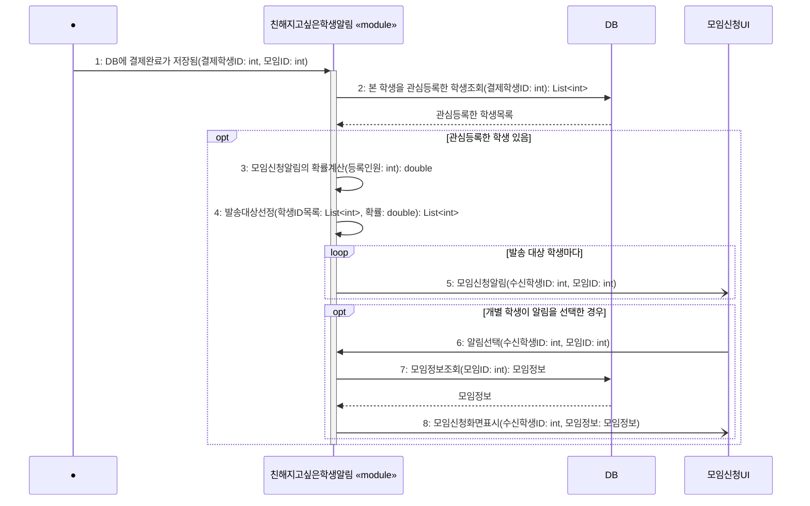

# 2. 시퀀스 다이어그램 (3번 발표용)

원본: [sequence/seq-03.md](../../sequence/seq-03.md) (최성민, a13bd6e). 흐름(시작 방식, opt/loop 구조)과 **메시지(메소드명·매개변수·반환값)는 원본 그대로** 쓴다. 라이프라인 이름만 발표용으로 바꿨다. 단, 신청 화면에 띄울 모임 내용의 출처가 없어서(빈틈) 메시지 하나(7번 모임정보조회)를 더하고, 8번이 그 모임정보를 넘기도록 했다. 메시지는 8개다.

- 1번은 2-2에서 DB에 '결제완료'가 저장될 때 생기는 Found Message다.
- 3번 확률 = 1 ÷ 등록인원
- 알림 권한은 모든 학생이 이미 동의한 것으로 본다. 그래서 권한 확인 없이 확률로만 발송 대상을 정한다.
- 6~8번은 알림을 받은 학생마다 각자 알림을 눌러 모임 신청 화면으로 이동하는 선택 흐름이다. 누르지 않으면 아무 동작 없이 끝나므로 `opt`로 감쌌다.
- 7번은 6번에서 받은 모임ID로 DB에서 모임 내용(모임이름, 시작시각, 참가비 등)을 조회한다. 8번은 그 모임정보를 화면에 넘겨, 화면이 띄울 내용이 어디서 왔는지 보이게 한다.

## 원본과 달라진 점

| 위치 | 원본 (seq-03) | 발표용 | 이유 |
|---|---|---|---|
| 라이프라인 | 친해지고싶은학생알림 | 친해지고싶은학생알림 «module» | 이름은 원본 그대로 두고, 기능 하나를 맡는 모듈임을 스테레오타입으로 표시한다 |
| 라이프라인 | 학생UI | 모임신청UI | 학생UI 하나에 연산이 몰리지 않게 화면 단위로 나눈다 (#24) |
| 7번 (추가) | 없음 | 모임정보조회(모임ID: int): 모임정보 | 화면에 띄울 모임 내용을 누가 가져오는지 없었다 ("그 정보는 누가 가지고 있어?", 11/11 수업) |
| 8번 (원본 7번) | 모임신청화면표시(수신학생ID: int, 모임ID: int) | 모임신청화면표시(수신학생ID: int, 모임정보: 모임정보) | 7번에서 받은 모임정보를 화면에 넘긴다 |
