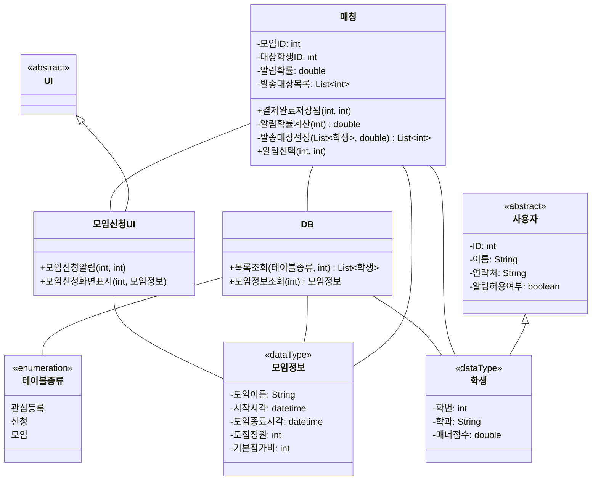

# 3. 클래스 다이어그램 (3번 발표용)

[2-sequence.md](2-sequence.md)에서 나온 클래스 8개다.

| 종류 | 클래스 | 어디서 나왔나 |
|---|---|---|
| 라이프라인 | 매칭, DB, 모임신청UI | 시퀀스 라이프라인 (받는 메시지 = `+`, 자기 호출 = `-`) |
| 부모 클래스 | UI «abstract» | 모임신청UI의 부모. 다른 화면(현장운영UI 등)도 이걸 상속한다 |
| 타입 | 테이블종류 «enumeration» | 2번 매개변수 |
| 타입 | 학생 «dataType», 사용자 «abstract» | 2번 반환·4번 매개변수. 학생은 사용자를 상속한다 |
| 타입 | 모임정보 «dataType» | 7번 반환·8번 매개변수 |

- 방향은 상속(빈 삼각형)에만 둔다. 나머지 관계는 화살표 없이 선만 긋는다 (FEEDBACK #11, 교수님 "상속 말고 방향 넣지 말라").
- 매개변수는 자료형만 적는다 (#16). StarUML로 옮길 때 테이블종류 타입은 String으로 적는다 (8.1).
- 테이블종류 값은 이 기능과 관련된 것만 적었다. 전체 값은 [class-diagram/present-03.md](../../class-diagram/present-03.md)의 18개 목록을 따른다.
- DB·모임신청UI는 다른 기능의 연산도 갖게 되지만, 이 그림에는 3번에서 쓰는 연산만 그렸다.
- 사용자 속성은 present-03.md 안에서 이 기능에 필요한 것만 남겼다.
- 모임정보 속성은 신청 화면에 띄울 것만 적었다. 이름과 타입은 1번 모임공지등록의 입력값(모임이름, 시작시각, 모임종료시각, 모집정원, 기본참가비)을 따른다. 모임정보는 GLOSSARY에 아직 없다 (학생·사용자와 같이 등록 필요).
- 매칭 속성 `관심등록학생목록`은 원본 클래스 파일에 있었는데, 2번 결과를 바로 4번에 넘기므로 뺐다. 계속 들고 있는 상태가 아니기 때문이다 (#25).

## 메시지 ↔ 연산 대조표

| 메시지 | 받는 클래스 | 연산 |
|---|---|---|
| 1 결제완료저장됨 | 매칭 | + 결제완료저장됨(int, int) |
| 2 목록조회 | DB | + 목록조회(테이블종류, int): List<학생> |
| 3 알림확률계산 | 매칭 (자기 호출) | - 알림확률계산(int): double |
| 4 발송대상선정 | 매칭 (자기 호출) | - 발송대상선정(List<학생>, double): List<int> |
| 5 모임신청알림 | 모임신청UI | + 모임신청알림(int, int) |
| 6 알림선택 | 매칭 | + 알림선택(int, int) |
| 7 모임정보조회 | DB | + 모임정보조회(int): 모임정보 |
| 8 모임신청화면표시 | 모임신청UI | + 모임신청화면표시(int, 모임정보) |

메시지 8개 = 연산 8개, 클래스 8개.
