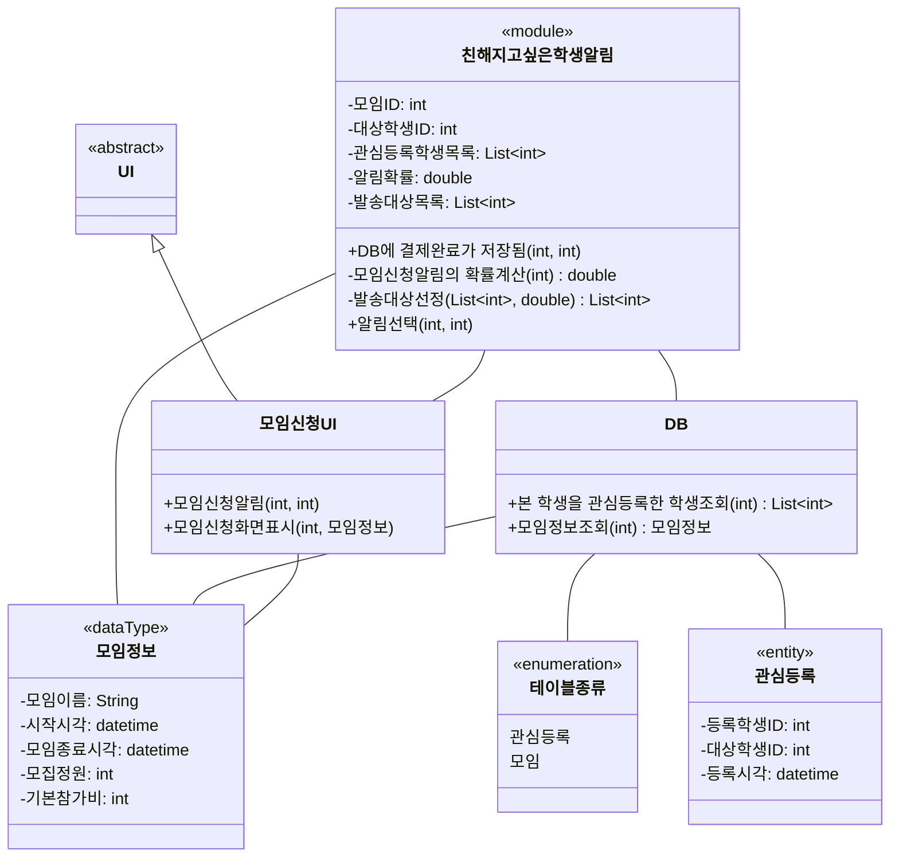

# 3. 클래스 다이어그램 (3번 발표용)

[2-sequence.md](2-sequence.md)에서 나온 클래스 8개다.

| 종류 | 클래스 | 어디서 나왔나 |
|---|---|---|
| 라이프라인 | 친해지고싶은학생알림 «module», DB, 모임신청UI | 시퀀스 라이프라인 (받는 메시지 = `+`, 자기 호출 = `-`) |
| 부모 클래스 | UI «abstract» | 모임신청UI의 부모. 다른 화면(현장운영UI 등)도 이걸 상속한다 |
| 타입 | 테이블종류 «enumeration» | DB가 가진 테이블. 이 시퀀스에서 쓰는 테이블만 적는다 (2번 → 관심등록, 7번 → 모임) |
| 타입 | 모임정보 «dataType» | 7번 반환·8번 매개변수. 모임 테이블의 칸도 보여 준다 |
| 저장 데이터 | 관심등록 «entity» | 2번이 조회하는 관심등록 테이블의 칸. DB에는 속성을 두지 않고 테이블의 칸을 엔티티 클래스로 그린다 |

- 연산 이름·매개변수·반환값은 시퀀스(원본 seq-03 메시지)와 똑같이 쓴다.
- 방향은 상속(빈 삼각형)에만 둔다. 나머지 관계는 화살표 없이 선만 긋는다 (FEEDBACK #11, 교수님 "상속 말고 방향 넣지 말라").
- 매개변수는 자료형만 적는다 (#16).
- DB는 하나로 두고, 어떤 테이블이 있는지는 테이블종류 enum으로 보인다. 값은 이 시퀀스에서 조회하는 테이블만 적었다. 신청 테이블은 1번 Found Message의 출처일 뿐이라 넣지 않았다. 연산은 원본 메시지 그대로라 테이블종류를 매개변수로 받지 않는다.
- DB 안의 데이터는 UML 엔티티 클래스 방식으로 그린다. DB에는 연산만 두고, 테이블의 칸은 엔티티 클래스의 속성으로 써서 DB와 선으로 잇는다. 관심등록 속성은 원본 [classes/InterestRegistrationDB.md](../../classes/InterestRegistrationDB.md) 설명("등록하는 학생 ID, 관심 대상으로 등록될 학생 ID, 등록 시각")을 따른다. 모임 테이블은 모임정보가 같은 역할을 한다.
- DB·모임신청UI는 다른 기능의 연산도 갖게 되지만, 이 그림에는 3번에서 쓰는 연산만 그렸다.
- 모임정보 속성은 신청 화면에 띄울 것만 적었다. 이름과 타입은 1번 모임공지등록의 입력값(모임이름, 시작시각, 모임종료시각, 모집정원, 기본참가비)을 따른다. 모임정보는 GLOSSARY에 아직 없다.
- 친해지고싶은학생알림 속성은 원본 클래스 파일([classes/CloseStudentNotification.md](../../classes/CloseStudentNotification.md))의 5개를 그대로 쓴다.

## 메시지 ↔ 연산 대조표

| 메시지 | 받는 클래스 | 연산 |
|---|---|---|
| 1 DB에 결제완료가 저장됨 | 친해지고싶은학생알림 | + DB에 결제완료가 저장됨(int, int) |
| 2 본 학생을 관심등록한 학생조회 | DB | + 본 학생을 관심등록한 학생조회(int): List<int> |
| 3 모임신청알림의 확률계산 | 친해지고싶은학생알림 (자기 호출) | - 모임신청알림의 확률계산(int): double |
| 4 발송대상선정 | 친해지고싶은학생알림 (자기 호출) | - 발송대상선정(List<int>, double): List<int> |
| 5 모임신청알림 | 모임신청UI | + 모임신청알림(int, int) |
| 6 알림선택 | 친해지고싶은학생알림 | + 알림선택(int, int) |
| 7 모임정보조회 | DB | + 모임정보조회(int): 모임정보 |
| 8 모임신청화면표시 | 모임신청UI | + 모임신청화면표시(int, 모임정보) |

메시지 8개 = 연산 8개, 클래스 8개.
