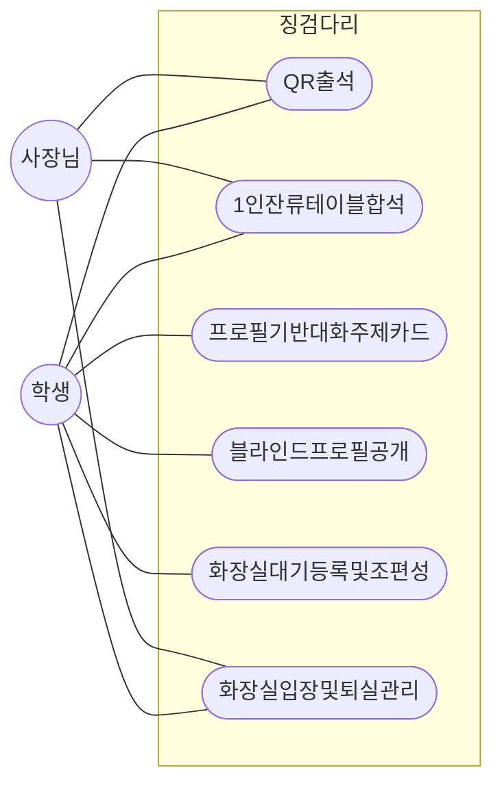

# 1. 유스케이스 다이어그램

기준: [usecase/usecase-v2.md](../../usecase/usecase-v2.md) (11/10 미팅 기준 초안, '시간' 액터 없음)

## ② 모임 현장 운영 단계 (발표용 메인)

8번이 어느 흐름 속에 있는지 보여 준다.

- 8번은 같은 테이블 출석 학생이 '정보 공개'를 누르면 시작한다 (사람). 액터 학생은 **정보 공개에 동의하고 공개된 프로필을 보는 학생**이다.
- 8번은 다른 유스케이스와 include/extend로 잇지 않는다 (usecase-v2.md include/extend 표).
