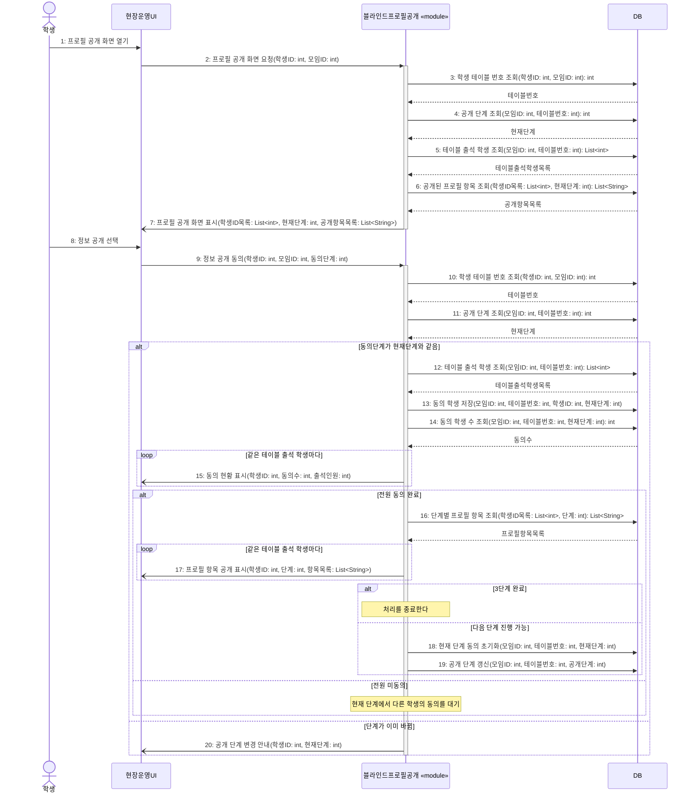

# 2. 시퀀스 다이어그램 v2 (8번 발표용, 검토용 초안)

[2-sequence.md](2-sequence.md)(v1)와 나란히 보며 고르기 위한 초안이다. 아직 3-class.md, staruml.js에는 반영하지 않았다.

v1에서 바꾼 것:

1. **액터를 넣는다.** 학생이 화면에서 하는 일부터 그린다.
2. **프로필 공개 화면을 여는 것부터 시작한다.** 화면을 열면 시스템이 같은 테이블 학생, 지금 공개 단계, 지금까지 공개된 항목을 내려 준다. 그래서 화면이 단계를 들고 있는 이유가 생긴다.
3. **테이블출석현황을 뺀다.** 모듈이 DB에 바로 출석 학생을 조회한다.
4. **테이블번호는 화면이 보내지 않는다.** 모듈이 DB에서 조회한다.
5. **단계는 화면이 "동의한 단계"로 보내고, 모듈이 DB의 지금 단계와 비교한다.** 학생이 보지 않은 단계에 동의한 것으로 저장되지 않게 한다.

### 1~7번: 프로필 공개 화면 열기

- 학생이 같은 테이블에 앉아 프로필 공개 화면을 연다. 화면은 로그인한 학생ID와 지금 들어와 있는 모임ID를 들고 있다가 2번에 넣어 보낸다.
- 3번은 DB의 배치 테이블에서 이 학생의 최종배치 테이블 번호를 조회한다 (req-08 Action 1 "배치DB에서 해당 테이블의 최종배치를 확인"). 원본 배치DB의 `학생테이블번호조회`를 재사용한다.
- 4번은 그 테이블의 지금 공개 단계를 조회한다. 공개 단계의 원본은 DB 하나뿐이다 (19번이 갱신하는 값). 처음에는 1단계다.
- 5번은 DB의 출석 테이블에서 같은 테이블 출석 학생 목록을 조회한다.
- 6번은 그 학생들의 프로필 사진과, 현재단계 전까지 공개된 항목(1단계 MBTI, 2단계 학과, 3단계 학번 중)을 조회한다.
- 7번으로 화면이 같은 테이블 학생, 지금 단계, 공개된 항목을 보여 준다. 화면은 이 현재단계를 들고 있다가 9번의 동의단계로 보낸다.

### 8~20번: 정보 공개 동의

- 9번의 동의단계는 학생이 화면에서 보고 동의한 단계다. 10~11번으로 DB에서 테이블번호와 지금 단계를 다시 조회해 비교한다. 화면이 보낸 값을 그대로 믿지 않는다.
- 단계가 같으면 v1과 같은 흐름이다. 12번 목록의 크기가 출석 인원이고, 동의 수가 출석 인원과 같으면 전원 동의다.
- 화면을 연 뒤 다른 학생들의 동의로 단계가 이미 넘어갔으면, 동의를 저장하지 않고 20번으로 바뀐 단계를 알린다. 학생은 바뀐 단계를 보고 다시 동의할 수 있다.
- 18~19번으로 현재 단계 동의가 초기화되고 공개 단계가 다음 단계로 갱신된다.

## v1과 달라진 점

| 위치 | v1 | v2 | 이유 |
|---|---|---|---|
| 액터 | 없음 (화면에서 시작) | 학생 → 화면 1번, 8번 | 누가 무엇을 해서 시작하는지 보이게 |
| 시작 | 정보 공개 동의부터 | 프로필 공개 화면 열기부터 (1~7번 추가) | 화면이 같은 테이블 학생과 단계를 어디서 받았는지 보이게 |
| 라이프라인 | 테이블출석현황 «module» | 없음 | 8번에서는 출석DB에 그대로 전달만 해서 하는 일이 없었다. 모듈이 DB에 바로 조회한다 |
| 정보 공개 동의 | (학생ID, 모임ID, 테이블번호, 현재단계) | (학생ID, 모임ID, 동의단계) | 테이블번호는 DB에서 조회한다. 단계는 "동의한 단계"로 받아 DB와 비교만 한다 |
| 단계 비교 alt (추가) | 없음 | 동의단계가 현재단계와 같음 / 단계가 이미 바뀜 | 학생이 보지 않은 단계에 동의한 것으로 저장되지 않게 |
| 추가 메시지 | | 공개 단계 조회, 공개된 프로필 항목 조회, 프로필 공개 화면 표시, 공개 단계 변경 안내 | 위 변경에 필요 |
| 메시지 수 | 10개 | 20개 | |

## 원본에 새로 필요한 것

- 배치DB(classes/ArrangementDB.md)에 없는 연산: `공개단계조회(모임ID, 테이블번호): int`
- 프로필DB(classes/ProfileDB.md)에 없는 연산: `공개된프로필항목조회(학생ID목록, 현재단계): List<String>`
- 현장운영UI(학생UI)에 없는 연산: `프로필공개화면표시`, `공개단계변경안내`
- 요구사항 req-08 Action 1의 시작 조건이 "'정보 공개'를 누르면"에서 "프로필 공개 화면을 열면"으로 바뀌고, 단계 비교의 else 동작이 생긴다. 원본까지 바꿀지는 담당(양수현)과 팀이 정한다.
- 테이블출석현황을 빼는 것은 발표용에서만 할지, 원본 seq-08까지 바꿀지 정해야 한다. 테이블출석현황은 다른 기능 12개도 쓰는 공통 객체다.

## 남은 고민

- 메시지가 20개라 발표 시간에 길 수 있다.
- 화면을 열 때(1~7번)와 동의할 때(8~20번) 모듈 실행이 두 번으로 나뉜다. 같은 학생이 한 화면에서 이어서 하는 동작이라 하나의 기능(유스케이스 하나)으로 본다.
- 화면을 열 때 동의 현황("4명 중 2명 동의")도 보여 줄지. 보여 주려면 1~7번 사이에 동의 학생 수 조회가 하나 더 필요하다.
