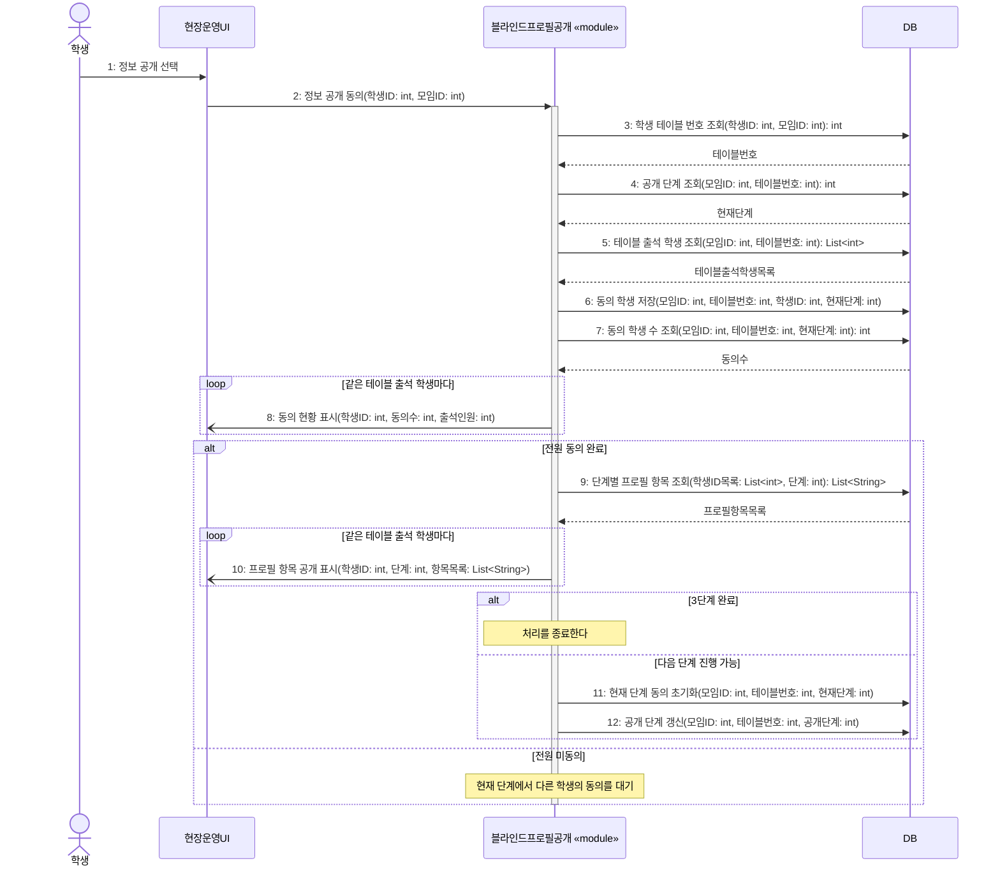

# 2. 시퀀스 다이어그램 v2 (8번 발표용, 검토용 초안)

[2-sequence.md](2-sequence.md)(v1)와 나란히 보며 고르기 위한 초안이다. 아직 3-class.md, staruml.js에는 반영하지 않았다.

v1에서 바꾼 것 세 가지:

1. **액터를 넣는다.** 학생이 화면의 '정보 공개'를 누르는 것부터 그린다.
2. **테이블출석현황을 뺀다.** 모듈이 DB에 바로 출석 학생을 조회한다.
3. **테이블번호·현재단계를 화면이 보내지 않는다.** 화면은 누가(학생ID), 어느 모임에서(모임ID) 눌렀는지만 보내고, 테이블번호와 공개 단계는 모듈이 DB에서 조회한다.

- 1번은 학생이 같은 테이블에 앉아 '정보 공개'를 누르는 것이다. 화면은 2번으로 모듈에 동의를 전달한다 (액터 → 화면 → 모듈 → DB).
- 3번은 DB의 배치 테이블에서 이 학생의 최종배치 테이블 번호를 조회한다 (req-08 Action 1 "배치DB에서 해당 테이블의 최종배치를 확인"). 원본 배치DB의 `학생테이블번호조회`를 재사용한다.
- 4번은 그 테이블의 지금 공개 단계를 조회한다. 공개 단계의 원본은 DB 하나뿐이다 (12번이 갱신하는 값). 처음에는 1단계다.
- 5번은 DB의 출석 테이블에서 같은 테이블 출석 학생 목록을 조회한다. 목록의 크기가 출석 인원이다.
- 6~7번은 현재 단계의 동의 학생을 저장하고 동의 수를 조회한다. 동의 수가 출석 인원과 같으면 전원 동의다.
- 9번의 프로필 항목은 1단계 MBTI, 2단계 학과, 3단계 학번 순이다.
- 11~12번으로 현재 단계 동의가 초기화되고 공개 단계가 다음 단계로 갱신된다.

## v1과 달라진 점

| 위치 | v1 | v2 | 이유 |
|---|---|---|---|
| 액터 | 없음 (화면에서 시작) | 학생 → 화면 1번 추가 | 누가 무엇을 해서 시작하는지 보이게 |
| 라이프라인 | 테이블출석현황 «module» | 없음 | 8번에서는 출석DB에 그대로 전달만 해서 하는 일이 없었다. 모듈이 DB에 바로 조회한다 |
| 정보 공개 동의 | (학생ID, 모임ID, 테이블번호, 현재단계) | (학생ID, 모임ID) | 테이블번호·공개 단계는 시스템이 DB에 저장하는 값이다. 화면이 보내면 값이 어긋나거나 조작될 수 있고, 화면이 어디서 받았는지도 없었다 |
| 3번, 4번 (추가) | 없음 | 학생 테이블 번호 조회, 공개 단계 조회 | 화면 대신 DB에서 조회한다 |
| 출석 학생 조회 | 2번 현황 → 3번 DB (2단계) | 5번 모듈 → DB (1단계) | 테이블출석현황을 빼서 |
| 메시지 수 | 10개 | 12개 | |

## 원본에 새로 필요한 것

- `공개 단계 조회(모임ID, 테이블번호): int`는 원본 배치DB(classes/ArrangementDB.md)에 없는 연산이다. 원본 seq-08에도 쓰려면 배치DB에 `공개단계조회`를 추가해야 한다.
- 테이블출석현황을 빼는 것은 발표용에서만 할지, 원본 seq-08까지 바꿀지 정해야 한다. 테이블출석현황은 다른 기능 12개도 쓰는 공통 객체다.
