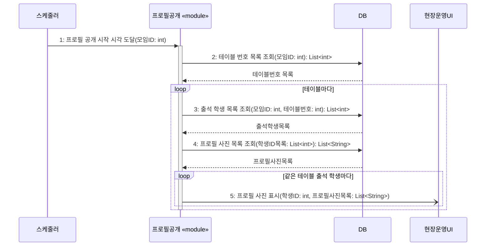

# 2. 시퀀스 다이어그램 v3 (8번 발표용, 검토용 초안)

v1(동의 방식), v2(화면 열기부터), v4(5분마다 자동 공개)와 비교하기 위한 초안이다. 요구사항은 시퀀스를 정한 뒤 마지막에 반영한다.

처음 v3는 8-a(스케줄러가 시작)와 8-b(학생이 다음 단계)를 두 장으로 그렸는데, **8-a만 남겼다.**

**v3 기능 정리**

- 정해진 시각이 되면 **스케줄러가 프로필 공개를 시작**한다.
- 모임의 테이블마다 출석한 학생을 조회해, **같은 테이블 출석 학생끼리** 서로의 프로필 사진을 보여 준다.
- 테이블출석현황 객체를 거치지 않고, 모듈이 DB에서 테이블 번호 목록과 테이블마다 출석 학생 목록을 바로 조회한다.

## 프로필 공개 시작 (스케줄러)

- 1번은 모임을 등록할 때 스케줄러에 등록해 둔 프로필 공개 시작 시각이 되면 온다 (PLAN-scheduler.md와 같은 방식). 시각을 언제로 할지(예: 모임 시작 10분 후, 출석 가능 시간이 끝날 때)는 정해야 한다.
- 2번은 DB의 배치 테이블에서 그 모임의 테이블 번호 목록을 조회한다.
- 3번은 2번 목록의 테이블마다 DB의 출석 테이블에서 그 테이블에 출석한 학생 목록을 조회한다. 배정됐지만 오지 않은 학생은 빠진다.
- 4번은 그 테이블 출석 학생들의 프로필 사진을 조회한다.
- 5번은 같은 테이블 출석 학생에게만 보낸다. 다른 테이블 학생의 프로필은 보이지 않는다.

## v1과 달라진 점

| 위치 | v1 | v3 |
|---|---|---|
| 시작 | 학생이 정보 공개 동의를 누름 (학생UI) | 스케줄러가 시작 시각을 알림 |
| 대상 | 누른 학생의 테이블 하나 | 모임의 모든 테이블 (loop) |
| 테이블출석현황 | 출석DB에 그대로 전달만 함 | 없음. 모듈이 DB에 바로 조회 |
| 동의 관련 메시지 | 정보공개동의, 동의학생저장, 동의학생수조회, 동의현황표시, 동의상태변경, 공개단계갱신 | 없음 |
| 메시지 수 | 10개 | 5개 |

## 새로 필요한 것

- 스케줄러: 모임을 등록할 때 프로필 공개 시작 시각을 등록한다 (1번 모임공지등록 쪽)
- 연산: `프로필 공개 시작 시각 도달`, `테이블 번호 목록 조회`, `출석 학생 목록 조회`, `프로필 사진 목록 조회`, `프로필 사진 표시`
  - 원본 배치DB에 `테이블목록조회(모임ID): List<int>`, 출석DB에 `테이블출석조회(모임ID, 테이블번호): List<int>`가 있어 같은 일을 한다. 원본에 반영할 때 이름을 맞출지 정한다.

## 남은 고민

- 사진만 보여 주고 끝난다. MBTI·학과·학번을 어떻게 공개할지(v1 동의, v4 5분마다 자동 등)는 이 그림에 없다.
- 프로필 공개 시작 시각을 언제로 할지.
