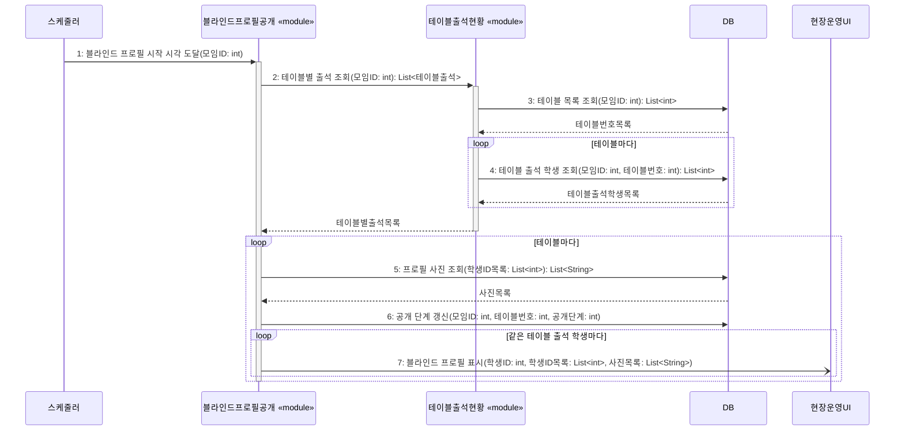
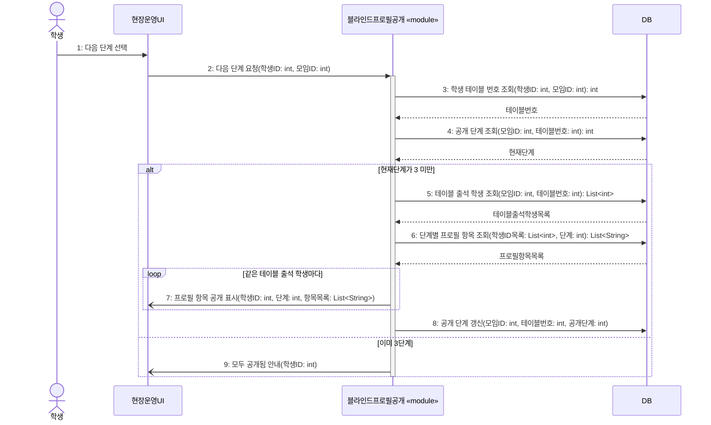

# 2. 시퀀스 다이어그램 v3 (8번 발표용, 검토용 초안)

v1(동의 방식), v2(화면 열기부터)와 비교하기 위한 초안이다. 요구사항은 시퀀스를 정한 뒤 마지막에 반영한다.

**v3 기능 정리**

- 정해진 시각이 되면 **스케줄러가 블라인드 프로필을 시작**한다. 테이블마다 같은 테이블 출석 학생들의 **프로필 사진만** 보여 준다 (8-a).
- 그 뒤 MBTI → 학과 → 학번은 **학생이 "다음 단계"를 눌러야** 공개된다. 같은 테이블에서 **한 명만 눌러도 그 테이블만** 다음 단계로 넘어간다 (8-b).
- 동의를 모으지 않는다. 한 명이 거절해서 아무것도 안 열리는 상황이 없다.
- 공개를 원하지 않는 항목은 학생이 모임 전에 프로필 설정에서 "비공개"로 해 둔다. 공개할 때 비공개 항목은 빼고 보여 준다.

시작 조건이 두 개(스케줄러, 학생)라 시퀀스를 두 장으로 그린다.

## 8-a 블라인드 프로필 시작 (스케줄러)

- 1번은 모임을 등록할 때 스케줄러에 등록해 둔 블라인드 프로필 시작 시각이 되면 온다 (PLAN-scheduler.md와 같은 방식). 시각을 언제로 할지(예: 모임 시작 10분 후, 출석 가능 시간이 끝날 때)는 정해야 한다.
- 2~4번에서 테이블출석현황이 배치 테이블(테이블 목록)과 출석 테이블(테이블마다 출석 학생)을 합쳐 **테이블별 출석 학생**을 만든다. 배정됐지만 오지 않은 학생은 빠진다. `테이블 별 출석 조회`는 6번 1인잔류테이블합석도 쓰는 연산이다.
- 2번의 반환 `테이블출석`은 테이블번호와 그 테이블 출석 학생ID목록을 묶은 «dataType»이다 (새로 필요).
- 6번은 테이블마다 공개 단계를 0(사진만 공개)으로 저장한다.
- 7번으로 같은 테이블 학생들의 사진이 그 테이블 학생에게만 보인다.

## 8-b 다음 단계 공개 (학생)

- 화면은 로그인한 학생ID와 지금 들어와 있는 모임ID만 보낸다. 테이블번호와 공개 단계는 3~4번으로 DB에서 조회한다.
- 3번은 원본 배치DB의 `학생테이블번호조회`를 재사용한다.
- 4번에서 조회한 공개 단계는 **그 테이블의 값**이다. 다른 테이블은 영향받지 않는다.
- 6번은 현재단계 + 1 단계의 항목(1단계 MBTI, 2단계 학과, 3단계 학번)을 조회한다. 학생이 비공개로 설정한 항목은 빼고 돌려준다.
- 7번은 그 테이블 출석 학생에게만 보낸다. 8번으로 그 테이블의 공개 단계만 현재단계 + 1로 갱신한다.
- 5번은 테이블 하나의 출석 학생이라 DB에 바로 조회한다. 테이블출석현황은 여러 테이블을 합쳐 묶어야 하는 8-a에서만 쓴다.

## v1과 달라진 점

| 위치 | v1 | v3 |
|---|---|---|
| 기능 | 같은 테이블 전원이 동의해야 다음 단계 공개 | 시각이 되면 사진 공개로 시작, 그 뒤 한 명이라도 누르면 그 테이블만 다음 단계 |
| 시퀀스 | 1장 (학생UI에서 시작) | 2장: 8-a 스케줄러 시작, 8-b 학생 액터 시작 |
| 동의 관련 메시지 | 정보공개동의, 동의학생저장, 동의학생수조회, 동의현황표시, 동의상태변경 | 모두 없음 |
| 테이블출석현황 | 출석DB에 그대로 전달만 함 | 8-a에서 배치와 출석을 합쳐 테이블별로 묶음 |
| 화면이 보내는 값 | 학생ID, 모임ID, 테이블번호, 현재단계 | 학생ID, 모임ID |
| 메시지 수 | 10개 | 8-a 7개, 8-b 9개 |

## 새로 필요한 것

- 스케줄러: 모임을 등록할 때 블라인드 프로필 시작 시각을 등록한다 (1번 모임공지등록 쪽)
- 연산: `블라인드 프로필 시작 시각 도달`, `테이블별 출석 조회`의 반환 타입 변경(`List<테이블출석>`), `프로필 사진 조회`, `블라인드 프로필 표시`, `다음 단계 요청`, `공개 단계 조회`, `모두 공개됨 안내`
- «dataType» `테이블출석` (테이블번호, 학생ID목록)
- 프로필 설정의 항목별 비공개 여부 (ASSUMED-FEATURES '프로필 등록'에 추가)

## 남은 고민

- 같은 테이블에서 두 명이 거의 동시에 "다음 단계"를 누르면 두 단계가 한 번에 넘어갈 수 있다. 8번 갱신을 "현재단계일 때만 + 1"로 하거나, 누른 학생의 화면 단계를 같이 보내 비교하는 방법이 있다.
- 블라인드 프로필 시작 시각을 언제로 할지.
- 테이블에 배정되지 않았거나 출석하지 않은 학생이 "다음 단계"를 누르는 경우는 그리지 않았다 (화면에 버튼이 보이지 않는다고 본다).
