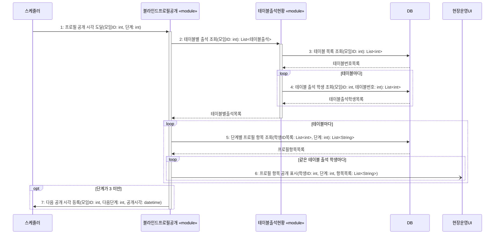

# 2. 시퀀스 다이어그램 v4 (8번 발표용, 검토용 초안)

v1(동의 방식), v2(화면 열기부터), v3(버튼으로 다음 단계)와 비교하기 위한 초안이다. 요구사항은 시퀀스를 정한 뒤 마지막에 반영한다.

**v4 기능 정리**

- 정해진 시각이 되면 **스케줄러가 블라인드 프로필을 시작**한다. 테이블마다 같은 테이블 출석 학생들의 **프로필 사진**만 보여 준다 (0단계).
- 그 뒤 **5분마다 자동으로** 다음 단계가 열린다: 1단계 MBTI → 2단계 학과 → 3단계 학번.
- 버튼도 동의도 없다. 누가 거절해서 분위기가 깨지는 상황이 없다.
- 학생은 모임 전에 프로필 설정에서 공개하지 않을 항목을 **"비공개"**로 정해 둔다. 공개할 때 비공개 항목은 빼고 보여 준다. 학생이 무엇을 공개할지는 스스로 정하는 셈이다.

시작 조건이 스케줄러 하나라 시퀀스는 한 장이다.

- 1번은 스케줄러가 공개 시각이 되었다고 알리는 메시지다. 첫 번째(0단계, 사진) 시각은 모임을 등록할 때 스케줄러에 등록한다 (PLAN-scheduler.md와 같은 방식). 그 뒤의 시각은 7번이 등록한다.
- 2~4번에서 테이블출석현황이 배치 테이블(테이블 목록)과 출석 테이블(테이블마다 출석 학생)을 합쳐 **테이블별 출석 학생**을 만든다. 배정됐지만 오지 않은 학생은 빠진다. 공개할 때마다 다시 조회하므로 늦게 온 학생도 다음 공개부터 포함된다.
- 2번의 반환 `테이블출석`은 테이블번호와 그 테이블 출석 학생ID목록을 묶은 «dataType»이다 (새로 필요). `테이블별 출석 조회`는 6번 1인잔류테이블합석도 쓰는 연산이다.
- 5번은 단계에 맞는 항목을 조회한다: 0단계 프로필 사진, 1단계 MBTI, 2단계 학과, 3단계 학번. 학생이 비공개로 설정한 항목은 빼고 돌려준다.
- 6번은 같은 테이블 출석 학생에게만 보낸다. 다른 테이블 학생의 프로필은 보이지 않는다.
- 7번은 3단계(학번)가 아니면 다음 단계를 공개 간격(5분) 뒤로 스케줄러에 등록한다. 공개시각 = 지금 시각 + 5분. 공개 간격 5분은 시스템 상수다.
- 모든 테이블이 같은 시각에 같은 단계로 공개되므로 테이블마다 공개 단계를 저장하지 않는다.

## 다른 버전과 비교

| | v1 동의 | v3 버튼 | v4 자동 |
|---|---|---|---|
| 다음 단계로 넘어가는 조건 | 같은 테이블 전원 동의 | 같은 테이블에서 한 명이 누름 | 5분 지남 |
| 학생이 하는 일 | 동의 누르기 | 다음 단계 누르기 | 모임 전에 비공개 항목 설정 |
| 분위기 | 한 명이 안 누르면 멈춤 | 거절 없음 | 거절 없음 |
| 시퀀스 | 1장 | 2장 (스케줄러 시작, 학생 다음 단계) | 1장 |
| 메시지 수 | 10개 | 7개 + 9개 | 7개 |
| 테이블출석현황 | 출석DB에 전달만 함 | 시작(8-a)에서 테이블별로 묶음 | 테이블별로 묶음 |
| 테이블별 공개 단계 저장 | 필요 | 필요 | 필요 없음 |
| 남는 고민 | 화면이 보내는 단계·테이블번호 | 동시에 누름 | 학생이 받기만 함, 테이블별 속도 차이 없음 |

## 새로 필요한 것

- 스케줄러: 모임을 등록할 때 블라인드 프로필 시작(0단계) 시각을 등록한다 (1번 모임공지등록 쪽). 시작 시각을 언제로 할지(예: 모임 시작 10분 후) 정해야 한다.
- 스케줄러가 메시지(7번 다음 공개 시각 등록)를 받으므로 클래스 그림에 스케줄러를 넣을지 정해야 한다 (RULES.md 6장 "아직 정하지 않은 것").
- 연산: `프로필 공개 시각 도달`, `테이블별 출석 조회`의 반환 타입 변경(`List<테이블출석>`), `다음 공개 시각 등록`
- «dataType» `테이블출석` (테이블번호, 학생ID목록)
- 상수: 공개 간격 5분
- 프로필 설정의 항목별 비공개 여부 (ASSUMED-FEATURES '프로필 등록'에 추가)
- v1의 동의 관련 연산(정보공개동의, 동의학생저장, 동의학생수조회, 동의현황표시, 동의상태변경, 공개단계갱신)은 쓰지 않는다
