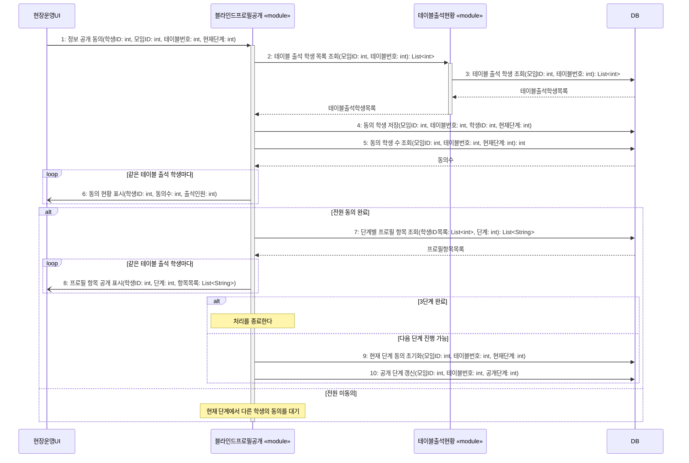

# 2. 시퀀스 다이어그램 (8번 발표용)

원본: [sequence/seq-08.md](../../sequence/seq-08.md) (양수현, e062d67). 흐름(시작 방식, alt/loop 구조)과 메시지의 매개변수·반환값은 원본 그대로 쓴다. [RULES.md](../RULES.md)대로 라이프라인을 바꾸고, 메소드명은 보는 사람이 읽기 편하게 공백을 넣고 직관적이지 않은 이름 2개(3번, 9번)를 바꿨다. 메시지는 10개다.

- 1번은 같은 테이블 출석 학생이 '정보 공개'를 누를 때 시작한다 (사람 → 화면).
- 2번 테이블 출석 학생 목록 조회는 공통 객체 테이블출석현황의 연산을 재사용한다. 목록의 크기가 출석 인원이다.
- 3번은 DB의 출석 테이블, 4·5·9·10번은 배치 테이블, 7번은 프로필 테이블을 쓴다.
- 4~5번은 현재 단계의 동의 학생을 저장하고 동의 수를 조회한다. 동의 수가 출석 인원과 같으면 전원 동의다.
- 7번의 프로필 항목은 1단계 MBTI, 2단계 학과, 3단계 학번 순이다.
- 9~10번으로 현재 단계 동의가 초기화되고 공개 단계가 다음 단계로 갱신된다.

## 원본과 달라진 점

| 위치 | 원본 (seq-08) | 발표용 | 이유 |
|---|---|---|---|
| 라이프라인 | 블라인드프로필공개 | 블라인드프로필공개 «module» | 이름은 원본 그대로 두고, UI·DB가 아닌 처리 담당 객체(모듈)임을 스테레오타입으로 표시한다 |
| 라이프라인 | 테이블출석현황 | 테이블출석현황 «module» | 여러 기능이 같이 쓰는 공통 객체도 처리 담당 객체라 같은 표시를 한다 |
| 라이프라인 | 학생UI | 현장운영UI | 8번은 ② 모임 현장 운영 단계라 그 단계의 화면으로 나눈다 (#24) |
| 라이프라인 | 배치DB, 출석DB, 프로필DB | DB | DB는 하나로 합친다. 테이블은 클래스 그림의 테이블종류 enum으로 보인다 |
| 메소드명 전체 | 공백 없음 (예: 동의학생수조회) | 공백 넣음 (예: 동의 학생 수 조회) | 보는 사람이 읽기 편하게 (RULES 0장). 매개변수·반환값은 그대로 |
| 3번 | 테이블출석조회 | 테이블 출석 학생 조회 | 출석 여부가 아니라 학생 목록을 돌려준다는 것이 이름에 보이게 |
| 9번 | 동의상태변경 | 현재 단계 동의 초기화 | 실제로 하는 일(초기화)이 이름에 보이게. 그래서 원본의 노트 "9번은 현재 단계의 동의를 초기화한다"는 뺐다 |
