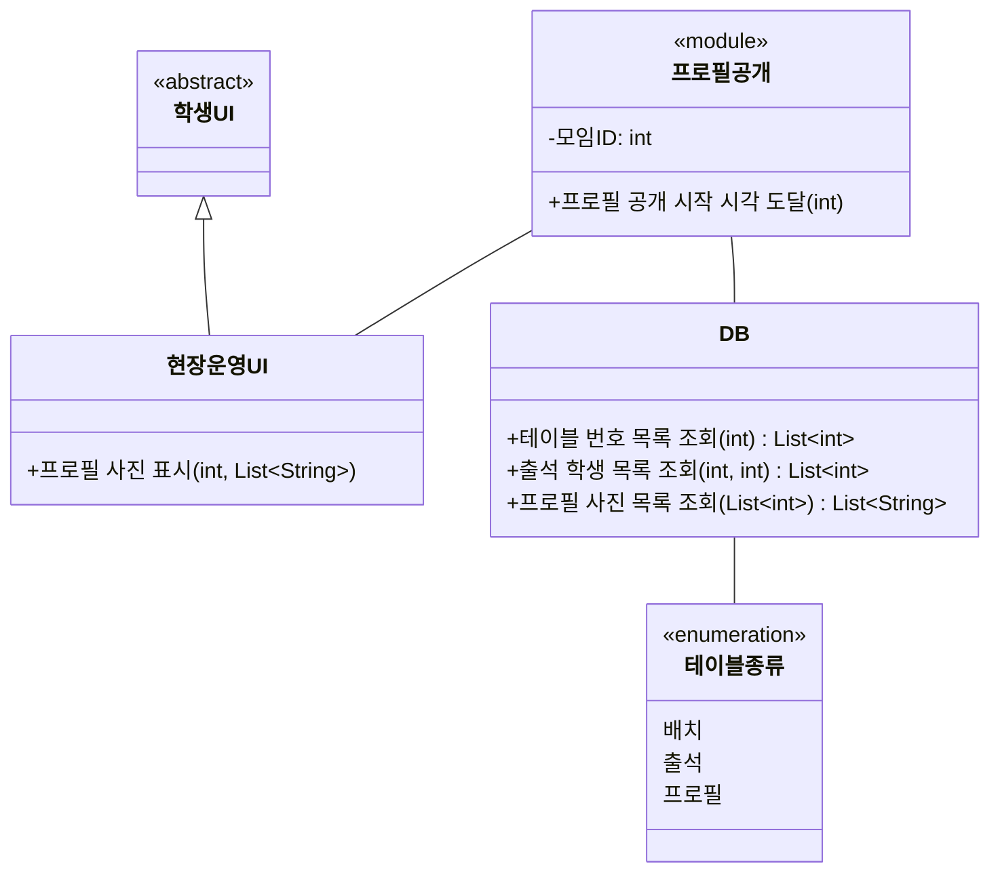

# 3. 클래스 다이어그램 v3 (8번 발표용, 검토용 초안)

[2-sequence-v3.md](2-sequence-v3.md)에서 나온 클래스 5개다.

| 종류 | 클래스 | 어디서 나왔나 |
|---|---|---|
| 라이프라인 | 프로필공개 «module» (담당 객체), DB, 현장운영UI | 시퀀스 라이프라인 (받는 메시지 = `+`) |
| 부모 클래스 | 학생UI «abstract» | 현장운영UI의 부모. 원본 학생UI를 단계별 화면으로 나누고, 학생이 보는 화면(모임신청UI 등)이 모두 이걸 상속한다 |
| 타입 | 테이블종류 «enumeration» | DB가 가진 테이블. 이 시퀀스에서 쓰는 테이블만 적는다 (2번 → 배치, 3번 → 출석, 4번 → 프로필) |

- 연산 이름·매개변수·반환값은 발표용 시퀀스 v3 메시지와 똑같이 쓴다 (공백 포함). 매개변수는 자료형만 적는다 (#16).
- 방향은 상속(빈 삼각형)에만 둔다. 나머지 관계는 화살표 없이 선만 긋는다.
- 스케줄러는 1번 메시지를 보내기만 하고 받는 메시지가 없어 연산이 없다. Found Message·시간 액터처럼 클래스로 그리지 않는다 (CONVENTIONS 6.1).
- DB는 하나로 두고 테이블은 테이블종류 enum으로 보인다. DB에는 속성을 쓰지 않는다.
- DB·현장운영UI는 다른 기능의 연산도 갖지만, 이 그림에는 8번 v3에서 쓰는 연산만 그렸다.
- 매개변수·반환에 «dataType»이 없다 (int, List<int>, List<String>만 쓴다).

### 프로필공개 속성 (원본과 다름)

RULES는 담당 객체 속성을 원본 클래스 파일 그대로 쓰라고 하지만, v3는 처리 방식이 바뀌어 원본 속성 두 개가 맞지 않는다.

| 원본 속성 (classes/BlindProfileDisclosure.md) | v3 | 이유 |
|---|---|---|
| 모임ID: int | 그대로 | 처리 중인 모임 |
| 테이블번호: int | 뺌 | 테이블 하나가 아니라 모임의 모든 테이블을 loop로 돈다 |
| 현재단계: int | 뺌 | 단계 없이 사진만 공개한다 |

## 메시지 ↔ 연산 대조표

| 메시지 | 받는 클래스 | 연산 |
|---|---|---|
| 1 프로필 공개 시작 시각 도달 | 프로필공개 | + 프로필 공개 시작 시각 도달(int) |
| 2 테이블 번호 목록 조회 | DB | + 테이블 번호 목록 조회(int): List<int> |
| 3 출석 학생 목록 조회 | DB | + 출석 학생 목록 조회(int, int): List<int> |
| 4 프로필 사진 목록 조회 | DB | + 프로필 사진 목록 조회(List<int>): List<String> |
| 5 프로필 사진 표시 | 현장운영UI | + 프로필 사진 표시(int, List<String>) |

메시지 5개 = 연산 5개, 클래스 5개.
