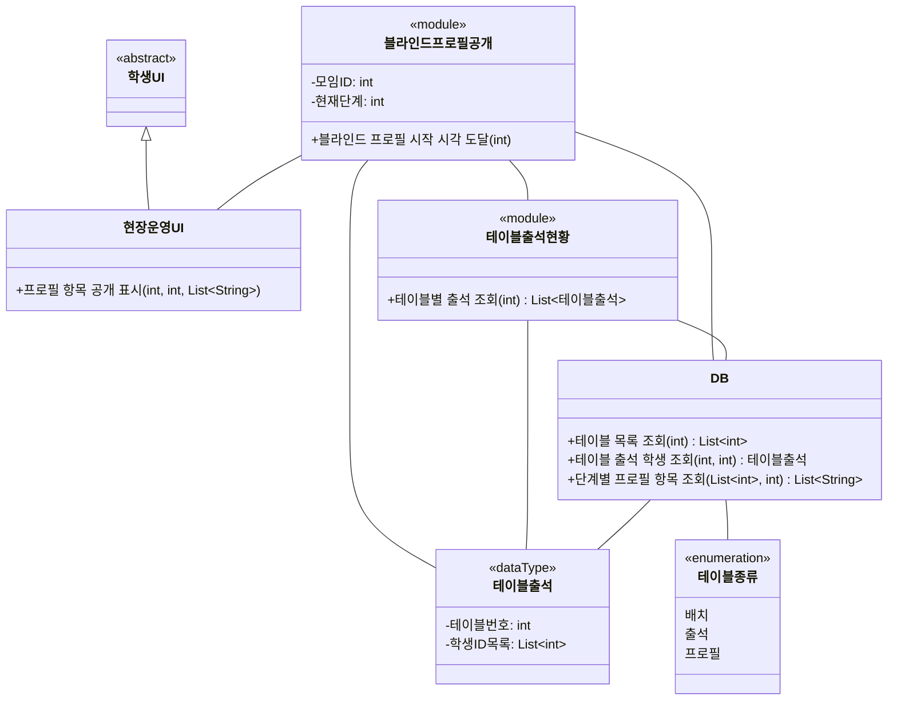

# 3. 클래스 다이어그램 v4 (8번 발표용, 검토용 초안)

[2-sequence-v4.md](2-sequence-v4.md)에서 나온 클래스 7개다. v1 시퀀스의 클래스는 [3-class.md](3-class.md)에 있다.

| 종류 | 클래스 | 어디서 나왔나 |
|---|---|---|
| 라이프라인 | 블라인드프로필공개 «module» (담당 객체), 테이블출석현황 «module» (공통 객체), DB, 현장운영UI | 시퀀스 라이프라인 (받는 메시지 = `+`) |
| 부모 클래스 | 학생UI «abstract» | 현장운영UI의 부모. 원본 학생UI를 단계별 화면으로 나누고, 학생이 보는 화면(모임신청UI 등)이 모두 이걸 상속한다 |
| 타입 | 테이블종류 «enumeration» | DB가 가진 테이블. 이 시퀀스에서 쓰는 테이블만 적는다 (3번 → 배치, 4번 → 출석, 5번 → 프로필) |
| 타입 | 테이블출석 «dataType» | 4번 반환, 2번 반환(List). 테이블번호와 그 테이블 출석 학생ID목록을 묶는다 |

- 연산 이름·매개변수·반환값은 발표용 시퀀스 v4 메시지와 똑같이 쓴다 (공백 포함). 매개변수는 자료형만 적는다 (#16).
- 방향은 상속(빈 삼각형)에만 둔다. 나머지 관계는 화살표 없이 선만 긋는다.
- 스케줄러는 1번 메시지를 보내기만 하고 받는 메시지가 없어 연산이 없다. Found Message·시간 액터처럼 클래스로 그리지 않는다 (CONVENTIONS 6.1).
- 테이블출석 «dataType»은 테이블출석현황이 만들어 돌려주고(2번 반환), 블라인드프로필공개가 받아 테이블마다 꺼내 쓴다. DB는 테이블 하나의 테이블출석을 돌려준다(4번 반환). 그래서 세 클래스와 선으로 잇는다.
- DB는 하나로 두고 테이블은 테이블종류 enum으로 보인다. DB에는 속성을 쓰지 않는다.
- DB·현장운영UI·테이블출석현황은 다른 기능의 연산도 갖지만, 이 그림에는 8번 v4에서 쓰는 연산만 그렸다.

### 블라인드프로필공개 속성 (원본과 다름)

RULES는 담당 객체 속성을 원본 클래스 파일 그대로 쓰라고 하지만, v4는 처리 방식이 바뀌어 원본 속성 하나가 맞지 않는다.

| 원본 속성 | v4 | 이유 |
|---|---|---|
| 모임ID: int | 그대로 | 처리 중인 모임 |
| 테이블번호: int | 뺌 | v4는 테이블 하나가 아니라 모임의 모든 테이블을 loop로 돈다 |
| 현재단계: int | 그대로 | loop에서 지금 공개 중인 단계 (1~3) |

## 메시지 ↔ 연산 대조표

| 메시지 | 받는 클래스 | 연산 |
|---|---|---|
| 1 블라인드 프로필 시작 시각 도달 | 블라인드프로필공개 | + 블라인드 프로필 시작 시각 도달(int) |
| 2 테이블별 출석 조회 | 테이블출석현황 | + 테이블별 출석 조회(int): List<테이블출석> |
| 3 테이블 목록 조회 | DB | + 테이블 목록 조회(int): List<int> |
| 4 테이블 출석 학생 조회 | DB | + 테이블 출석 학생 조회(int, int): 테이블출석 |
| 5 단계별 프로필 항목 조회 | DB | + 단계별 프로필 항목 조회(List<int>, int): List<String> |
| 6 프로필 항목 공개 표시 | 현장운영UI | + 프로필 항목 공개 표시(int, int, List<String>) |

메시지 6개 = 연산 6개, 클래스 7개.

## v1 클래스와 달라진 점

| | v1 ([3-class.md](3-class.md)) | v4 |
|---|---|---|
| 블라인드프로필공개 연산 | 정보 공개 동의 | 블라인드 프로필 시작 시각 도달 |
| 테이블출석현황 연산 | 테이블 출석 학생 목록 조회 (전달만) | 테이블별 출석 조회 (배치 + 출석을 합쳐 테이블별로 묶음) |
| DB 연산 | 6개 (동의 저장·조회·초기화, 공개 단계 갱신 등) | 3개 |
| 현장운영UI 연산 | 동의 현황 표시, 프로필 항목 공개 표시 | 프로필 항목 공개 표시 |
| 새 클래스 | | 테이블출석 «dataType» |
| 클래스 수 | 6개 | 7개 |
