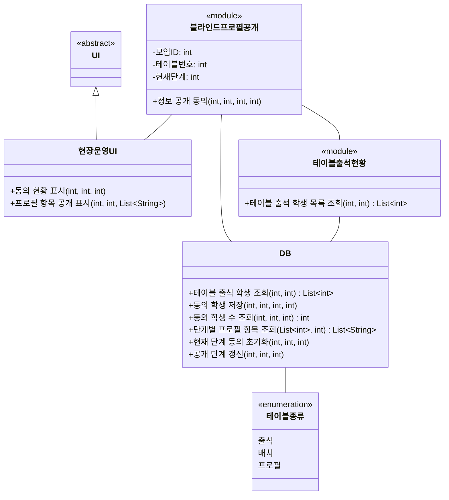

# 3. 클래스 다이어그램 (8번 발표용)

[2-sequence.md](2-sequence.md)에서 나온 클래스 6개다.

| 종류 | 클래스 | 어디서 나왔나 |
|---|---|---|
| 라이프라인 | 블라인드프로필공개 «module» (담당 객체), 테이블출석현황 «module» (공통 객체), DB, 현장운영UI | 시퀀스 라이프라인 (받는 메시지 = `+`) |
| 부모 클래스 | UI «abstract» | 현장운영UI의 부모. 다른 화면(모임신청UI 등)도 이걸 상속한다 |
| 타입 | 테이블종류 «enumeration» | DB가 가진 테이블. 이 시퀀스에서 쓰는 테이블만 적는다 (3번 → 출석, 4·5·9·10번 → 배치, 7번 → 프로필) |

- 연산 이름·매개변수·반환값은 발표용 시퀀스 메시지와 똑같이 쓴다 (공백 포함).
- 방향은 상속(빈 삼각형)에만 둔다. 나머지 관계는 화살표 없이 선만 긋는다 (FEEDBACK #11, 교수님 "상속 말고 방향 넣지 말라").
- 매개변수는 자료형만 적는다 (#16).
- DB는 하나로 두고, 어떤 테이블이 있는지는 테이블종류 enum으로 보인다. 연산은 원본 메시지 그대로라 테이블종류를 매개변수로 받지 않는다. DB에는 속성을 쓰지 않는다.
- 테이블출석현황은 여러 기능이 같이 쓰는 공통 객체다. 처리 담당 객체라 담당 객체처럼 «module»을 붙인다. 다른 기능의 연산도 있지만 8번에서 쓰는 연산만 그렸다. 원본 클래스 파일에 속성이 없다.
- DB·현장운영UI도 다른 기능의 연산을 갖게 되지만, 이 그림에는 8번에서 쓰는 연산만 그렸다.
- 블라인드프로필공개 속성은 원본 클래스 파일([classes/BlindProfileDisclosure.md](../../classes/BlindProfileDisclosure.md))의 3개를 그대로 쓴다.
- 매개변수·반환에 «dataType»이 없다 (int, List<int>, List<String>만 쓴다).

## 메시지 ↔ 연산 대조표

| 메시지 | 받는 클래스 | 연산 |
|---|---|---|
| 1 정보 공개 동의 | 블라인드프로필공개 | + 정보 공개 동의(int, int, int, int) |
| 2 테이블 출석 학생 목록 조회 | 테이블출석현황 | + 테이블 출석 학생 목록 조회(int, int): List<int> |
| 3 테이블 출석 학생 조회 | DB | + 테이블 출석 학생 조회(int, int): List<int> |
| 4 동의 학생 저장 | DB | + 동의 학생 저장(int, int, int, int) |
| 5 동의 학생 수 조회 | DB | + 동의 학생 수 조회(int, int, int): int |
| 6 동의 현황 표시 | 현장운영UI | + 동의 현황 표시(int, int, int) |
| 7 단계별 프로필 항목 조회 | DB | + 단계별 프로필 항목 조회(List<int>, int): List<String> |
| 8 프로필 항목 공개 표시 | 현장운영UI | + 프로필 항목 공개 표시(int, int, List<String>) |
| 9 현재 단계 동의 초기화 | DB | + 현재 단계 동의 초기화(int, int, int) |
| 10 공개 단계 갱신 | DB | + 공개 단계 갱신(int, int, int) |

메시지 10개 = 연산 10개, 클래스 6개.
