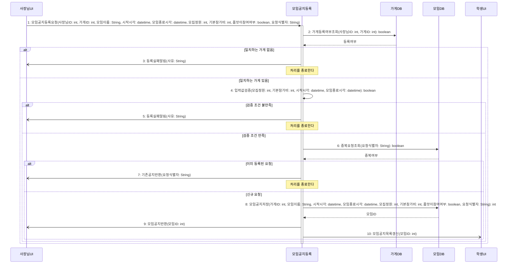

# seq-01 모임공지등록

## 참여 객체

| 객체 | 종류 | 클래스 파일 |
|---|---|---|
| 모임공지등록 | 담당 객체 | classes/MeetingNoticeRegistration.md |
| 가게DB | DB | classes/StoreDB.md |
| 모임DB | DB | classes/MeetingDB.md |
| 사장님UI | UI | classes/OwnerUI.md |
| 학생UI | UI | classes/StudentUI.md |

시작 방식: **사람이 누름** (사장님이 '모임공지등록'을 선택) → `사장님UI`

## 다이어그램

## 메시지 ↔ Action 대응표

| 메시지 | Action |
|---|---|
| 1 | 1 |
| 2~3 | 2 |
| 4~5 | 3, 4, 5, 6 |
| 6~7 | 7 |
| 8 | 8 |
| 9~10 | 9 |

## 메모

- 4번 입력값검증은 정원 12명 이상 4의 배수, 기본참가비 0원 초과, 종료 시각이 시작 시각보다 늦음, 신청 마감 시각(전날 18:00)이 현재보다 늦음을 종합 검증한다.
- 8번 모임공지저장 시 모임 상태는 '모집중'으로 기본 설정된다.

