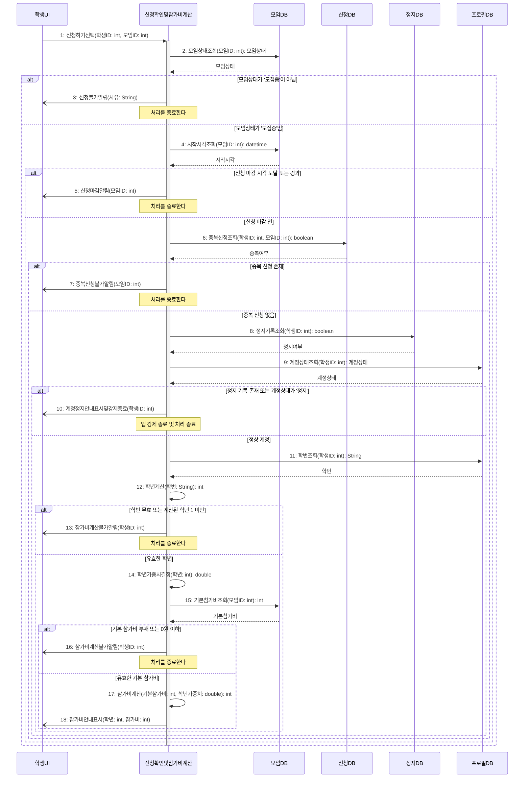

# seq-02-1 신청확인및참가비계산

## 참여 객체

| 객체 | 종류 | 클래스 파일 |
|---|---|---|
| 신청확인및참가비계산 | 담당 객체 | classes/ApplicationCheckAndFeeCalc.md |
| 모임DB | DB | classes/MeetingDB.md |
| 신청DB | DB | classes/ApplicationDB.md |
| 정지DB | DB | classes/SuspensionDB.md |
| 프로필DB | DB | classes/ProfileDB.md |
| 학생UI | UI | classes/StudentUI.md |

시작 방식: **사람이 누름** (학생이 모임 공지에서 '신청하기' 선택) → `학생UI`

## 다이어그램

## 메시지 ↔ Action 대응표

| 메시지 | Action |
|---|---|
| 1 | 1 |
| 2~3 | 2 |
| 4~5 | 3 |
| 6~7 | 4 |
| 8~10 | 5 |
| 11~13 | 6, 7 |
| 14 | 8 |
| 15~16 | 9 |
| 17~18 | 10 |

## 메모

- 4번의 신청 마감 시각은 모임 시작 시각의 전날 18:00으로 산출된다.
- 12번 학년계산은 학번 앞 네 자리(입학 연도)를 현재 연도와 비교하여 계산한다.
- 14번 학년가중치는 1~2학년 1.0, 3학년 1.1, 4학년 이상 1.2로 설정된다.

