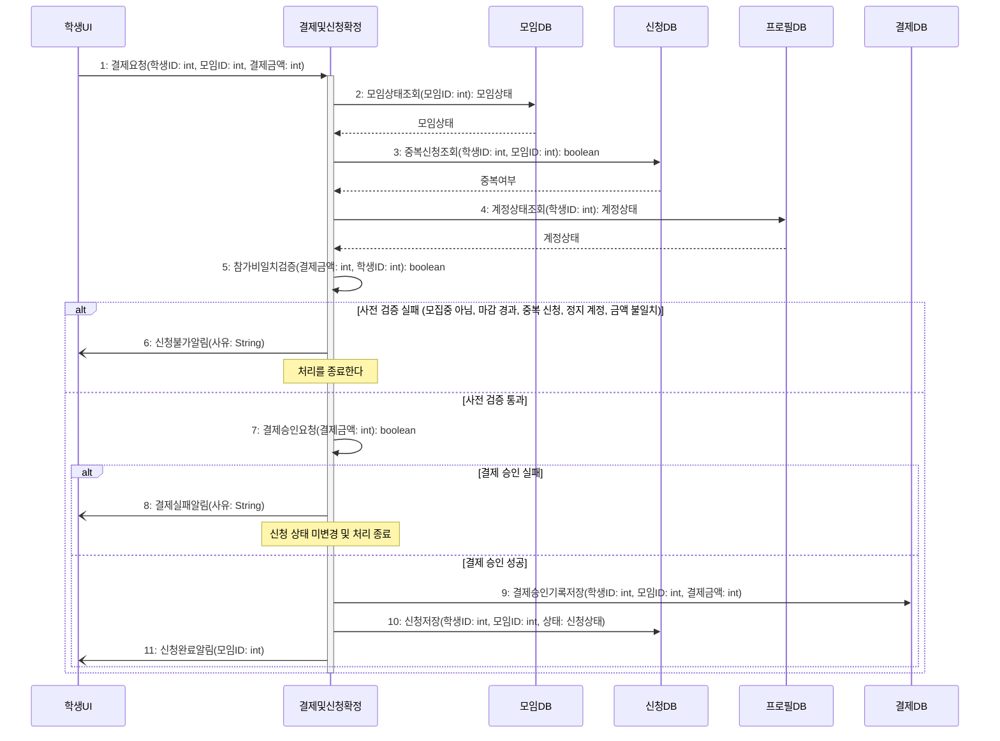

# seq-02-2 결제및신청확정

## 참여 객체

| 객체 | 종류 | 클래스 파일 |
|---|---|---|
| 결제및신청확정 | 담당 객체 | classes/PaymentAndApplicationConfirm.md |
| 모임DB | DB | classes/MeetingDB.md |
| 신청DB | DB | classes/ApplicationDB.md |
| 프로필DB | DB | classes/ProfileDB.md |
| 결제DB | DB | classes/PaymentDB.md |
| 학생UI | UI | classes/StudentUI.md |

시작 방식: **사람이 누름** (학생이 참가비를 확인하고 '결제하기' 선택) → `학생UI`

## 다이어그램

## 메시지 ↔ Action 대응표

| 메시지 | Action |
|---|---|
| 1 | 1 |
| 2~6 | 2 |
| 7~8 | 3 |
| 9~10 | 4 |
| 11 | 5 |

## 메모

- 10번 신청저장 시 신청 상태는 '결제완료'로 기록된다.
- 9번 결제 승인 건은 중복 결제 방지를 위해 한 번만 저장된다.
- 결제완료가 저장되면 후속 기능인 3번(친해지고 싶은 학생 알림)이 Found Message로 동작한다.

