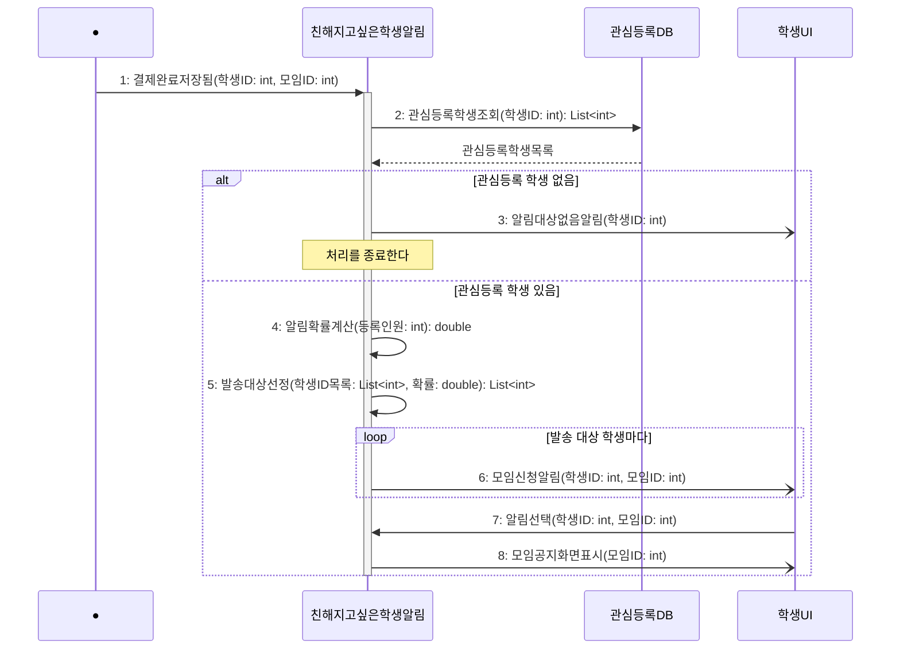

# seq-03 친해지고싶은학생알림

## 참여 객체

| 객체 | 종류 | 클래스 파일 |
|---|---|---|
| 친해지고싶은학생알림 | 담당 객체 | classes/CloseStudentNotification.md |
| 관심등록DB | DB | classes/InterestRegistrationDB.md |
| 학생UI | UI | classes/StudentUI.md |

시작 방식: **데이터 변화** (신청DB에 신청 상태 '결제완료'가 저장됨) → Found Message

## 다이어그램

## 메시지 ↔ Action 대응표

| 메시지 | Action |
|---|---|
| 1~2 | 1 |
| 3 | 2 |
| 4 | 3 |
| 5~6 | 4, 5 |
| 7~8 | 6 |

## 메모

- 1번 시작 메시지는 '2-2. 결제 및 신청 확정'에서 신청DB에 '결제완료' 상태가 저장될 때 발생하는 Found Message다.
- 4번 알림 확률 계산식은 $p = 1 / n$ (등록인원 $n$)이다.
- 6번 모임신청알림은 알림 권한이 허용된 학생에게만 발송된다.
- 7~8번은 알림을 수신한 학생이 알림을 눌러 해당 모임 공지 화면으로 이동하는 흐름이다.

