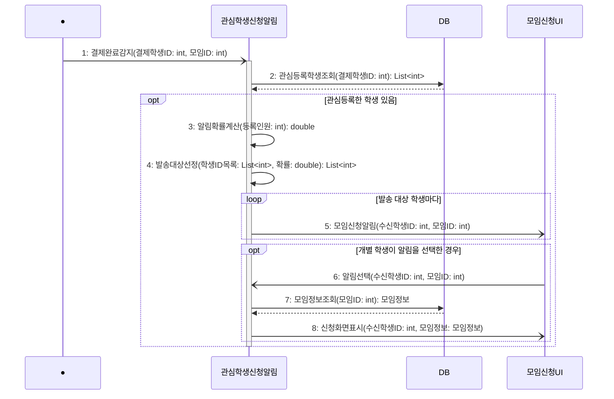

# seq-03 관심학생신청알림

## 참여 객체

| 객체 | 종류 | 클래스 파일 |
|---|---|---|
| 관심학생신청알림 | 담당 객체 | classes/CloseStudentNotification.md |
| DB | DB | classes/InterestRegistrationDB.md |
| 모임신청UI | UI | classes/StudentUI.md |

시작 방식: **데이터 변화** (DB에 신청 상태 '결제완료'가 저장됨) → Found Message

## 다이어그램

## 메시지 ↔ Action 대응표

| 메시지 | Action |
|---|---|
| 1~2 | 1, 2 |
| 3 | 3 |
| 4~5 | 4, 5 |
| 6~8 | 6 |

## 메모

- 1번 결제완료감지는 '2-2. 결제 및 신청 확정'에서 DB에 '결제완료' 상태가 저장될 때 발생하는 Found Message다.
- 3번 알림확률계산의 계산식은 $p = 1 / n$ (등록인원 $n$)이다.
- 5번 모임신청알림은 알림 권한이 허용된 학생에게만 발송된다.
- 6~8번은 알림을 수신한 개별 학생마다 각자 독립적·비동기적으로 알림을 눌러 해당 모임 신청 화면으로 이동하는 선택 시나리오다. 알림을 누르지 않으면 아무 동작 없이 종료되므로 `opt`로 감쌌다.
- 7번 모임정보조회는 모임 신청 화면에 표시할 모임 정보를 DB에서 조회하는 메시지다.

