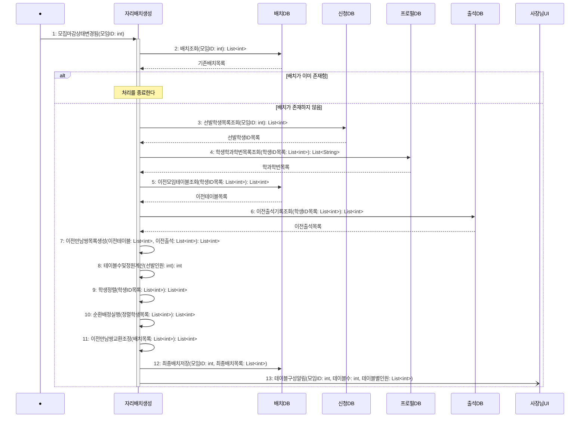

# seq-04-2 자리배치생성

## 참여 객체

| 객체 | 종류 | 클래스 파일 |
|---|---|---|
| 자리배치생성 | 담당 객체 | classes/SeatArrangementGeneration.md |
| 배치DB | DB | classes/ArrangementDB.md |
| 신청DB | DB | classes/ApplicationDB.md |
| 프로필DB | DB | classes/ProfileDB.md |
| 출석DB | DB | classes/AttendanceDB.md |
| 사장님UI | UI | classes/OwnerUI.md |

시작 방식: **데이터 변화** (모임 상태가 '모집마감'으로 바뀜) → Found Message

## 다이어그램

## 메시지 ↔ Action 대응표

| 메시지 | Action |
|---|---|
| 1~2 | 1 |
| 3~4 | 2 |
| 5~7 | 3 |
| 8 | 4 |
| 9 | 5 |
| 10 | 6 |
| 11 | 7 |
| 12~13 | 8 |

## 메모

- 1번 시작 메시지는 모임의 모집 마감 사건에 의해 기동되는 Found Message다.
- 10번 순환배정은 학과·입학연도·신청시각 순으로 정렬된 학생을 1번부터 테이블마다 한 명씩 채워 넣는 연산이다.
- 12번 최종배치저장으로 배치DB에 최종 배치가 확정된다.

