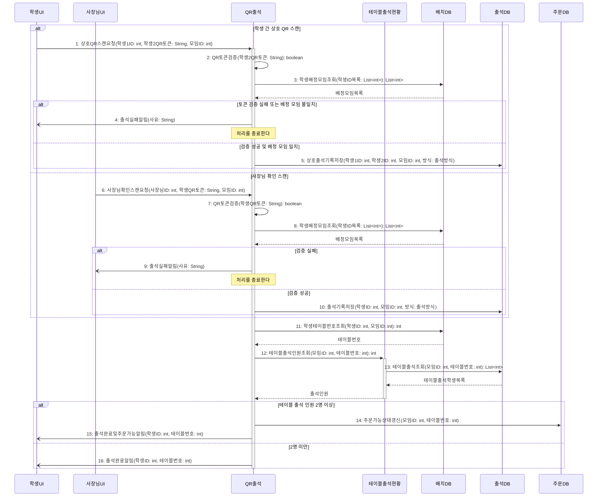

# seq-05 QR출석

## 참여 객체

| 객체 | 종류 | 클래스 파일 |
|---|---|---|
| QR출석 | 담당 객체 | classes/QRAttendance.md |
| 테이블출석현황 | 공통 객체 | classes/TableAttendanceStatus.md |
| 배치DB | DB | classes/ArrangementDB.md |
| 출석DB | DB | classes/AttendanceDB.md |
| 주문DB | DB | classes/OrderDB.md |
| 학생UI | UI | classes/StudentUI.md |
| 사장님UI | UI | classes/OwnerUI.md |

시작 방식: **사람이 누름** (학생이 상대방 QR을 스캔) → `학생UI`

## 다이어그램

## 메시지 ↔ Action 대응표

| 메시지 | Action |
|---|---|
| 1~4 | 1, 2, 3 |
| 5 | 4 |
| 6~10 | 5 |
| 11~16 | 6 |

## 메모

- 5번 상호출석기록저장의 출석방식은 'QR', 10번 출석기록저장의 출석방식은 '사장님확인'이다.
- 12번 테이블출석인원조회는 공통 객체 테이블출석현황의 표준 연산(GLOSSARY 5장)을 재사용한다.
- 14번으로 주문 가능 상태가 갱신되어야 해당 테이블의 주문이 허용된다.

