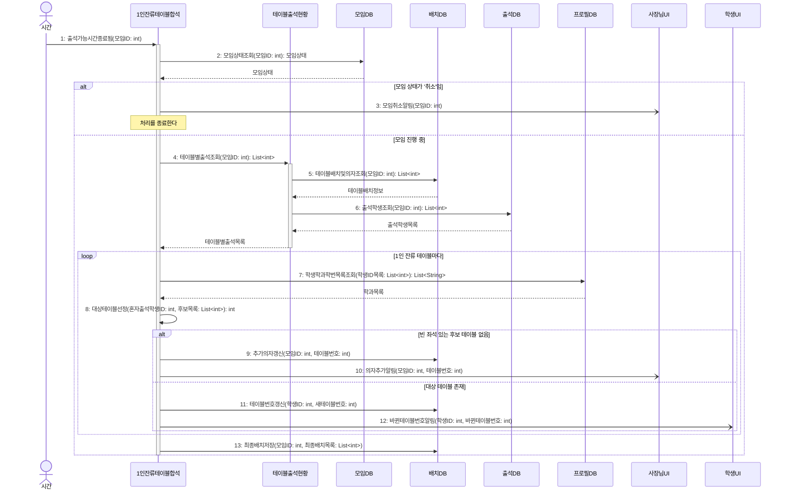

# seq-06 1인잔류테이블합석

## 참여 객체

| 객체 | 종류 | 클래스 파일 |
|---|---|---|
| 1인잔류테이블합석 | 담당 객체 | classes/SinglePersonTableMerge.md |
| 테이블출석현황 | 공통 객체 | classes/TableAttendanceStatus.md |
| 모임DB | DB | classes/MeetingDB.md |
| 배치DB | DB | classes/ArrangementDB.md |
| 출석DB | DB | classes/AttendanceDB.md |
| 프로필DB | DB | classes/ProfileDB.md |
| 학생UI | UI | classes/StudentUI.md |
| 사장님UI | UI | classes/OwnerUI.md |

시작 방식: **정해진 시각** (출석 가능 시간 종료 시점) → `시간` 액터

## 다이어그램

## 메시지 ↔ Action 대응표

| 메시지 | Action |
|---|---|
| 1~3 | 1 |
| 4~6 | 2 |
| 7~8 | 3, 4 |
| 9~10 | 4.1 |
| 11~12 | 5 |
| 13 | 6 |

## 메모

- 1번 시작 메시지는 모임 시작 10분 후 출석 가능 시간이 마감되는 시각 사건이다.
- 4번 테이블별출석조회는 공통 객체 테이블출석현황의 표준 연산(GLOSSARY 5장)이다.
- 8번 대상테이블선정 시 빈 좌석(테이블 정원 + 추가 의자 − 출석 인원) 1개 이상, 다른 학과, 최소 출석 인원, 낮은 번호 순으로 우선순위를 판정한다.
- 13번으로 합석 이력이 반영된 최종배치가 확정 저장된다.

