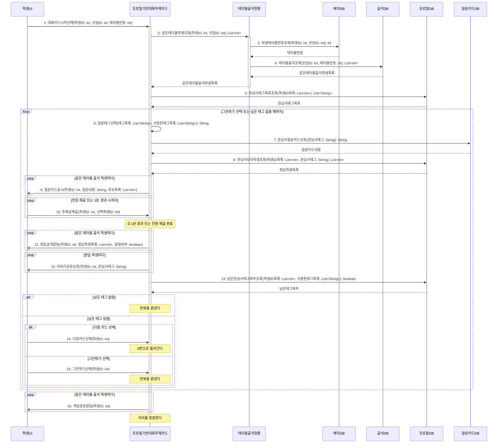

# seq-07 프로필기반대화주제카드

## 참여 객체

| 객체 | 종류 | 클래스 파일 |
|---|---|---|
| 프로필기반대화주제카드 | 담당 객체 | classes/ProfileTopicCard.md |
| 테이블출석현황 | 공통 객체 | classes/TableAttendanceStatus.md |
| 배치DB | DB | classes/ArrangementDB.md |
| 출석DB | DB | classes/AttendanceDB.md |
| 프로필DB | DB | classes/ProfileDB.md |
| 질문카드DB | DB | classes/QuestionCardDB.md |
| 학생UI | UI | classes/StudentUI.md |

시작 방식: **사람이 누름** (학생이 '대화 카드 시작'을 선택) → `학생UI`

## 다이어그램

## 메시지 ↔ Action 대응표

| 메시지 | Action |
|---|---|
| 1~5 | 1 |
| 6~9 | 2 |
| 10 | 3 |
| 11 | 4 |
| 12~13 | 5 |
| 14~16 | 6 |

## 메모

- 2번 같은테이블학생조회는 공통 객체 테이블출석현황의 표준 연산(GLOSSARY 5장)을 재사용한다.
- 6번에서 고른 태그는 프로필기반대화주제카드의 사용한태그목록에 더한다.
- 9번 질문 카드의 정답 후보는 같은 테이블 출석 학생들로 한정된다.
- 8번의 정답은 여러 명일 수 있어 목록으로 돌려받는다. 10번에서 정답 학생 중 한 명을 고르면 맞힌 것으로 보고, 11번의 맞힘여부로 알린다.
- 13번은 사용한태그목록을 넘겨 프로필DB가 아직 묻지 않은 태그가 있는지 판단하게 한다.
