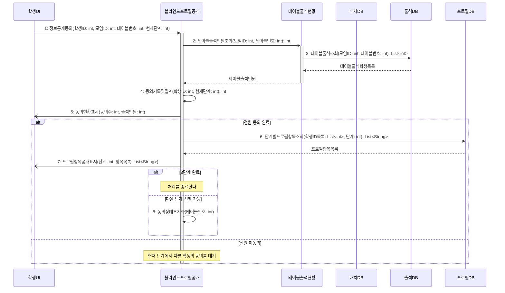

# seq-08 블라인드프로필공개

## 참여 객체

| 객체 | 종류 | 클래스 파일 |
|---|---|---|
| 블라인드프로필공개 | 담당 객체 | classes/BlindProfileDisclosure.md |
| 테이블출석현황 | 공통 객체 | classes/TableAttendanceStatus.md |
| 배치DB | DB | classes/ArrangementDB.md |
| 출석DB | DB | classes/AttendanceDB.md |
| 프로필DB | DB | classes/ProfileDB.md |
| 학생UI | UI | classes/StudentUI.md |

시작 방식: **사람이 누름** (같은 테이블 출석 학생이 '정보 공개' 선택) → `학생UI`

## 다이어그램

## 메시지 ↔ Action 대응표

| 메시지 | Action |
|---|---|
| 1~5 | 1 |
| 6~7 | 2 |
| 8 | 3 |

## 메모

- 2번 테이블출석인원조회는 공통 객체 테이블출석현황의 표준 연산(GLOSSARY 5장)을 재사용한다.
- 6번의 프로필 항목은 1단계 MBTI, 2단계 학과, 3단계 학번 순이다.
- 8번으로 현재 단계의 동의 상태가 초기화되고 다음 단계로 진행된다.

