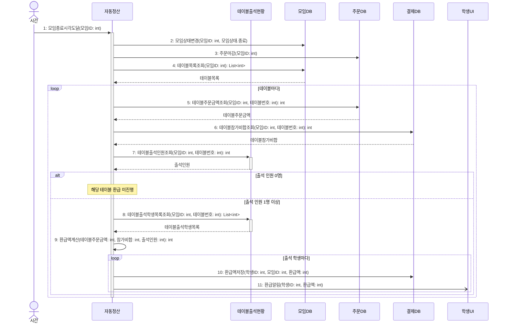

# seq-09 자동정산

## 참여 객체

| 객체 | 종류 | 클래스 파일 |
|---|---|---|
| 자동정산 | 담당 객체 | classes/AutoSettlement.md |
| 테이블출석현황 | 공통 객체 | classes/TableAttendanceStatus.md |
| 모임DB | DB | classes/MeetingDB.md |
| 주문DB | DB | classes/OrderDB.md |
| 결제DB | DB | classes/PaymentDB.md |
| 학생UI | UI | classes/StudentUI.md |

시작 방식: **정해진 시각** (모임 종료 시각 도달) → `시간` 액터

## 다이어그램

## 메시지 ↔ Action 대응표

| 메시지 | Action |
|---|---|
| 1 | 1 |
| 2~3 | 1 |
| 4~8 | 2 |
| 9 | 3 |
| 10~11 | 4 |

## 메모

- 1번 시작 메시지는 모임 종료 시각에 스케줄러에 의해 발생하는 시간 사건이다.
- 7번과 8번은 공통 객체 테이블출석현황의 표준 연산(GLOSSARY 5장)을 재사용한다.
- 9번 환급액 계산은 (출석 학생 결제 참가비 합 - 테이블 주문 금액) ÷ 출석 인원으로 1인 환급액을 구하고, 원 단위 나머지는 학생 ID 순으로 1원씩 배분한다.
- 11번 환급알림은 비동기로 학생에게 발송된다.
