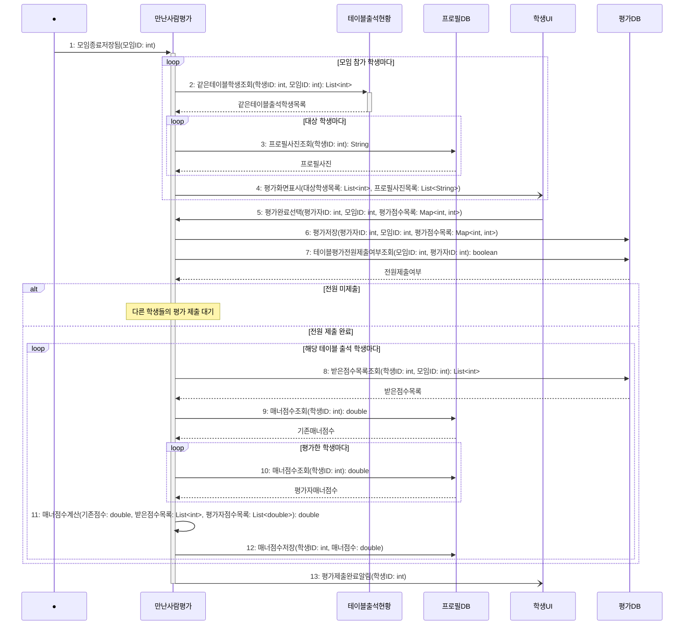

# seq-10 만난사람평가

## 참여 객체

| 객체 | 종류 | 클래스 파일 |
|---|---|---|
| 만난사람평가 | 담당 객체 | classes/MeetingEvaluation.md |
| 테이블출석현황 | 공통 객체 | classes/TableAttendanceStatus.md |
| 프로필DB | DB | classes/ProfileDB.md |
| 평가DB | DB | classes/EvaluationDB.md |
| 학생UI | UI | classes/StudentUI.md |

시작 방식: **데이터 변화** (모임DB의 모임 상태가 '종료'로 변경됨) → Found Message

## 다이어그램

## 메시지 ↔ Action 대응표

| 메시지 | Action |
|---|---|
| 1~4 | 1 |
| 5 | 2 |
| 6 | 3 |
| 7 | 4 |
| 8~12 | 5 |
| 13 | 6 |

## 메모

- 1번 시작 메시지는 모임 상태가 '종료'로 기록될 때 기동되는 Found Message다.
- 2번 같은테이블학생조회는 공통 객체 테이블출석현황의 표준 연산(GLOSSARY 5장)을 재사용한다.
- 11번 매너점수계산은 평가자 매너점수가 4.0 이상인 경우 1회 추가 가중치를 부여하여 계산한다.
- 13번 완료 알림은 학생UI에 비동기로 전송된다.
