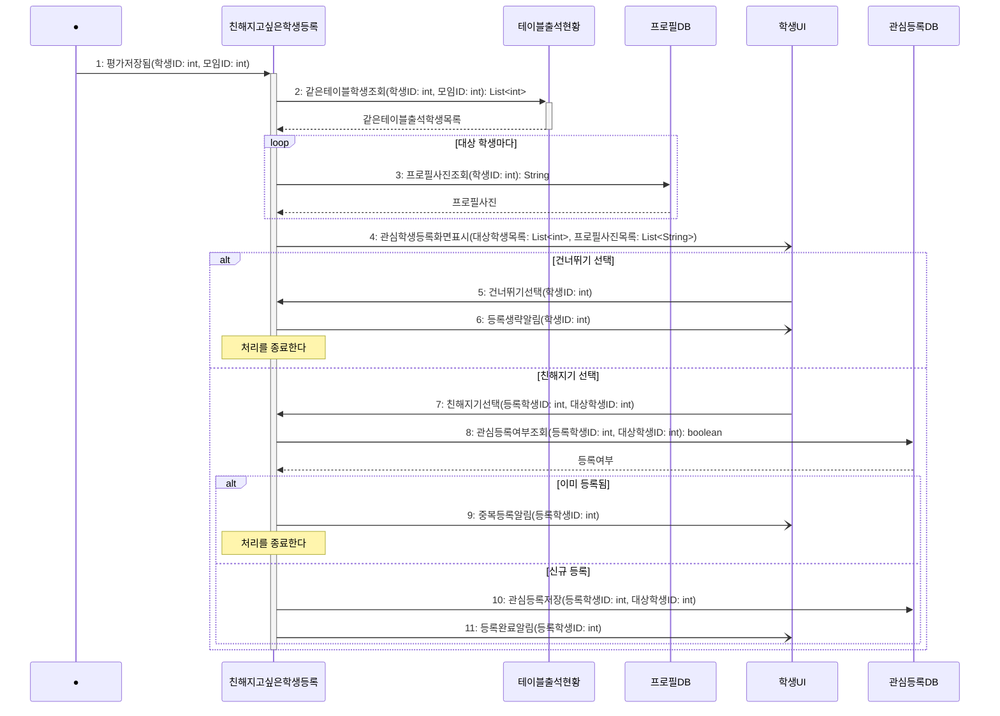

# seq-11 친해지고싶은학생등록

## 참여 객체

| 객체 | 종류 | 클래스 파일 |
|---|---|---|
| 친해지고싶은학생등록 | 담당 객체 | classes/CloseStudentRegistration.md |
| 테이블출석현황 | 공통 객체 | classes/TableAttendanceStatus.md |
| 프로필DB | DB | classes/ProfileDB.md |
| 관심등록DB | DB | classes/InterestRegistrationDB.md |
| 학생UI | UI | classes/StudentUI.md |

시작 방식: **데이터 변화** (평가DB에 학생의 평가가 저장됨) → Found Message

## 다이어그램

## 메시지 ↔ Action 대응표

| 메시지 | Action |
|---|---|
| 1~4 | 1 |
| 5~6 | 2 |
| 7 | 3 |
| 8~11 | 4 |

## 메모

- 1번 시작 메시지는 '10. 만난 사람 평가'에서 본인 평가가 평가DB에 저장될 때 발생하는 Found Message다.
- 2번 같은테이블학생조회는 공통 객체 테이블출석현황의 표준 연산(GLOSSARY 5장)을 재사용한다.
- 4번 관심학생등록화면표시는 2번에서 리턴받은 학생 목록과 3번에서 리턴받은 프로필 사진 목록을 인자로 전달하여 화면에 표시한다.
- 6, 9, 11번 알림은 비동기로 학생UI에 전달된다.
