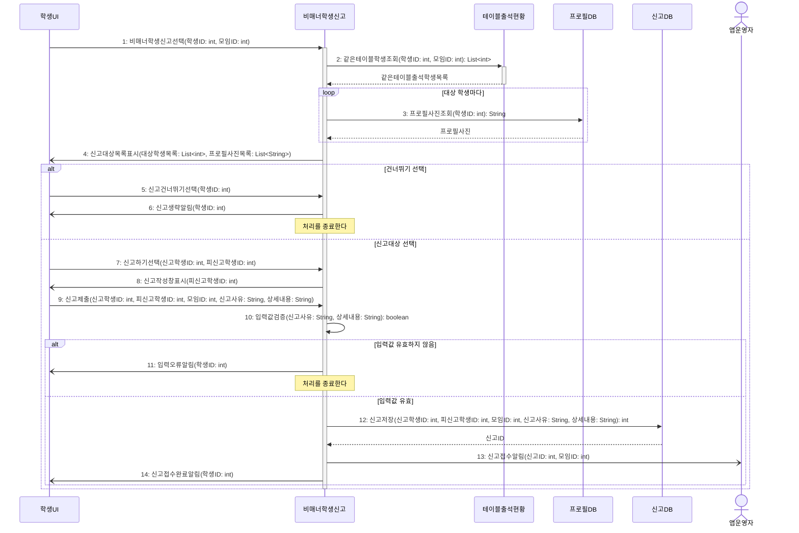

# seq-12 비매너학생신고

## 참여 객체

| 객체 | 종류 | 클래스 파일 |
|---|---|---|
| 비매너학생신고 | 담당 객체 | classes/MannerReport.md |
| 테이블출석현황 | 공통 객체 | classes/TableAttendanceStatus.md |
| 프로필DB | DB | classes/ProfileDB.md |
| 신고DB | DB | classes/ReportDB.md |
| 학생UI | UI | classes/StudentUI.md |
| 앱운영자 | 액터 | |

시작 방식: **사람이 누름** (학생이 '비매너 학생 신고'를 선택) → `학생UI`

## 다이어그램

## 메시지 ↔ Action 대응표

| 메시지 | Action |
|---|---|
| 1~4 | 1 |
| 5~6 | 2 |
| 7~8 | 3, 4 |
| 9 | 5 |
| 10~14 | 6 |

## 메모

- 2번 같은테이블학생조회는 공통 객체 테이블출석현황의 표준 연산(GLOSSARY 5장)을 재사용한다.
- 10번 입력값검증은 사유 선택 여부 및 내용 길이 제한을 검증한다.
- 12번 신고저장 후 생성된 신고ID를 바탕으로 앱운영자에게 신고 접수 통보가 전달된다.
- 4, 6, 8, 11, 13, 14번 알림은 비동기로 전송된다.
