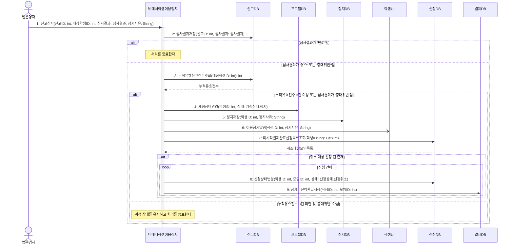

# seq-13 비매너학생이용정지

## 참여 객체

| 객체 | 종류 | 클래스 파일 |
|---|---|---|
| 비매너학생이용정지 | 담당 객체 | classes/MannerSuspension.md |
| 신고DB | DB | classes/ReportDB.md |
| 프로필DB | DB | classes/ProfileDB.md |
| 정지DB | DB | classes/SuspensionDB.md |
| 신청DB | DB | classes/ApplicationDB.md |
| 결제DB | DB | classes/PaymentDB.md |
| 학생UI | UI | classes/StudentUI.md |
| 앱운영자 | 액터 | |

시작 방식: **사람이 누름** (앱운영자가 신고를 심사) → `앱운영자` 액터

## 다이어그램

## 메시지 ↔ Action 대응표

| 메시지 | Action |
|---|---|
| 1~2 | 1, 2 |
| 3 | 3 |
| 4~9 | 4 |
| - | 5 |

## 메모

- 1번 심사는 앱운영자가 신고DB의 사유와 내용을 검토한 뒤 결과를 시스템에 입력하는 흐름이다.
- 3번 누적유효신고건수조회는 '반려'를 제외하고 '유효' 판정된 건수만 집계한다.
- 4번으로 프로필DB 계정 상태가 '정지'로 변경되면 이후 모든 모임 신청이 영구 차단된다.
- 7~9번은 정지된 학생이 이미 결제 완료했으나 아직 시작되지 않은 모임에 대한 자동 취소 및 전액 환급 처리다.
- 6번 이용정지알림은 비동기 푸시 알림으로 전송된다.
