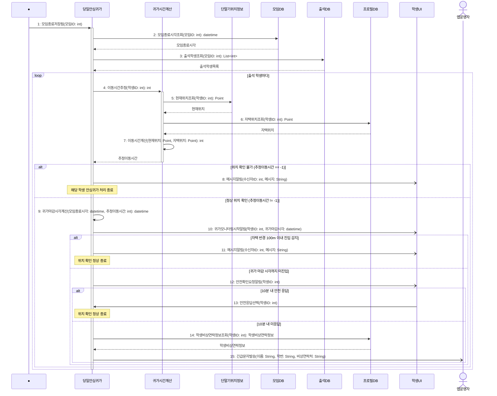

# seq-15 당일안심귀가

## 참여 객체

| 객체 | 종류 | 클래스 파일 |
|---|---|---|
| 당일안심귀가 | 담당 객체 | classes/SafeReturnHome.md |
| 귀가시간계산 | 공통 객체 | classes/ReturnHomeTimeCalc.md |
| 모임DB | DB | classes/MeetingDB.md |
| 출석DB | DB | classes/AttendanceDB.md |
| 프로필DB | DB | classes/ProfileDB.md |
| 단말기위치정보 | 외부 | classes/DeviceLocation.md |
| 학생UI | UI | classes/StudentUI.md |
| 앱운영자 | 액터 | |

시작 방식: **데이터 변화** (모임DB의 모임 상태가 '종료'로 변경됨) → Found Message

## 다이어그램

## 메시지 ↔ Action 대응표

| 메시지 | Action |
|---|---|
| 1~3 | 1 |
| 4~7 | 1, 3, 4, 5 |
| 8 | 2 |
| 9~10 | 6 |
| 11 | 7 |
| 12~15 | 8 |

## 메모

- 1번 시작 메시지는 '9. 자동 정산'에서 모임 상태가 '종료'로 저장될 때 발생하는 Found Message다.
- 4번 이동시간추정은 20번과 공유하는 공통 객체 귀가시간계산의 표준 연산(GLOSSARY 5장)이다. 단말기 위치 정보를 얻지 못하면 -1을 돌려준다.
- 8번 위치확인불가알림은 단말기 위치 정보를 얻지 못했을 때(추정이동시간 == -1) 학생UI에 알리고 모니터링 대상에서 제외하는 Action 2의 예외 처리다.
- 9번 귀가 마감 시각은 모임 종료 시각 + 추정 이동 시간 + 30분(여유 버퍼)으로 계산된다.
- 12번 확인 요청 후 10분 타이머가 동작하며, 미응답 시 비상 연락처를 포함한 SMS 외부 서비스 호출(15번)이 발생한다.
- 8, 10, 11, 12, 15번 알림·문자는 비동기로 발송된다.
- 8, 11번은 화면에 잠깐 보여 주고 끝나는 알림이라 메시지알림으로 보낸다 (FEEDBACK #25). 메시지는 8번 위치확인불가, 11번 안전귀가 안내이고, 원래 넘기던 값(사유, 금액 등)은 메시지 문장에 담는다.
