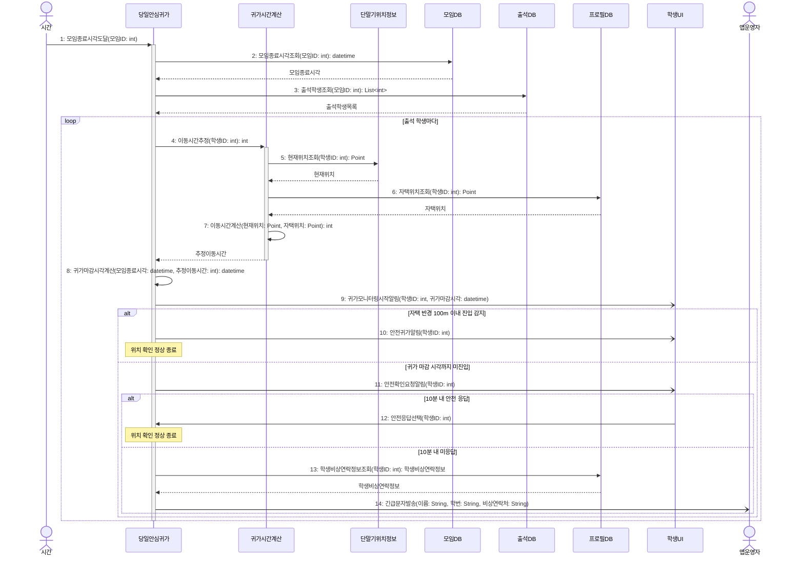

# seq-15 당일안심귀가

## 참여 객체

| 객체 | 종류 | 클래스 파일 |
|---|---|---|
| 당일안심귀가 | 담당 객체 | classes/SafeReturnHome.md |
| 귀가시간계산 | 공통 객체 | classes/ReturnHomeTimeCalc.md |
| 모임DB | DB | classes/MeetingDB.md |
| 출석DB | DB | classes/AttendanceDB.md |
| 프로필DB | DB | classes/ProfileDB.md |
| 단말기위치정보 | 외부 | classes/DeviceLocation.md |
| 학생UI | UI | classes/StudentUI.md |
| 앱운영자 | 액터 | |

시작 방식: **정해진 시각** (모임 종료 시각 도달) → `시간` 액터

## 다이어그램

## 메시지 ↔ Action 대응표

| 메시지 | Action |
|---|---|
| 1~3 | 1 |
| 4~7 | 2, 3, 4 |
| 8~9 | 5 |
| 10 | 6 |
| 11~14 | 7 |

## 메모

- 1번 시작 메시지는 모임 종료 시각 도달 시 발생하는 시간 사건이다.
- 4번 이동시간추정은 20번과 공유하는 공통 객체 귀가시간계산의 표준 연산(GLOSSARY 5장)이다.
- 5번 현재위치는 학생 단말기 GPS 수신이며, 6번 자택위치는 사전 등록된 프로필DB 좌표다.
- 8번 귀가 마감 시각은 종료 시각 + 추정 이동 시간 + 30분(여유 버퍼)으로 계산된다.
- 11번 확인 요청 후 10분 타이머가 동작하며, 미응답 시 비상 연락처를 포함한 SMS 외부 서비스 호출(14번)이 발생한다.
- 9, 10, 11, 14번 알림·문자는 비동기로 발송된다.
