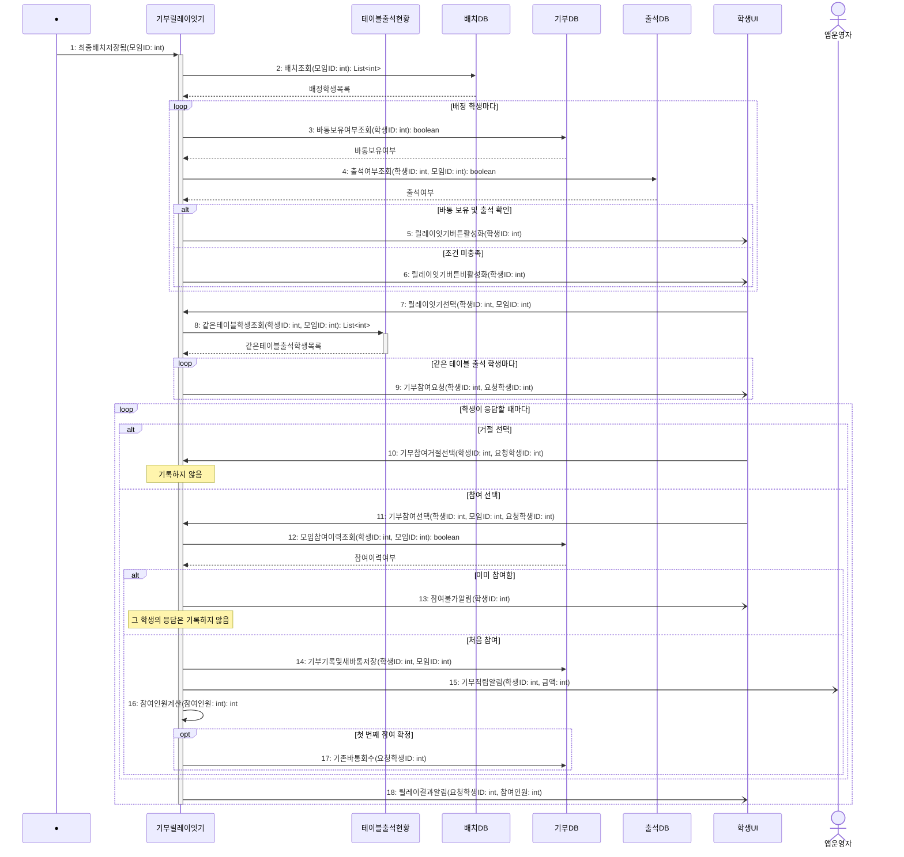

# seq-16 기부릴레이잇기

## 참여 객체

| 객체 | 종류 | 클래스 파일 |
|---|---|---|
| 기부릴레이잇기 | 담당 객체 | classes/DonationRelay.md |
| 테이블출석현황 | 공통 객체 | classes/TableAttendanceStatus.md |
| 배치DB | DB | classes/ArrangementDB.md |
| 기부DB | DB | classes/DonationDB.md |
| 출석DB | DB | classes/AttendanceDB.md |
| 학생UI | UI | classes/StudentUI.md |
| 앱운영자 | 액터 | |

시작 방식: **데이터 변화** (배치DB에 해당 모임의 최종배치가 저장됨) → Found Message

## 다이어그램

## 메시지 ↔ Action 대응표

| 메시지 | Action |
|---|---|
| 1~6 | 1 |
| 7~9 | 2 |
| 10 | 5 |
| 11~15 | 3 |
| 16~17 | 4 |
| 18 | 6 |

## 메모

- 1번 시작 메시지는 최종배치가 배치DB에 저장될 때 발생하는 Found Message다.
- 8번 같은테이블학생조회는 공통 객체 테이블출석현황의 표준 연산(GLOSSARY 5장)을 재사용한다.
- 14번으로 참여 시 새 바통이 부여되고, 15번으로 참여 1건당 1,000원 대리기부 통보가 앱운영자에게 발송된다.
- 16번은 처음 참여한 학생만 참여인원에 더한다. 참여인원이 1이 되는 첫 번째 참여에서 17번으로 요청한 학생의 기존 바통을 회수한다.
- 응답 마감은 두지 않는다. 응답이 올 때마다 18번으로 요청한 학생에게 결과를 알린다.
- 5, 6, 9, 13, 15, 18번 알림은 비동기로 전송된다.
