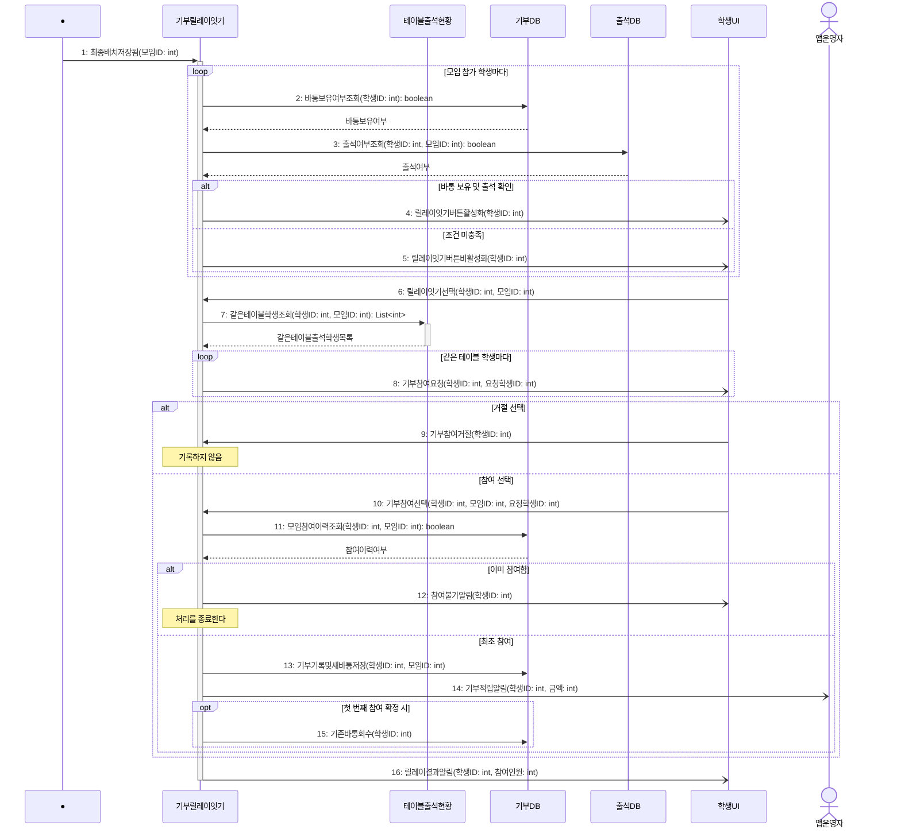

# seq-16 기부릴레이잇기

## 참여 객체

| 객체 | 종류 | 클래스 파일 |
|---|---|---|
| 기부릴레이잇기 | 담당 객체 | classes/DonationRelay.md |
| 테이블출석현황 | 공통 객체 | classes/TableAttendanceStatus.md |
| 기부DB | DB | classes/DonationDB.md |
| 출석DB | DB | classes/AttendanceDB.md |
| 학생UI | UI | classes/StudentUI.md |
| 앱운영자 | 액터 | |

시작 방식: **데이터 변화** (배치DB에 해당 모임의 최종배치가 저장됨) → Found Message

## 다이어그램

## 메시지 ↔ Action 대응표

| 메시지 | Action |
|---|---|
| 1~5 | 1 |
| 6~8 | 2 |
| 9~15 | 3, 4, 5 |
| 16 | 6 |

## 메모

- 1번 시작 메시지는 '6. 1인 잔류 테이블 합석' 등으로 최종배치가 배치DB에 저장될 때 발생하는 Found Message다.
- 7번 같은테이블학생조회는 공통 객체 테이블출석현황의 표준 연산(GLOSSARY 5장)을 재사용한다.
- 13번으로 참여 시 새 바통이 부여되고, 14번으로 참여 1건당 1,000원 대리기부 통보가 앱운영자에게 발송된다.
- 15번은 해당 모임의 첫 번째 학생 참여 확정 시 요청자의 기존 바통이 회수되는 처리다.
- 4, 5, 8, 12, 14, 16번 알림은 비동기로 전송된다.
